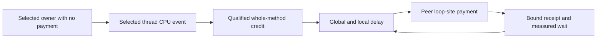

# Cooperative payment and sample eligibility

This explanation separates sample ownership, intervention overlap, and injected CPU cost.
It compares pinned source implementations with a proposed restricted .NET integration.
The source review does not establish runtime safety, payment capacity, or prediction accuracy.

## The next boundary

A CLR-bound native range identifies the current instrumented method.
It does not identify which instructions belong to original application work.
A CPU sample inside that range can include the injected countdown or probe arguments.
The [bound sample collection](../Reference/bound-samples.md) preserves lifetime and source evidence, but does not yet establish causal eligibility.

There are three different questions:

| Question | Required evidence |
| --- | --- |
| Which thread generated the sample? | Event owner, process identity, and sample metadata. |
| Could the measured interval include profiler payment? | Sampling boundaries or structural separation of sampled and paying owners. |
| Does the sampled method contain injected CPU work? | Native instruction ownership, or an explicit unresolved-attribution limitation. |

Solving one question does not solve the others.
Excluding payment CPU does not exclude the countdown inside the sampled method.
An IP outside a helper does not prove that its nominal period contains only application CPU.

## Native Coz excludes its wait interval

The inspected Coz revision is `256e3c389424d6a1691ee5d18b5ecb5a6c1001ec`.
Its Linux event measures per-thread task-clock CPU with nominal 1 ms samples.
A separate thread CPU timer requests sample processing after nominal 10 ms CPU intervals. [1]

`process_samples` processes buffered samples and credits selected locations before calling `add_delays`.
When a thread owes delay, `add_delays` disables its perf event, waits, credits actual elapsed wait, and enables the event again. [2]
The Linux perf wrapper uses `PERF_EVENT_IOC_DISABLE` and `PERF_EVENT_IOC_ENABLE`. [3]

This is a concrete separation between selected CPU sampling and the intentional wait.
It is not a general accounting scheme for all profiler CPU.
The event remains enabled during parts of sample processing, mapping, and delay checks outside the disabled region.
The inspected path contains no application/profiler instruction-ownership table and no per-record eligibility epoch.

Coz also checks delay at synchronization boundaries through `catch_up`.
The Linux implementation processes pending samples before that check. [4]
These checks preserve accounting order. They do not imply that every check has zero cost or that all check CPU is excluded.

Its location matcher checks the sampled IP and then caller addresses.
A selected caller can therefore match work performed below that caller. [5]
Copying this attribution rule into cooperative .NET helpers could attribute helper CPU to the selected method.
It would require an explicit profiler-frame exclusion policy, not merely a valid CLR identity.

Disabling and enabling a perf event does not create a new complete sample period.
The reviewed WSL kernel retains a remaining task-clock period across stop and start. [6]
A nominal sample can combine enabled CPU intervals on both sides of a pause.
This is why CozNet's epoch baseline rule is a conservative additional contract, not an upstream feature.

## JCoz samples before it sleeps

The inspected JCoz revision is `1df02b0f6e319bd7df05ba5451b1814791d1849f`.
Its controller sends `SIGPROF` to application threads.
The handler captures JVM frames with `AsyncGetCallTrace` and then adds selected-location credit.
Each thread counts handled signals during the experiment.
Every tenth handled signal, that thread reconciles local and global delay and can sleep inside its handler. [7]

JCoz installs `SA_RESTART | SA_SIGINFO`, without `SA_NODEFER`.
The ordinary signal rule blocks that signal during its handler. [8]
Consequently, its own `SIGPROF` handler does not recursively sample itself while performing that sleep.
This differs from an independent perf event that can continue to count CPU while a cooperative callback executes.

`SIGPROF` is a standard signal. Repeated instances can coalesce while blocked. [8]
The handler therefore does not establish that every nominal sampling opportunity produced one distinct observation.
Its inspected path does not attach an eligibility epoch or reconcile a continuous per-thread CPU counter with every sample.
These differences prevent treating its signal count as proof of exact CPU duration for a .NET credit stream.

The transferable idea is ordering: capture application state before the intervention and avoid measuring the intervention as selected work.
The JVM stack API and handler structure are not portable CLR mechanisms.

## Swift and Go bindings add no exclusion contract

Swift Coz revision `fe4bedf70edd89a49601ea1e48f2af660365e085` exposes marker macros through a C shim.
cozgo revision `d33f1dc723ec035e65022331b6677f5013da596a` does the same. [9]
The inspected shims do not control sampling, wait intervals, eligibility epochs, or native code ownership.
Their marker APIs cannot resolve cooperative sampling overlap in CozNet.

## A restricted first integration

The proposed first diagnostic samples only the selected owner and permits payment only on a separate peer owner.
Both owners execute the same bound method. The selected owner's callback never pays a lease.
The source remains attached to the selected native thread, and every retained record must identify that owner.

This structure excludes peer payment CPU from the selected thread's event by ownership.
It does not require guessing whether a selected sample overlapped a peer callback.
The peer can still change scheduling and application progress. Those effects remain part of the experiment.

This is defensible as a restricted capacity diagnostic with a workload-declared fixed eligibility state.
The selected loop has no explicit dependency wait or profiler payment after release.
The declaration means that the workload does not introduce those transitions.
It does not prove continuous CPU execution, absence of runtime suspension, or complete profiler CPU exclusion.
Task-clock sampling does not count off-CPU wall time, but runtime and helper CPU still need separate attribution.

The diagnostic must retain the following limitations:

- Selected whole-method samples can include injected countdown CPU.
- Selected callback checks still cost CPU even when payment is disabled.
- A method range does not classify native helper CPU or identify the duration represented by an endpoint IP.
- Source lifetime acceptance remains provisional until collection closure and final CLR validation.
- Peer overshoot can make the selected owner owe debt under Linux-style accounting.

That last limitation distinguishes this diagnostic from general Coz execution.
Native Coz can later delay a selected thread when its local delay falls below global delay. [2]
A no-payment selected owner cannot settle that debt.
The diagnostic must record and gate selected debt rather than forgive it or stop publishing peer overshoot.
It can demonstrate real sample-to-peer-payment plumbing without claiming a complete experiment engine.

## Eligibility when the selected owner can pay

The later general integration needs a transition protocol that the fixed-state diagnostic avoids.
Sampling admission must close before selected payment can begin.
Queued observations retain their original ownership and interval evidence.
They cannot acquire the current epoch merely because the collector drains them after payment.

Sampling can reopen only after the payment path has exited its excluded region and ownership is known.
A receipt that precedes callback return is insufficient evidence of that boundary.
The first observation of the new eligibility epoch establishes a baseline and earns no interval credit.
Consecutive observations within that epoch can then qualify under the existing `SampleCreditStream` contract.

The epoch records a declared eligibility transition. It does not repair unknown CPU attribution.
A hidden delay between two runnable observations cannot be discovered from those observations alone.
Every blocking or payment transition covered by the contract must be reported, including transitions between samples.
See [sample credit replay](../Reference/cpu-counter-evidence.md).

The current `BoundCpuEpoch` accepts one fresh disabled source and exactly one successful enable/disable pair.
That source epoch is separate from the credit stream's thread eligibility epoch.
Repeated pause/resume cannot be added to that collection while claiming its existing one-shot acceptance contract still applies.
A future producer needs an explicit multi-transition source journal or separate closed collection epochs.
Both designs must retain sample ordering, counter reconciliation, and lifetime invalidation evidence.

## What the first result can establish

A successful restricted run can show that real bound selected samples produce ledger credit and real peer payment receipts.
Its proof needs owner checks, final source closure, valid CLR lifetime, accepted journals, measured waits, and unchanged debt limits.
Rejected samples and lifetime invalidation keep the whole run invalid even if native payment already occurred.
Physical work cannot be rolled back by rejecting an immutable accounting result.

This result cannot establish original-application CPU attribution or prediction accuracy.
The earlier [injected instruction analysis](injected-cpu-attribution.md) still applies to the bound whole-method range.
The profiler cost must remain explicit rather than disappear behind the term “eligible.”

## Primary sources

1. [Coz event and timer setup](https://github.com/plasma-umass/coz/blob/256e3c389424d6a1691ee5d18b5ecb5a6c1001ec/libcoz/profiler.cpp#L598-L616), [period constants](https://github.com/plasma-umass/coz/blob/256e3c389424d6a1691ee5d18b5ecb5a6c1001ec/libcoz/profiler.h#L40-L48), and [thread CPU timer](https://github.com/plasma-umass/coz/blob/256e3c389424d6a1691ee5d18b5ecb5a6c1001ec/libcoz/ccutil/timer.h#L19-L23).
2. [Coz sample and delay ordering](https://github.com/plasma-umass/coz/blob/256e3c389424d6a1691ee5d18b5ecb5a6c1001ec/libcoz/profiler.cpp#L678-L758).
3. [Coz perf enable and disable](https://github.com/plasma-umass/coz/blob/256e3c389424d6a1691ee5d18b5ecb5a6c1001ec/libcoz/perf.cpp#L154-L166).
4. [Coz synchronization checks](https://github.com/plasma-umass/coz/blob/256e3c389424d6a1691ee5d18b5ecb5a6c1001ec/libcoz/profiler.h#L162-L222).
5. [Coz direct IP and callchain matching](https://github.com/plasma-umass/coz/blob/256e3c389424d6a1691ee5d18b5ecb5a6c1001ec/libcoz/profiler.cpp#L640-L675).
6. [WSL retained timer period](https://github.com/microsoft/WSL2-Linux-Kernel/blob/linux-msft-wsl-5.15.153.1/kernel/events/core.c#L10808-L10868) and [task-clock transitions](https://github.com/microsoft/WSL2-Linux-Kernel/blob/linux-msft-wsl-5.15.153.1/kernel/events/core.c#L10987-L10996). This source does not identify the executing kernel binary.
7. [JCoz signal dispatch](https://github.com/ByteLab-David/JCoz/blob/1df02b0f6e319bd7df05ba5451b1814791d1849f/src/native/profiler.cc#L156-L165) and [capture, credit, and payment](https://github.com/ByteLab-David/JCoz/blob/1df02b0f6e319bd7df05ba5451b1814791d1849f/src/native/profiler.cc#L573-L666).
8. [JCoz handler flags](https://github.com/ByteLab-David/JCoz/blob/1df02b0f6e319bd7df05ba5451b1814791d1849f/src/native/profiler.cc#L669-L679), [Linux signal-handler mask](https://man7.org/linux/man-pages/man2/sigaction.2.html), and [standard-signal coalescing](https://man7.org/linux/man-pages/man7/signal.7.html).
9. [Swift marker shim](https://github.com/funcmike/swift-coz/blob/fe4bedf70edd89a49601ea1e48f2af660365e085/Sources/CCoz/shim.h#L1-L17) and [Go marker shim](https://github.com/urjitbhatia/cozgo/blob/d33f1dc723ec035e65022331b6677f5013da596a/cozgo.h#L1-L17).
