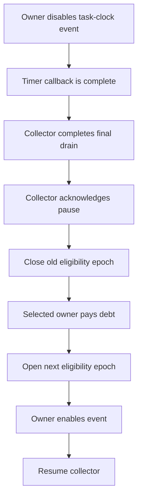

# Perf pause and sample ownership

This explanation describes the source contract needed before the selected owner can pay debt.
It separates completed sample publication from collection completeness and eligibility.

## Conclusion

For the reviewed task-clock implementation, successful owner-thread disable stops the sample producer before the syscall returns.
A subsequent final drain can therefore consume the old `PERF_RECORD_SAMPLE` records before admission changes.
This conclusion requires the restricted configuration below and correct ring memory ordering. [1–4]

It does **not** mean that all old evidence appears before resume.
Perf can defer `PERF_RECORD_LOST` until a later successful output operation.
That report can describe loss before the pause. An empty final drain does not prove complete collection. [4]

## Source and configuration boundaries

The inspected kernel revision is `33cad9854e0b15d9ee50b33a3f457ff31a37b291`.
The WSL tag `linux-msft-wsl-5.15.153.1` resolves to this revision.
This source inspection does not identify the running kernel binary or its configuration.

The conclusion assumes:

- One per-thread `PERF_COUNT_SW_TASK_CLOCK` event, without inheritance or output redirection.
- One dedicated forward ring, without other events or auxiliary record producers.
- The event owner calls disable from ordinary thread execution, outside a perf callback.
- Disable succeeds, and no other caller enables or changes the event during the boundary.
- One collector owns every drain and acknowledges only after its final drain completes.
- The consumer observes `data_head` with the required barrier and publishes `data_tail` after record reads.
- Source failures, loss, malformed records, and lifecycle rejection invalidate collection.

`LinuxCpuEventSession` opens an event for the calling thread with `pid=0` and `cpu=-1`.
`PerfAttribute.TaskClock` selects task-clock sampling without inheritance or sideband record flags.
Its flags enable only initial disable, kernel exclusion, hypervisor exclusion, and the explicit clock selection.
The session creates its own mmap ring and makes no output-redirection call.
Its disable operation checks the ioctl result.
These implementation choices match the restricted source path, but do not themselves enforce every ownership assumption.
See [bound collection](../Reference/bound-samples.md) and [the collector contract](../Reference/pausable-sample-collector.md).

## Why disable precedes the final drain

The disable ioctl selects `_perf_event_disable`.
That function uses `event_function_call` to execute the transition against the event context.
For a running task, `task_function_call` uses a synchronous CPU call and checks the target task identity.
For an inactive context, `event_function_call` performs the operation under the context lock. [1]

`__perf_event_disable` schedules the event out and sets its state to off.
Scheduling out invokes the PMU delete operation.
For task-clock, delete calls stop, which cancels the sampling hrtimer and updates the counter. [2]

`hrtimer_cancel` waits for a running handler to finish.
The task-clock timer runs in hard interrupt context and checks that the event remains active before producing a sample.
Owner-thread syscall execution cannot run concurrently with an unfinished hard interrupt on that same thread's CPU. [2, 3]

Sample output writes the record and calls `perf_output_end` before returning.
The ring publishes `data_head` only when the outermost output operation completes.
Nested writers therefore do not publish an incomplete earlier reservation.
The publication includes a write barrier, paired with the consumer's read barrier. [4]

These facts support the ordering below for this source.
They do not make a collector pause alone stop the kernel producer.

Opening admission before enable allows immediate new samples to retain the new ownership.
The collector must remain paused until that ownership is available.
The payment path must finish before sampling resumes.
A receipt alone does not establish that the callback has returned from its excluded region.

## What resume preserves

Task-clock stop saves the remaining timer period.
Start reuses that remaining period instead of creating a complete new nominal interval. [2]
The first sample after resume can therefore represent enabled CPU time from both sides of the pause.
CozNet must retain its first-observation baseline rule for the new eligibility epoch.

The ring also retains pending loss accounting.
On a failed reservation, perf increments `rb->lost` and the event's cumulative lost-sample count.
A later successful reservation emits the pending loss record. [4]
Changing the eligibility epoch must not clear that loss or treat it as proof that only the new epoch lost samples.
Source acceptance remains provisional until final source and lifetime checks complete.
`RingReader` retains cumulative `lostRecords`, `lostSamples`, and `throttles` across drains.
Reusing that reader across pause and resume preserves late loss evidence.
Any later loss must reject the whole run, including previously accepted payment accounting.
That rejection cannot reverse native waits that already occurred.

## Remote disable and other sources

Remote disable is not merely a queued request in this kernel.
The task-function path waits for its CPU call and handles migration or inactive contexts. [1]
The task-clock stop still cancels its timer. [2, 3]
However, remote disable does not establish when the application owner entered or left an excluded payment region.
That boundary needs a separate owner handshake.

Hardware PMUs, NMI producers, shared rings, inherited events, and auxiliary buffers require separate source analysis.
Ring nesting can delay publication until an outer writer finishes.
Stopping one event does not establish that another writer has finished. [4]
An interface named `Disable` cannot supply this guarantee for every backend.
Each backend needs an explicit producer-stop contract before the collector acknowledgement can close sample ownership.

## Native Coz comparison

The inspected Coz revision is `256e3c389424d6a1691ee5d18b5ecb5a6c1001ec`.
`process_samples` credits available samples before calling `add_delays`.
When debt requires a wait, `add_delays` stops the sampler, waits, accounts elapsed delay, and starts the sampler. [5]
The Linux sampler uses perf enable and disable ioctls. [6]

The inspected path does not acknowledge a separate collector's final drain between disable and payment.
It also does not attach CozNet eligibility epochs to queued records.
CozNet needs that additional ownership boundary because its collector and payment owner execute separately.
This difference does not establish better prediction accuracy or lower overhead.

## Primary sources

1. [Task calls and context dispatch](https://github.com/microsoft/WSL2-Linux-Kernel/blob/33cad9854e0b15d9ee50b33a3f457ff31a37b291/kernel/events/core.c#L66-L307), [disable transition](https://github.com/microsoft/WSL2-Linux-Kernel/blob/33cad9854e0b15d9ee50b33a3f457ff31a37b291/kernel/events/core.c#L2540-L2607), and [ioctl dispatch](https://github.com/microsoft/WSL2-Linux-Kernel/blob/33cad9854e0b15d9ee50b33a3f457ff31a37b291/kernel/events/core.c#L5784-L5800).
2. [Event removal](https://github.com/microsoft/WSL2-Linux-Kernel/blob/33cad9854e0b15d9ee50b33a3f457ff31a37b291/kernel/events/core.c#L2367-L2390), [sampling timer and remaining period](https://github.com/microsoft/WSL2-Linux-Kernel/blob/33cad9854e0b15d9ee50b33a3f457ff31a37b291/kernel/events/core.c#L10808-L10880), and [task-clock PMU](https://github.com/microsoft/WSL2-Linux-Kernel/blob/33cad9854e0b15d9ee50b33a3f457ff31a37b291/kernel/events/core.c#L10977-L11051).
3. [Synchronous timer cancellation](https://github.com/microsoft/WSL2-Linux-Kernel/blob/33cad9854e0b15d9ee50b33a3f457ff31a37b291/kernel/time/hrtimer.c#L1431-L1451).
4. [Sample output completion](https://github.com/microsoft/WSL2-Linux-Kernel/blob/33cad9854e0b15d9ee50b33a3f457ff31a37b291/kernel/events/core.c#L7702-L7729), [nested publication and barriers](https://github.com/microsoft/WSL2-Linux-Kernel/blob/33cad9854e0b15d9ee50b33a3f457ff31a37b291/kernel/events/ring_buffer.c#L28-L135), and [deferred loss records](https://github.com/microsoft/WSL2-Linux-Kernel/blob/33cad9854e0b15d9ee50b33a3f457ff31a37b291/kernel/events/ring_buffer.c#L149-L260).
5. [Coz sample processing and payment](https://github.com/plasma-umass/coz/blob/256e3c389424d6a1691ee5d18b5ecb5a6c1001ec/libcoz/profiler.cpp#L678-L758).
6. [Coz perf controls](https://github.com/plasma-umass/coz/blob/256e3c389424d6a1691ee5d18b5ecb5a6c1001ec/libcoz/perf.cpp#L154-L166).
