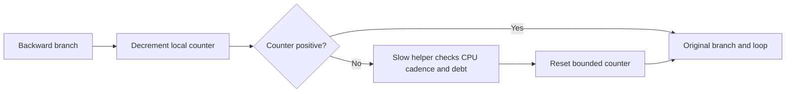

# Reducing automatic probe overhead

Date: 2026-10-13.
This source review proposes the next controlled Linux x64 experiment. It does not establish a production profiling design.

## Recommendation

Inject a local integer countdown and a conditional call at backward branches.
Keep timestamp reads, thread-local lookups, callback dispatch, and ledger work in a separate slow helper.
Call that helper only when the countdown expires.
Retain a bounded method-entry service path for repeated short invocations.
Measure this version before adding cross-thread armed polling.

The .NET JIT uses this basic shape for loop OSR patchpoints.
It initializes one counter per stack frame, decrements it in JIT IR, and bypasses the helper while the counter remains positive. [R1]
This is an implementation precedent, not a public extension point.
Do not call the runtime's internal patchpoint helper from profiler IL.

## Current evidence

The retained comparison reports 3.2455 microseconds per manual batch and 329.4311 microseconds per injected batch.
Each injected batch executes 10,002 helper calls for 10,000 loop iterations.
The zero-speedup run attributes only four of 500 samples to `CpuWorkload.Run`. [L1]
These observations demonstrate excessive overhead in this workload, not a general cost estimate for IL rewriting.

`InjectedProbes.Hit` updates a thread-local counter and invokes a thread-local `Action` on every call.
The callback enters `ProbeCadence.IsDue`, which checks thread identity and reads an elapsed timestamp before its CPU-time gate. [L2][L3][L4]
Moving only the CPU-clock syscall behind a gate therefore leaves substantial work on every loop iteration.

The fixed map captures symbols after warmup. Code compiled later can remain unmapped. [L5]
Unmapped samples must remain unknown. Do not attribute them to a particular helper without code-range evidence.
This mapping limit is separate from the measured batch cost.

## What the other implementations contribute

| Implementation | Verified mechanism | Useful lesson |
|---|---|---|
| Native Coz | Linux samples have a nominal 1 ms period. A timer processes batches every ten periods. Processing credits selected samples, then applies delays. [C1][C2][C3] | Separate frequent observation from less frequent settlement. Its normal path does not insert a managed call at every loop edge. |
| JCoz | Sends thread signals, captures JVM frames, and reconciles global/local delay after ten signals. [J1][J2] | Batch settlement independently of application iteration count. Its JVM signal handler is not a validated CLR suspension adapter. |
| Swift Coz | Calls native Coz progress macros through C shims. [S1] | Supplies no separate low-overhead intervention mechanism. |
| cozgo | Calls native Coz progress macros through C shims. [G1] | Supplies no replacement delay engine or reusable managed loop gate. |

Native Coz's Linux delay path stops the thread sampler before waiting and restarts it afterward. [C4]
Its automatic location selection also rejects locations in `coz.h`. [C5]
Those are concrete exclusion mechanisms. They do not automatically exclude managed helper code in CozNet.

## Candidate designs

### 1. Local countdown with a conditional helper

Proposed control flow:

The common path should contain integer operations and a conditional branch only.
It must not call `Hit`, read `ThreadStatic` state, invoke a delegate, or read a clock.
Updating an exact helper-call diagnostic on every edge would preserve the current problem.
Count slow-path executions and eligible poll sites separately.

Use a positive fixed interval first, such as 256 backedges, and compare several intervals.
This example value is a measurement candidate, not a time guarantee.
Retain `ProbeCadence` on the slow path so iteration counts never become CPU-time credits.
The collector's checked sample periods remain the credit input. [L3][L4]

A local counter gives a bound in executed poll sites.
It does not give a wall-time or CPU-time bound without a bound on work between sites.
Nested calls, blocking operations, and expensive iterations can make that interval large.
Keep the first experiment restricted to the existing arithmetic loop.

Counter reset at each entry can starve service across repeated short invocations.
Retain a once-per-entry service check for the first prototype, or carry a remaining count in per-thread state.
The latter adds entry/exit state access and needs recursion and exceptional-exit rules.
Do not silently remove the entry path because the long-loop case passes.

The rewriter must extend the local signature and preserve the evaluation stack at each insertion.
It must redirect branch targets through the gate and recompute branch sizes and code maps.
The existing rewriter already changes branches and exports maps, but its current inserted instruction is only a parameterless call. [L6]
The runtime patchpoint implementation operates on JIT IR and handles control flow itself. It is not drop-in IL rewriting code. [R1]

### 2. Armed polling

The JIT's inline GC poll reads a runtime trap value and branches around the helper when no trap is present. [R2]
A profiler-owned equivalent could expose an epoch or armed flag set by a controller.
Use proper acquire/release publication and verify the generated machine code.
A normal nonvolatile field read can be optimized in ways that break the intended repeated observation.
The runtime explicitly marks its trap expression to prevent inappropriate reuse. [R2]

Polling a shared flag every edge still costs a load and branch.
It can also add coherence traffic when a controller changes the flag.
Polling after countdown expiry combines cheaper loop coverage with an externally requested slow path.
However, it cannot react before the next poll site.

Only arming the thread that receives selected samples is insufficient.
Other registered workers must settle newly published global delay even when they receive no selected sample.
The controller must publish requests to those workers or use a shared generation they all observe.
The current bridge explicitly checks both selected and companion threads. [L4]

An acknowledgement must not erase a newer request.
Use a monotonic request epoch or an atomic exchange protocol with a proved pending-work rule.
This is a new state contract. Implement it after the simpler countdown establishes its cost and service interval.

### 3. Direct suspension

CLR profiler runtime suspension stops managed execution through `SuspendEE` and resumes it through `RestartEE`. [R3]
It does not provide the required operation of delaying other workers while the selected worker continues.
Use it only for its supported runtime-wide purposes, not as the next causal intervention mechanism.

`DoStackSnapshot` is a stack-inspection operation.
Its cross-thread path requires safe suspension support, rejects unsafe regions, and can return `E_NOTIMPL`. [R4]
These constraints do not establish permission to retain a target in a suspended state for an arbitrary causal delay.
Native Coz and JCoz demonstrate runtime-specific signal mechanisms, not safe CLR-managed helper execution from a POSIX signal handler. [C3][J1][J2]
No reviewed source supplies a lower-risk direct-suspension replacement for this controlled cooperative prototype.

## Excluding profiler work from selected CPU

Keep the slow helper non-inlined and exclude its native ranges from selected work.
Warm all helper paths before a fixed-map experiment, or replace the fixed map with lifecycle-aware range registration.
Retain unmapped samples separately in either case. [L5]

An inline countdown creates profiler instructions inside the selected method.
The current method-name match would credit their samples as selected work. [L4]
Marking a helper `NoInlining` does not solve this inline attribution problem.
Preserve inserted-instruction identity and investigate native subranges for those instructions.
The current original-IL map marks each original instruction as accurate; it does not provide a verified exclusion map for new countdown instructions. [L6]
If the runtime map cannot separate those ranges, report that limitation and the measured control perturbation.
Do not claim exact profiler-CPU exclusion based on method-level filtering alone.

Do not pause the perf event throughout application work merely to avoid poll samples.
That would suppress the observations needed for causal credit.
Any explicit disable/enable interval around slow service also needs bounded cost and ordered sample handling.

## Next experiment and acceptance evidence

1. Compare uninstrumented, current dense-helper, and conditional-countdown zero-speedup runs with identical work and warmed code.
2. Sweep fixed counts such as 64, 256, and 1,024. Record elapsed time, CPU time, code size, and slow-helper count.
3. Inspect JIT disassembly. Require no helper, TLS lookup, delegate call, or timestamp read on the positive-counter path.
4. Use one long invocation that crosses many countdown expirations. Require live credit and companion waits before it returns.
5. Use repeated short invocations. Require service without relying solely on final settlement.
6. Preserve checksums and verify branch paths, counter boundaries, zero credit, and cancellation behavior.
7. Record maximum CPU and elapsed gaps between service points. Do not infer a time bound from the chosen count.
8. Report selected, known profiler, and unmapped sample counts separately. Audit new inline instructions before interpreting selected CPU share.
9. Repeat physical-optimization prediction checks only after the overhead comparison and attribution limits are explicit.

These are proposed gates. This report performs no build, timing run, or runtime validation.

## Sources

[L1]: ../../reliability/features/linux-perf/injected-probes.md
[L2]: ../../tests/CozNet.LinuxPerf/InjectedProbes.cs
[L3]: ../../tests/CozNet.LinuxPerf/ProbeCadence.cs
[L4]: ../../tests/CozNet.LinuxPerf/SampledIntervention.cs
[L5]: ../../lode/profiling/linux-perf.md
[L6]: ../../native/Profiler.cpp
[R1]: https://github.com/dotnet/runtime/blob/60629d14374c56f1cb51819049ad1fa529307f8d/src/coreclr/jit/patchpoint.cpp#L11-L203
[R2]: https://github.com/dotnet/runtime/blob/60629d14374c56f1cb51819049ad1fa529307f8d/src/coreclr/jit/flowgraph.cpp#L311-L345
[R3]: https://github.com/dotnet/runtime/blob/60629d14374c56f1cb51819049ad1fa529307f8d/src/coreclr/vm/proftoeeinterfaceimpl.cpp#L6801-L6880
[R4]: https://github.com/dotnet/runtime/blob/60629d14374c56f1cb51819049ad1fa529307f8d/src/coreclr/vm/proftoeeinterfaceimpl.cpp#L8634-L8694
[C1]: https://github.com/plasma-umass/coz/blob/256e3c389424d6a1691ee5d18b5ecb5a6c1001ec/libcoz/profiler.h#L39-L47
[C2]: https://github.com/plasma-umass/coz/blob/256e3c389424d6a1691ee5d18b5ecb5a6c1001ec/libcoz/profiler.cpp#L600-L623
[C3]: https://github.com/plasma-umass/coz/blob/256e3c389424d6a1691ee5d18b5ecb5a6c1001ec/libcoz/profiler.cpp#L736-L758
[C4]: https://github.com/plasma-umass/coz/blob/256e3c389424d6a1691ee5d18b5ecb5a6c1001ec/libcoz/profiler.cpp#L678-L734
[C5]: https://github.com/plasma-umass/coz/blob/256e3c389424d6a1691ee5d18b5ecb5a6c1001ec/libcoz/profiler.cpp#L736-L758
[J1]: https://github.com/ByteLab-David/JCoz/blob/1df02b0f6e319bd7df05ba5451b1814791d1849f/src/native/profiler.cc#L156-L165
[J2]: https://github.com/ByteLab-David/JCoz/blob/1df02b0f6e319bd7df05ba5451b1814791d1849f/src/native/profiler.cc#L573-L666
[S1]: https://github.com/funcmike/swift-coz/blob/fe4bedf70edd89a49601ea1e48f2af660365e085/Sources/CCoz/shim.h#L1-L17
[G1]: https://github.com/urjitbhatia/cozgo/blob/d33f1dc723ec035e65022331b6677f5013da596a/cozgo.h#L1-L17
