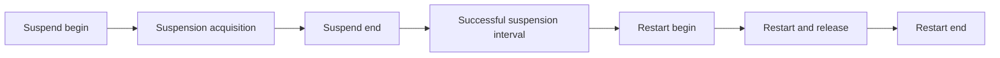

# Runtime suspension events and clock correlation

## Decision

Capture EventPipe GC suspension events in a separate, bounded diagnostic run on .NET 10 Linux.
Correlate these events with CozNet's `Stopwatch` records through bracketed custom markers.
Keep the raw trace, marker brackets, unmatched events, and reported event loss.

Use this capture to classify temporal overlap with request delays and debt growth.
Do not interpret process-level suspension events as exact suspension intervals for each worker.
Do not subtract these intervals from causal accounting or claim that overlap establishes the cause of a delay.

This report inspects primary sources. No capture ran during this research.
Related context: [sampled signals](../../lode/profiling/sampled-signals.md), [spin reliability](../../reliability/features/native-signal/spin-reliability.md), and [signal intervention](native-signal-intervention.md).

## Events and meaning

Use provider `Microsoft-Windows-DotNETRuntime`, keyword `GCKeyword = 0x1`, and level `Informational = 4`.
The .NET 10 manifest defines the following events under that keyword and level. [R1]

| Manifest event | ID/version | TraceEvent callback | Meaning from runtime call sites |
| --- | --- | --- | --- |
| `GCSuspendEEBegin_V1` | 9/1 | `GCSuspendEEStart` | The runtime starts a suspension attempt, before acquiring the thread-store lock. |
| `GCSuspendEEEnd_V1` | 8/1 | `GCSuspendEEStop` | The runtime has completed the suspension path successfully. |
| `GCRestartEEBegin_V1` | 7/1 | `GCRestartEEStart` | The runtime starts restart work, before releasing managed execution. |
| `GCRestartEEEnd_V1` | 3/1 | `GCRestartEEStop` | The restart path has resumed threads and released the thread-store lock. |

The manifest's Begin/End names differ from TraceEvent's Start/Stop names. Preserve event ID and version when exporting records. [R1][T1]

Let the four timestamps be `S0`, `S1`, `R0`, and `R1`, respectively.

- `S1 - S0`: suspension acquisition interval. This includes coordination and lock acquisition, not just thread suspension work.
- `R0 - S1`: interval between successful suspension and the start of restart work.
- `R1 - R0`: restart interval. Some threads can resume before its end.
- `R1 - S0`: broad suspension envelope. It includes acquisition and restart work.

These labels follow the event placement in `ThreadSuspend::SuspendEE` and `ThreadSuspend::RestartEE`. [R2]
They do not identify when each thread stopped or when the OS next scheduled that thread.
Native execution in preemptive GC mode can continue during a managed-runtime suspension. [R2]



## Reasons, collection identity, and pairing

`GCSuspendEEBegin_V1` contains `Reason`, `Count`, and `ClrInstanceID`.
The other three version-one events contain only `ClrInstanceID`. They have no suspension ID or GC count. [R1]

Suspension reason `1` means `SuspendForGC`. Reason `6` means `SuspendForGCPrep`.
The manifest also defines other reasons, including debugger, shutdown, and other suspension. Preserve their numeric values. [R1]
Do not label every event under the GC keyword as a collection-induced pause.

The emitter reads the current GC count for reasons `1` and `6`. It writes unsigned `-1` for other reasons. [R2]
Preserve the raw value `0xFFFFFFFF`. TraceEvent exposes `Count` as a signed `int`, so this value appears as `-1`. [T1]
Treat the count as correlation evidence, not a unique identifier for a suspension episode.

Also retain `GCStart_V2` (ID 1) and `GCEnd_V1` (ID 2).
Their payloads include collection count, generation depth, and CLR instance.
`GCStart_V2` also contains collection reason, type, and client sequence number. [R1]

Collection reasons and suspension reasons are different enumerations.
For example, .NET 10 includes collection reason `17`, `reason_induced_aggressive`.
The inspected TraceEvent `GCReason` enum ends at `13`. Export the raw numeric value even if its enum label is unknown. [R3][T1]
Collection type distinguishes non-concurrent, background, and foreground collections. Background activity need not equal one continuous suspension envelope. [R3]

Pair suspension events by process and CLR instance in decoded timestamp order.
Assign an analysis-local episode sequence. Retain event thread IDs as provenance, not as the set of suspended workers.
Do not require the GC count to increase for every suspension boundary.
Do not pair all events by callback thread or by the nearest `GCStart` alone.

Handle incomplete and unusual sequences explicitly.
The runtime's debugger retry path can call `RestartEE(FALSE, FALSE)` before a successful suspension, then retry below the original begin emission. [R2]
Thus, missing `SuspendEEEnd` does not automatically prove event loss.
Classify incomplete, retried, overlapping, or ambiguous sequences. Do not manufacture endpoints or force every sequence into four events.

## Clock source and timestamp provenance

EventPipe timestamps an event instance with `ep_perf_timestamp_get` when it constructs that instance.
The trace header records an opening timestamp and the performance-counter frequency. [R4]
The event timestamp is not the time when the collector reads or dispatches that event.

In pinned .NET 10 CoreCLR, EventPipe's performance counter calls `minipal_hires_ticks`.
On Linux, this function uses `clock_gettime(CLOCK_MONOTONIC)` and a frequency of one billion ticks per second. [R5]

The .NET 10 Unix `Stopwatch` also uses `minipal_hires_ticks` through `SystemNative_GetTimestamp`.
Its frequency is one billion ticks per second. The inspected Linux implementations therefore share a clock and scale. [R6]

This is implementation evidence for that runtime, not a universal `Stopwatch` API guarantee about EventPipe.
Record runtime version, image identity, `Stopwatch.Frequency`, and parser version. Verify the relationship with markers in each trace.
Do not equate these clocks with perf-event timestamps, UTC, or native request clocks merely because all values have nanosecond units.

TraceEvent exposes `TimeStampRelativeMSec` as a public session-relative event timestamp.
It also exposes `TimeStampQPC`, but marks it discouraged. Its `QPCFreq` property is internal in the inspected source. [T2]
Use the public relative timestamp for the first implementation. Preserve raw QPC if available without private reflection.
The raw `.nettrace` retains the header frequency for a format-aware reader. [R4][T3]
Do not assume TraceEvent provides a public frequency property in the selected package version.

## Marker protocol

Create a small explicit `EventSource` provider, for example `CozNet-RuntimeCorrelation`, with one informational marker event and keyword `0x1`.
Warm the event source and marker path before measurement. Confirm the provider is enabled before emitting the opening calibration markers.
Do not use an event-reader callback's `Stopwatch.GetTimestamp()` as the event time.

The target emits a marker between two local clock reads:

```csharp
long before = Stopwatch.GetTimestamp();
markers.ClockMarker(runId, sequence, before, Stopwatch.Frequency);
long after = Stopwatch.GetTimestamp();
markerBrackets.Add(new MarkerBracket(runId, sequence, before, after));
```

This is a design example, not existing project code.
Store `after` in the sidecar record. It cannot be part of the same already-emitted event.
Use a typed marker payload and preallocated bracket storage. Keep formatting and file writes outside the measured controller path.
An EventSource marker writes to EventPipe synchronously through the runtime event provider. The native event timestamp is assigned before that write returns. [R4][R7]
Pair marker payload and sidecar by run identity and monotonically increasing sequence.

Let `t` be the marker's `TimeStampRelativeMSec`, and `F` the target's `Stopwatch.Frequency`.
Define an offset `B` such that `StopwatchTicks = B + t * F / 1000`.
Each marker establishes an offset interval:

```text
before - t * F / 1000 <= B <= after - t * F / 1000
```

This is arithmetic notation, not a clock measurement from the collector.
Use centered arithmetic or sufficient precision to avoid cancellation with large absolute timestamps.
Emit several markers before and after measurement, and sparse markers between stages.
Intersect their offset intervals. Report the resulting width as alignment uncertainty.
Retain all brackets. Wide brackets can result from suspension or scheduling during marker emission.

An empty intersection indicates an invalid clock assumption, pairing problem, or precision problem.
Fail correlation instead of silently fitting an offset that hides the discrepancy.
Start and end markers also test drift. Do not infer a new frequency from one marker or from wall-clock arrival times.
If frequency equality is verified and raw QPC is available, apply the same bracket method directly to raw ticks.

## Bounded capture design

Use a separate collector process in the same Linux container or compatible PID/socket namespace.
Keep diagnostics enabled and ensure the collector can access the target's diagnostic socket.
Keep native CLR startup profiling disabled. EventPipe does not require a native profiler. [D1][D2]

Configure only these providers initially:

| Provider | Keywords | Level |
| --- | ---: | ---: |
| `Microsoft-Windows-DotNETRuntime` | `0x1` | 4 |
| `CozNet-RuntimeCorrelation` | `0x1` | 4 |

Do not enable heap dumps, allocation sampling, stacks, or rundown for this boundary-only capture.
The inspected diagnostics client supports `EventPipeSessionConfiguration` with `requestRundown: false` and `requestStackwalk: false`. [D3]
The simpler provider-list overload requests stack walking by default. Select and verify the explicit configuration API in the pinned package.

Use an explicit bounded buffer, such as 64 MiB, and record its size.
Collect opening markers, the fixed measurement window, and closing markers. Then stop the session and drain it to completion.
Retain the existing process watchdog and workload failure limits. A trace timeout or missing closing marker fails this diagnostic.
Copy the stream to `.nettrace` and parse it outside the target's measured interval.
If streaming decoding is required, copy relevant values in callbacks. Do not retain parser-owned event objects.

Run matched traced and untraced cases to measure diagnostic overhead.
Compare zero and 50 percent with the same providers, marker schedule, buffer, and GC policy.
Keep cold startup and steady measurement separate. Do not discard failed workloads because their trace is difficult to pair.

## Loss, completeness, and interpretation

EventPipe uses bounded buffers and can drop events if the writer outpaces the reader. [D1]
TraceEvent reconstructs dropped-event counts from sequence gaps and sequence-point blocks, then exposes `EventsLost`. [T3]
Inspect this value after full processing. It is a trace-wide count, not a count specific to GC boundaries.

Require clean stream completion, all expected markers, and zero reported loss for a complete-coverage claim.
Zero reported loss alone does not prove coverage when capture starts late, ends early, or has a truncated final stream.
Preserve parser errors, unknown event versions, unpaired boundaries, and unknown reasons as explicit limitations.
Do not interpret a missing suspension event as proof that no suspension occurred.

Report overlap with three distinct intervals: suspension acquisition, the successful suspension core, and the broad envelope.
Propagate marker uncertainty to interval endpoints. Distinguish definite overlap, possible overlap, and no observed overlap.
The broad envelope is useful for diagnosis, but overstates the period during which every managed worker was stopped.

The capture cannot prove whether a particular worker was runnable, descheduled, inside the signal handler, or executing native code.
It cannot distinguish OS scheduling delay from runtime suspension solely from process-level events.
Per-thread scheduler evidence remains a separate investigation.
The 50-microsecond request cap and two-percentage-point accuracy gate remain unchanged.

## Sources

Runtime sources are pinned to .NET 10.0.0 commit `60629d14374c56f1cb51819049ad1fa529307f8d`.
TraceEvent sources are pinned to `10e5d271cebcdf5d6cf122c6ab9c863860a7a2f1`.
The inspected diagnostics client is pinned to `738e0055b7a523a355a7148bfd3ac77bf99974b2`. This does not select a NuGet package version.

[R1] [Runtime event manifest](https://github.com/dotnet/runtime/blob/60629d14374c56f1cb51819049ad1fa529307f8d/src/coreclr/vm/ClrEtwAll.man): provider, keyword, event IDs, versions, payloads, and reason maps.

[R2] [Runtime suspension and restart implementation](https://github.com/dotnet/runtime/blob/60629d14374c56f1cb51819049ad1fa529307f8d/src/coreclr/vm/threadsuspend.cpp#L5378-L5717): event placement, native execution, and debugger retries.

[R3] [GC reason and type definitions](https://github.com/dotnet/runtime/blob/60629d14374c56f1cb51819049ad1fa529307f8d/src/coreclr/gc/gc.h).

[R4] [Event instance timestamp](https://github.com/dotnet/runtime/blob/60629d14374c56f1cb51819049ad1fa529307f8d/src/native/eventpipe/ep-event-instance.c) and [trace header](https://github.com/dotnet/runtime/blob/60629d14374c56f1cb51819049ad1fa529307f8d/src/native/eventpipe/ep-file.c).

[R5] [CoreCLR EventPipe clock adapter](https://github.com/dotnet/runtime/blob/60629d14374c56f1cb51819049ad1fa529307f8d/src/coreclr/vm/eventing/eventpipe/ep-rt-coreclr.h#L998-L1015) and [minipal clock](https://github.com/dotnet/runtime/blob/60629d14374c56f1cb51819049ad1fa529307f8d/src/native/minipal/time.c).

[R6] [Unix Stopwatch](https://github.com/dotnet/runtime/blob/60629d14374c56f1cb51819049ad1fa529307f8d/src/libraries/System.Private.CoreLib/src/System/Diagnostics/Stopwatch.Unix.cs) and [native timestamp implementation](https://github.com/dotnet/runtime/blob/60629d14374c56f1cb51819049ad1fa529307f8d/src/native/libs/System.Native/pal_time.c#L82-L85).

[R7] [Managed EventPipe provider write path](https://github.com/dotnet/runtime/blob/60629d14374c56f1cb51819049ad1fa529307f8d/src/libraries/System.Private.CoreLib/src/System/Diagnostics/Tracing/EventPipeEventProvider.cs).

[T1] [TraceEvent CLR parser](https://github.com/microsoft/perfview/blob/10e5d271cebcdf5d6cf122c6ab9c863860a7a2f1/src/TraceEvent/Parsers/ClrTraceEventParser.cs): callback names, payload accessors, and enums.

[T2] [TraceEvent timestamps](https://github.com/microsoft/perfview/blob/10e5d271cebcdf5d6cf122c6ab9c863860a7a2f1/src/TraceEvent/TraceEvent.cs).

[T3] [EventPipe reader](https://github.com/microsoft/perfview/blob/10e5d271cebcdf5d6cf122c6ab9c863860a7a2f1/src/TraceEvent/EventPipe/EventPipeEventSource.cs) and [sequence/loss accounting](https://github.com/microsoft/perfview/blob/10e5d271cebcdf5d6cf122c6ab9c863860a7a2f1/src/TraceEvent/EventPipe/EventCache.cs).

[D1] Microsoft, [EventPipe](https://learn.microsoft.com/dotnet/core/diagnostics/eventpipe).

[D2] Microsoft, [diagnostics client library](https://learn.microsoft.com/dotnet/core/diagnostics/diagnostics-client-library).

[D3] [Explicit session configuration](https://github.com/dotnet/diagnostics/blob/738e0055b7a523a355a7148bfd3ac77bf99974b2/src/Microsoft.Diagnostics.NETCore.Client/DiagnosticsClient/EventPipeSessionConfiguration.cs) and [client overloads](https://github.com/dotnet/diagnostics/blob/738e0055b7a523a355a7148bfd3ac77bf99974b2/src/Microsoft.Diagnostics.NETCore.Client/DiagnosticsClient/DiagnosticsClient.cs). Newer non-lossy options in this source require .NET 11 and are outside this .NET 10 proposal.
