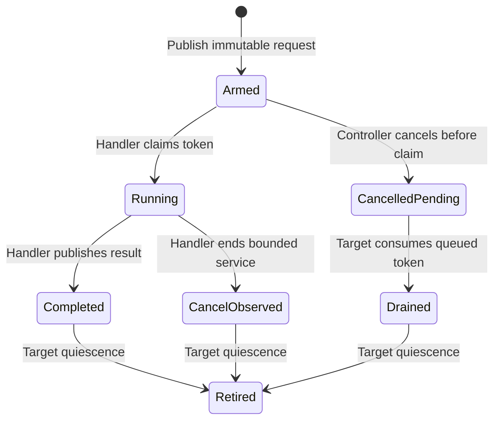

# Native signal request lifetime

Date: 2026-10-13.
Linux source revision: `8bb7eca972ad531c9b149c0a51ab43a417385813` (`v5.15`).
This review defines a proposed Linux x64 experiment contract. It does not verify an implementation.
It complements [the CoreCLR signal investigation](native-signal-intervention.md).

## Recommendation

Keep the handler code and fixed request slots alive until the disposable process exits.
Use a dedicated real-time signal, one outstanding request per target, and a never-reused request token during that process.
Stop senders before requesting target-side quiescence.
Do not equate a completion acknowledgement with handler return.

This simple contract avoids making library unload and slot reclamation prerequisites for the first experiment.
It still requires explicit cancellation, queued-signal draining, and target lifetime control.

## Delivery and token contract

`rt_tgsigqueueinfo` sends one `siginfo_t` payload to a particular `(tgid, tid)` pair.
`SI_QUEUE` is a suitable user-generated code.
The receiver needs `SA_SIGINFO` to read the payload. [P1][K1]
Success means the send operation succeeded. It is not an acknowledgement of handler entry or completion.
The kernel can discard ignored signals without calling a handler. [K2]

Use a real-time signal that neither CoreCLR nor another component owns.
Linux coalesces pending standard signals, retaining at most one queued instance of that signal.
The kernel explicitly bypasses this coalescing rule for real-time signals. [K2]
Therefore, `SIGPROF` is unsuitable when every request token needs distinct delivery semantics.
Do not select CoreCLR's activation signal or the libc thread library's reserved signals. [L1][P2]

On Linux x64, `sigval_t` contains either an `int` or a pointer-sized value.
The integer member does not hold a 64-bit token.
Use the pointer-sized payload representation as opaque bits, with verified x64 size and layout. Never dereference it. [K3]
Use platform headers and explicit layout assertions rather than copying a foreign `siginfo_t` declaration.

The handler can find its slot from the token and verify ownership with a direct `gettid` syscall.
It does not need a thread-local slot pointer.
Direct Linux syscall wrappers should return the raw result or negative error value to ordinary local variables.
Do not use libc `errno`, lazy TLS resolution, or a wrapper that introduces those dependencies in the handler.
This is a proposed implementation constraint, which requires inspection of the generated native code.

A useful token format contains a bounded slot index and a monotonically increasing generation.
Reject overflow instead of wrapping a generation.
The handler first checks signal number, `si_code`, token validity, and slot-index bounds.
It then verifies the published token and the current native TID before accessing request fields.
Do not accept an arbitrary pointer from the payload as a slot address.

`si_pid`, `si_uid`, and `si_value` are supplied by the sender in this syscall. [P1][K1]
They can detect accidental foreign delivery, but they are not authentication against code in the same process.
State the experiment's trusted-process assumption explicitly.

## Publication and completion

Publish all request fields before an atomic release transition to `Armed`.
The handler acquires that publication and atomically claims the request before it changes accounting.
The sender must publish before entering the syscall: another CPU can run the handler before the syscall returns.
Keep send-result bookkeeping separate from handler state.
Do not store `Queued` after syscall success and overwrite a completion that already occurred.

Proposed request states:

These state names are a proposed design, not kernel states.
Use only verified lock-free atomic operations in the handler.
Keep payload data immutable until the request reaches a proven reclamation point.
Put cancellation in a separate atomic field rather than overwriting fields the handler is reading.
POSIX permits lock-free C atomic operations under its signal-safety conditions. [P3]
Audit the actual C++ compiler output if the implementation uses C++ atomics.

After processing, a release-store completion record can publish the result and preceding slot accesses.
It cannot prove that the handler has executed its epilogue or returned through the signal trampoline.
The kernel restores interrupted execution and the signal mask through `rt_sigreturn`. [K4][P4]
That operation occurs after the handler's final acknowledgement store.

Consequently, `completed=true` or `activeHandlers=0` cannot alone permit `dlclose`, unmapping the handler, or restoring the previous disposition.
Even a last-instruction decrement leaves native return and trampoline execution outstanding.
An acknowledgement can permit slot-data reuse only with a separately audited no-further-access contract.
Avoid that optimization in the first experiment.
A fixed monotonic pool of per-request slots can enforce this rule for a bounded run.
Fail on pool exhaustion. Do not silently recycle a canceled or acknowledged slot.

## Cancellation and failed delivery

Cancellation revokes permission to perform further intervention. It does not retract a signal already queued in the kernel.
The documented syscall has no operation for deleting one queued signal by token. [P1]
Keep canceled request generations recognizable until delivery, explicit draining, or target termination has resolved them.

If the handler already claimed the request, cancellation must not free or modify its immutable payload.
The handler checks cancellation at bounded wait boundaries and exits by its absolute deadline.
Cancellation cannot promise an instantaneous stop while the thread is descheduled or in a syscall.
Record measured intervention before cancellation instead of treating the request as if it never ran.

Handle `EAGAIN`, `ESRCH`, `EINVAL`, and `EPERM` as distinct send outcomes. [P1]
Retry `EAGAIN` only under a bounded policy and only when no prior send of that token succeeded.
Never resend merely because an accepted request lacks an acknowledgement.
It can still be pending behind a blocked signal or an earlier handler.

Keep each registered target alive until the controller releases its registration.
The numeric `(tgid, tid)` pair is not a permanent thread-generation handle.
The kernel resolves the target task when processing the send. [K5]
If a TID is reused, comparing only the numeric TID does not identify the old managed thread.
A registration barrier that prevents target exit during sends closes this race for the controlled workload.

## Quiescence and draining

The strongest simple proof comes from the target running ordinary code after all senders stop.
Use a native shutdown entry called from normal target execution, never from its signal handler.

1. Atomically close the sender gate and join or otherwise synchronize all controller send operations.
2. Mark outstanding requests canceled. Keep slots and handler code resident.
3. Ask every registered target to enter the normal-context shutdown entry.
4. On each target, block only the dedicated profiler signal and keep it blocked during draining.
5. Consume pending profiler signals with zero-timeout `sigtimedwait` until it reports `EAGAIN`.
6. Check drained tokens and record their canceled or stale outcomes without executing intervention.
7. Publish target quiescence only after blocking and draining have completed.
8. Keep the handler installed and its storage resident until process exit in the initial experiment.

`sigtimedwait` removes a pending signal for the calling thread and returns its `siginfo_t`.
A zero timeout polls instead of waiting. [P5]
A controller cannot use this operation to drain another thread's thread-directed pending queue.
Each target must perform its own drain.
For direct syscalls, verify kernel signal-set size and ABI instead of passing libc-sized structures blindly. [P5]

Running the shutdown entry in normal target context proves that earlier handlers on that thread have returned.
Blocking the signal prevents a new handler from starting during the drain.
Stopping senders first prevents a new accepted request after the final empty-queue check.
These are three separate requirements; an acknowledgement supplies none of them alone.

If a target cannot reach this handshake before the process deadline, fail the experiment and terminate the disposable process.
Do not unload the library or recycle its memory as a timeout fallback.
Do not call `pthread_join` on a CLR-owned thread merely because it has a native TID.
`pthread_join` requires a joinable pthread handle with valid ownership. [P6]

## Why disposition changes are not draining

Setting `SIG_IGN` discards pending signals of that number, including other threads' pending instances. [K6]
It does not prove that an already-running handler has returned.
It also changes process-wide behavior and discards accounting evidence.
Do not use it as a request-cancellation primitive.

Restoring `SIG_DFL` while a real-time signal remains pending can expose its default terminating action. [P2]
Restoring another handler can deliver a late token to the wrong component.
Full restoration requires exclusive signal ownership, no active senders, per-target quiescence, and no pending deliveries.
Library unloading additionally requires proof that no handler or trampoline can still return into that library.
Process-lifetime residency deliberately avoids that final obligation for the first spike.

## Required checks

- Block the signal on a target, queue a request, cancel it, then drain it. Require zero intervention and one accounted token.
- Delay handler completion until after the sender returns, then invert that scheduling order. Neither order may corrupt state.
- Inject an old generation, invalid index, wrong TID, duplicate token, and unexpected signal code. Require rejection before payload use.
- Cancel a running request. Preserve its measured partial delay and verify bounded completion.
- Stop while a request is pending and while a handler is running. Require the target-side quiescence handshake.
- Exhaust or simulate the queue limit. Preserve `EAGAIN` without duplicate successful sends.
- Hold a target past its shutdown deadline. Require process failure, with no library unload or slot reuse.

Handler syscalls, GC interaction, and interrupted-IP eligibility remain separate checks from this lifetime protocol. [L1]

## Sources

[L1]: native-signal-intervention.md
[P1]: https://man7.org/linux/man-pages/man2/rt_tgsigqueueinfo.2.html
[P2]: https://man7.org/linux/man-pages/man7/signal.7.html
[P3]: https://pubs.opengroup.org/onlinepubs/9799919799/functions/V2_chap02.html#tag_16_04_03
[P4]: https://man7.org/linux/man-pages/man2/sigreturn.2.html
[P5]: https://man7.org/linux/man-pages/man2/sigwaitinfo.2.html
[P6]: https://man7.org/linux/man-pages/man3/pthread_join.3.html
[K1]: https://github.com/torvalds/linux/blob/8bb7eca972ad531c9b149c0a51ab43a417385813/kernel/signal.c#L4013-L4037
[K2]: https://github.com/torvalds/linux/blob/8bb7eca972ad531c9b149c0a51ab43a417385813/kernel/signal.c#L1066-L1105
[K3]: https://github.com/torvalds/linux/blob/8bb7eca972ad531c9b149c0a51ab43a417385813/include/uapi/asm-generic/siginfo.h#L8-L64
[K4]: https://github.com/torvalds/linux/blob/8bb7eca972ad531c9b149c0a51ab43a417385813/arch/x86/kernel/signal.c#L657-L684
[K5]: https://github.com/torvalds/linux/blob/8bb7eca972ad531c9b149c0a51ab43a417385813/kernel/signal.c#L3892-L3920
[K6]: https://github.com/torvalds/linux/blob/8bb7eca972ad531c9b149c0a51ab43a417385813/kernel/signal.c#L4113-L4135
