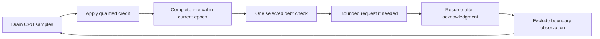

# Selected-thread signal cadence

The first sampled signal controller checked selected debt after every service iteration.
Native Coz processes available CPU samples before one delay check.
This ordering lets new selected credit offset debt before the selected thread waits again.

## Primary-source comparison

The inspected Coz revision is `256e3c389424d6a1691ee5d18b5ecb5a6c1001ec`.

| Operation | Native Coz behavior |
| --- | --- |
| Sampling | One-millisecond nominal task-clock periods and a batch size of ten. [1] |
| Processing timer | A per-thread CPU timer requests processing after ten milliseconds of thread CPU time. [2] |
| Sample processing | Credit the available selected samples, then call `add_delays` once. [3] |
| Debt payment | Disable sampling, wait once, account actual elapsed wait, enable sampling, and return. [3] |
| Synchronization | Additional checks occur at wake, blocking, and thread-exit boundaries. [4] |

An overshooting wait does not cause an immediate second delay check in that call.
Native Coz can receive new samples before it checks again.
Its synchronization hooks mean that sample-only checks are not a general replacement for thread-lifecycle and dependency handling.

Native Coz accepts the full current debt and retries interrupted sleeps. [5]
CozNet keeps a 50 µs request cap and does not retry inside the handler.
The peer therefore needs independent continued service to settle a larger debt through bounded requests.
Neither implementation uses the service signal's interrupted address as a substitute CPU sample.

## Sampling boundary

Coz's event start and stop operations use perf enable and disable ioctls. [5]
The matching WSL kernel source preserves the remaining task-clock timer period across stop and start. [6]
An emitted record retains a nominal period, which can span several enabled intervals.
Re-enabling the event therefore does not establish a fresh, complete one-millisecond observation.
Source matching does not prove the identity of the running kernel binary.

CozNet conservatively excludes the first observation after an eligibility-epoch change.
An accepted observation can therefore earn no credit because it only establishes a baseline.
Using every accepted observation as a new selected-delay trigger can repeat the pause before an eligible interval arrives.
Numeric credit is also insufficient as the trigger because a qualified zero-percent interval correctly earns zero credit.

## Controlled implementation

`SelectedSignalCadence` permits one selected check after a batch contains a complete interval in the same eligibility epoch.
It rejects decreasing epochs and clears prior readiness at an epoch change.
`SampledSignalWorkload` applies all drained observations before it consumes that permission.
The peer continues settlement independently.
The original continuous policy remains available as an explicit control.

This policy uses available qualified batches, not native Coz's exact ten-millisecond CPU timer.
Ten selected one-millisecond periods at 50 percent can publish 5 ms of debt.
That would exceed the current 2 ms observed-debt gate before service starts.
The experiment retains its gate and records this cadence difference.
General sampling and synchronization support remain incomplete.

The warm mode runs 250 ms of controller work before measurement.
It drains requests, retires the temporary ledger handles, and creates fresh accounting state.
Native targets remain registered throughout both phases.
The measurement stream starts with an excluded boundary observation because perf retains its partial period.
Both percentages use the same warmup duration.
Warmup observations and failed cold runs remain in the evidence.

See [the retained capacity results](../../reliability/features/native-signal/sampled.md) and [the controller contract](../../lode/profiling/sampled-signals.md).

## Sources

[1] [Coz sampling constants](https://github.com/plasma-umass/coz/blob/256e3c389424d6a1691ee5d18b5ecb5a6c1001ec/libcoz/profiler.h#L40-L48).

[2] [Coz sampler setup](https://github.com/plasma-umass/coz/blob/256e3c389424d6a1691ee5d18b5ecb5a6c1001ec/libcoz/profiler.cpp#L598-L637) and [Linux CPU timer](https://github.com/plasma-umass/coz/blob/256e3c389424d6a1691ee5d18b5ecb5a6c1001ec/libcoz/ccutil/timer.h).

[3] [Coz sample and delay processing](https://github.com/plasma-umass/coz/blob/256e3c389424d6a1691ee5d18b5ecb5a6c1001ec/libcoz/profiler.cpp#L678-L758).

[4] [Coz synchronization contracts](https://github.com/plasma-umass/coz/blob/256e3c389424d6a1691ee5d18b5ecb5a6c1001ec/libcoz/profiler.h#L151-L222) and [interposed calls](https://github.com/plasma-umass/coz/blob/256e3c389424d6a1691ee5d18b5ecb5a6c1001ec/libcoz/libcoz.cpp).

[5] [Coz perf controls](https://github.com/plasma-umass/coz/blob/256e3c389424d6a1691ee5d18b5ecb5a6c1001ec/libcoz/perf.cpp) and [measured sleep](https://github.com/plasma-umass/coz/blob/256e3c389424d6a1691ee5d18b5ecb5a6c1001ec/libcoz/util.h).

[6] [WSL remaining-period handling](https://github.com/microsoft/WSL2-Linux-Kernel/blob/linux-msft-wsl-5.15.153.1/kernel/events/core.c#L10808-L10868) and [task-clock start and stop](https://github.com/microsoft/WSL2-Linux-Kernel/blob/linux-msft-wsl-5.15.153.1/kernel/events/core.c#L10987-L10996).
