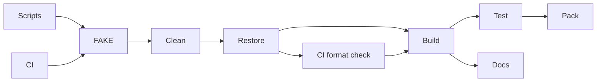

# MiniScaffold build

`build/build.fs` owns the FAKE target graph. Its baseline is MiniScaffold's `v0.40.0-beta001` library template.
The [release package](https://github.com/TheAngryByrd/MiniScaffold/releases/tag/v0.40.0-beta001) matches commit `bb58c5acb91c6bc34648ec8829d7866ffaa049e2` for these build files.
The release still contains `SourceLinkTest`. CozNet removes that target and its CLI helper at the user's request.
`build/Changelog.fs` supplies release-note handling. `build/FsDocs.fs` supplies documentation commands.
The build project targets .NET 10 and has a committed package lock.
`build.cmd` and `build.sh` restore local tools and forward target arguments.
CI invokes the same `DotnetPack` target with `CONFIGURATION=Release`.

```powershell
./build.cmd DotnetPack
./build.cmd BuildDocs
./build.cmd GenerateCoverageReport
./build.cmd NativeVerify
dotnet run --project build/build.fsproj -- --list
```

`DotnetPack` is the default target. It cleans project outputs, restores, builds, tests, and packages the library into `dist/`.
On CI, the graph also checks formatting before compilation.
Cleanup resolves paths and rejects directories outside the repository before removal.
`BuildDocs` builds the solution and generates documentation under `docs/`.
Generated packages and documentation remain ignored.
AltCover supplies coverage collection. `ENABLE_COVERAGE=true` enables the template's 80% sequence-coverage threshold during tests.
`GenerateCoverageReport` collects coverage without that threshold and writes HTML under `docs/coverage/`.

The repository owner is `TheAngryByrd`. The release branch is `master`.
Release and publish targets remain explicit actions. Default packaging does not publish packages or create Git tags.
Keep build orchestration in this graph instead of duplicating it in scripts or CI.
`NativeVerify` is an explicit Windows x64 prototype target.
It runs `NativeBuild`, builds the instrumentation workload in Release, and executes four bounded child processes.
It is separate from default packaging because other native backends are incomplete.
`LinuxPerfVerify` builds the Linux capability workload and runs its Docker checks.
Its default uses managed waits with 10-millisecond thread-CPU batching.
`LinuxWaitCompare` compares managed and native waits with per-probe and CPU-batched checks.
Both targets use the same bounded runner. Comparison records go under `artifacts/linux-wait-comparison/`.
`LinuxPredictionVerify` compares sampled predictions with a physical CPU optimization in eight randomized blocks.
It uses two-second measurement windows and writes unique directories under `artifacts/linux-prediction/`.
Accuracy failures produce `summary.json` before the target fails. The two-percentage-point gate remains mandatory.
It requires a local `mcr.microsoft.com/dotnet/sdk:10.0.100` image and a Linux Docker engine.
See [Linux perf feasibility](../profiling/linux-perf.md) for the isolated container settings and support limits.



See [practices](../practices.md), [the index](../lode-map.md), and [the README](../../README.md).
