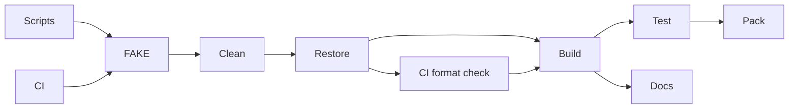

# MiniScaffold build

`LinuxMatchedPrediction` uses `LinuxPerfWorkload` and `VerifyMatchedPrediction.ps1` for eight four-case diagnostic blocks.
It requires `COZNET_CALIBRATION_DIRECTORY` and supports `COZNET_PYTHON` for the Python command.
The analyzer currently rejects accuracy because attribution and calibration bounds remain unresolved.
See [matched prediction diagnostics](../profiling/matched-prediction.md).

`LinuxInterleavedCalibration` depends on `LinuxPerfWorkload` and calls `VerifyPhysicalCalibration.ps1 -Interleaved`.
It preserves the contiguous route and retains evidence under `artifacts/interleaved-calibration/`.
See [the interleaved procedure](../../docsSrc/How_Tos/run-interleaved-calibration.md).

`LinuxPhysicalCalibration` depends on `LinuxPerfWorkload` and calls `VerifyPhysicalCalibration.ps1`.
It retains pre-execution source and binary snapshots, portable checks, physical runs, and fixed paired CPU calibration.
See [the procedure](../../docsSrc/How_Tos/run-physical-calibration.md).

`LinuxSampledTimer` uses `LinuxPerfWorkload` and `VerifyTimerInterop.ps1 -SampledTimer`.
It retains cold zero and 50-percent CPU-sampled timer cases under `artifacts/timer-sampled/`.
The sampled containers permit perf syscalls with `seccomp=unconfined`.
`LinuxSampledTimerPhases` adds `-ControllerPhases` to capture bounded startup phase intervals.
`LinuxInitializedTimer` also adds `-InitializeManagedPaths` and retains synthetic preparation separately from live measurements.
`LinuxPreparedTimer` adds `-InitializeNativeTransport` and requires dedicated setup slot 2 to retire and release before measurement.
`LinuxFastTimer` adds `-ShortInitialInterval` and requests 10 µs initial delivery with the same bounds and setup path.
`LinuxFastTimerCapacity` uses the same preparation and 10 µs interval without controller phase capture.
`LinuxFastTimerTransitions` runs all eight runtime-transition cases with 10 µs initial delivery and the existing reach and timing checks.
`LinuxFastTimerGc` runs prepared, phase-free sampled zero and 50-percent cases with forced GC, measurement reach, worker join, and 250 ms collection-call checks.
See [the procedure](../../docsSrc/How_Tos/run-sampled-timer.md).

`LinuxTimerApi` checks the target-local timer C ABI in deferred and chained-wait modes.
`TimerLayoutVerify` checks managed ABI sizes and offsets on the host without loading the Linux library.
`LinuxTimerInterop` checks first managed receipt preservation, late receipt rejection, and wrong-thread clock rejection on Linux x64.
`LinuxTimerManaged` uses the same runner with `-ManagedWorkload` and checks paid journals during controlled managed arithmetic.
`LinuxTimerManagedGc` also passes `-ForceGc` and requires a complete collection inside a recorded command interval.
Its evidence uses `artifacts/timer-managed-gc/` and retains the shared 250 ms GC call bound.
It retains source and binary hashes, runtime perf maps, and raw results under `artifacts/timer-managed/`.
All four managed targets depend on `LinuxPerfWorkload` inside the FAKE target graph.
The Linux runners retain unique directories under `artifacts/timer-api/` and `artifacts/timer-interop/`.
See [timer interop](../profiling/timer-interop.md) for scope and ownership.

`ServiceOwnerVerify` builds and checks the portable native coordinator on the host with CMake and a C++20 compiler.
Its `cooperative-target` CTest entry checks owner-thread polling, code-revocation guards, and finite lease receipts with controlled clocks.
Its `cooperative-abi` and `cooperative-timing` entries check the shared library, copy ownership, native receipt bounds, and production clock/wait adapter.
`CooperativeManagedVerify` checks pure managed receipts and ledger binding.
`CooperativeInteropVerify` and `LinuxCooperativeInteropVerify` build the native boundary and retain six managed interop cases per platform.
`LinuxSampledServiceVerify` builds the managed workload and native service libraries, then runs bounded zero and 50-percent sampled cases.
It retains every outcome under `artifacts/linux-sampled-service/`. The first treatment fails during warmup.
`LinuxSampledServicePhases` uses the same runner with bounded controller phase capture enabled.
`LinuxSampledServiceJit` also collects EventPipe JIT and GC events with dotnet-trace 10.0.750501.
`LinuxInitializedServiceVerify` exercises managed initialization, checks that synthetic accounting stays separate, and runs the phase comparison.
`LinuxServiceSubmissionTiming` uses the initialized workload and retains native submission intervals with managed timestamp brackets.
`LinuxServiceSchedulerTiming` also captures four scheduler streams, including the native owner, and runs native-clock overlap analysis on both retained cases.
`LinuxServiceOwnerVerify` performs the same checks in the existing `coznet-native-build:10.0.100` Linux image.
Both targets call `native/VerifyServiceOwner.ps1` and require no CLR profiler or signal transport.
They do not establish native delivery or prediction accuracy.
`LinuxSignalServiceVerify` enables the Linux signal transport and isolated native delivery checks.
Its timestamped output directories preserve each live run under `artifacts/service-owner-linuxcontainer-signal-*`.
`LinuxServiceInteropVerify` builds the managed workload and native ABI, then checks native ownership and first managed receipt.
`LinuxSelectedServiceInteropVerify` checks [selected native request settlement](../profiling/service-selected-adapter.md) and late-receipt rejection through slot 0.
It retains each run under `artifacts/service-interop/` and uses a 30-second process watchdog.
`ServiceAccountingVerify` builds the managed workload and runs portable journal-to-ledger checks on the host.
`ServiceAccountingCost` builds the managed workload and records [fixed journal costs](../profiling/service-accounting-cost.md).
`LinuxServiceSnapshotCost` builds the native ABI and records [cached snapshot costs](../profiling/service-snapshot-cost.md).
`LinuxServiceInteropVerify` also runs the `ServiceAccountingVerify` checks in Linux and verifies live journal settlement or rejection.

`build/build.fs` owns the FAKE target graph. Its baseline is MiniScaffold's `v0.40.0-beta001` library template.
`LinuxFastTimerScheduler` adds controller and target scheduler capture to the sampled timer forced-GC comparison.
`LinuxFastTimerSchedulerNoGc` captures the same scheduler streams without the forced-GC worker.
It selects `--sampled-timer-scheduler` with `no-gc` and preserves the prepared short-interval capacity settings.
It retains all outcomes under `artifacts/timer-sampled/` and fails after writing evidence when any case fails.
`LinuxTimerSchedulerCost` uses the same runner for eight seeded pairs at zero percent with capture enabled or disabled.
The [release package](https://github.com/TheAngryByrd/MiniScaffold/releases/tag/v0.40.0-beta001) matches commit `bb58c5acb91c6bc34648ec8829d7866ffaa049e2` for these build files.
The release still contains `SourceLinkTest`. CozNet removes that target and its CLI helper at the user's request.
`build/Changelog.fs` supplies release-note handling. `build/FsDocs.fs` supplies documentation commands.
The build project targets .NET 10 and has a committed package lock.
`build.cmd` and `build.sh` restore local tools and forward target arguments.
CI invokes the same `DotnetPack` target with `CONFIGURATION=Release`.

```powershell
./build.cmd DotnetPack
./build.cmd BuildDocs
./build.cmd GenerateCoverageReport
./build.cmd NativeVerify
dotnet run --project build/build.fsproj -- --list
```

`DotnetPack` is the default target. It cleans project outputs, restores, builds, tests, and packages the library into `dist/`.
On CI, the graph also checks formatting before compilation.
Cleanup resolves paths and rejects directories outside the repository before removal.
`BuildDocs` builds the solution and generates documentation under `docs/`.
Generated packages and documentation remain ignored.
AltCover supplies coverage collection. `ENABLE_COVERAGE=true` enables the template's 80% sequence-coverage threshold during tests.
`GenerateCoverageReport` collects coverage without that threshold and writes HTML under `docs/coverage/`.

The repository owner is `TheAngryByrd`. The release branch is `master`.
Release and publish targets remain explicit actions. Default packaging does not publish packages or create Git tags.
Keep build orchestration in this graph instead of duplicating it in scripts or CI.
`NativeVerify` is an explicit Windows x64 prototype target.
It runs `NativeBuild`, builds the instrumentation workload in Release, and executes four bounded child processes.
It is separate from default packaging because other native backends are incomplete.
`NativeLinuxVerify` runs `NativeLinuxBuild`, `NativeLinuxWorkload`, and the bounded Linux native runner.
Its graph is separate from `NativeVerify`. Either target can run without the other platform's compiler.
`NativeMapVerify` and `NativeLinuxMapVerify` also have separate platform build chains.
They run eight mapping cases per platform and retain JSON records and disassembly under `artifacts/native-map/`.
Each case compares one controlled method, mapping mode, and probe placement at interval 1024.
`NativeCountdownVerify` and `NativeLinuxCountdownVerify` use their corresponding platform build chains.
They repeat the native checks at probe intervals 64, 256, and 1024.
Evidence goes under `artifacts/countdown/`, separated by platform runner and interval.
The Linux build uses the pinned runtime source checkout and an isolated Clang/CMake Docker image.
It verifies injected probes and known-credit intervention. Linux stack-snapshot requests fail explicitly with `E_NOTIMPL`.
`LinuxPerfVerify` builds the Linux capability workload and runs its Docker checks.
`LinuxSignalVerify` builds a separate Linux x64 signal library and the shared capability workload.
It runs four native contract cases and six managed signal/GC cases with a 30-second process watchdog.
`LinuxSignalWaitCompare` uses the same build chain and compares sleep and spin in isolated processes.
It runs twelve basic signal/GC cases in seeded order and twelve sampled cases in three seeded blocks.
The basic and sampled suites both run even when one fails. Their outcomes remain separate in the parent report.
`LinuxSpinReliabilityVerify` runs spin transition cases and three sampled blocks with and without forced GC.
It preserves both suite outcomes and continues to sampled cases after a transition failure.
`LinuxRuntimeTraceCollect` uses the signal build chain and collects three seeded diagnostic blocks.
`LinuxSchedulerTraceCollect` uses that collector with scheduler capture for one four-case block.
`AnalyzeSchedulerRuntime.py` combines decoded runtime events and scheduler records after capture.
`python native/SchedulerRuntimeChecks.py` checks the combined analyzer without native APIs or timing workloads.
`LinuxSchedulerVerify` runs portable record-decoder and capture-shutdown fixtures in Linux.
`LinuxSchedulerCollect` retains four sampled workload cases with optional controller and target switch records.
Scheduler runners retain every outcome, verify source and executable snapshot hashes, and run the snapshot's analyzer.
Any failed child, missing record, changed snapshot, or analyzer failure fails the target after evidence is written.
`LinuxSchedulerCost` measures eight fixed-work enabled/disabled pairs without signals or forced GC.
The scheduler targets use `LinuxSignalWorkload` and keep evidence under `artifacts/`.
See [scheduler contracts](../profiling/scheduler-records.md) for interpretation limits.
Each block contains zero and 50 percent with and without forced GC. Every case uses spin and bracketed EventPipe markers.
It retains every child exit code, trace, workload record, collection command, and source/binary snapshot.
Failed workloads fail the target after all cases finish. Correlation runs separately and has its own validity result.
It also runs five portable phase-timing parser checks. The sampled runner repeats these checks beside its cadence checks.
Evidence remains under `artifacts/linux-signal/`. The target requires the existing native compiler image.
`LinuxSignalTransitionsVerify` uses the same build chain and a separate native workload fixture.
It runs five native lifecycle cases, eight managed transition cases, and three shared target-lifetime checks.
Evidence remains under `artifacts/linux-signal-transitions/`.
`LinuxSampledSignalsVerify` connects selected CPU samples to bounded signal requests at zero and 50 percent.
It retains raw samples, acknowledgments, and boundary snapshots under `artifacts/linux-sampled-signals/`.
Its observed debt limit is 2 ms per thread in a two-second window. Capacity failures fail the target after evidence is written.
`LinuxSampleCadenceVerify` checks selected debt after qualified samples while continuing peer service.
`LinuxWarmSampleCadenceVerify` adds 250 ms of warmup and resets accounting before the measurement window.
Both targets also execute the five portable cadence checks in the Linux workload.
The sampled runner also executes six synthetic-ring checks, including the empty-drain allocation check.
`LinuxInjectedVerify` builds the native profiler and compares manual and injected probes with the same wait backend.
It retains unique evidence directories under `artifacts/linux-injected/` and reports the zero-speedup cost ratio.
`LinuxCountdownVerify` uses the same native build and Linux workload chain.
It compares five probe configurations in three shuffled blocks and retains every result under `artifacts/linux-countdown/`.
Any failed case fails the target after the comparison records have been written.
Its default uses managed waits with 10-millisecond thread-CPU batching.
`LinuxWaitCompare` compares managed and native waits with per-probe and CPU-batched checks.
Both targets use the same bounded runner. Comparison records go under `artifacts/linux-wait-comparison/`.
`LinuxPredictionVerify` compares sampled predictions with a physical CPU optimization in eight randomized blocks.
It uses two-second measurement windows and writes unique directories under `artifacts/linux-prediction/`.
Accuracy failures produce `summary.json` before the target fails. The two-percentage-point gate remains mandatory.
`LinuxCountdownPredictionVerify` uses injected probes with interval 1024 and the same accuracy gate.
Its physical cases run without the profiler. Records go under `artifacts/linux-countdown-prediction/`.
`LinuxRawAttributionVerify` and `LinuxFilteredAttributionVerify` use the same native build, workload, and physical-prediction protocol.
Both require empty-stack placement and raw CLR maps at interval 1024.
The first retains whole-method credit. The second excludes raw IL candidates without claiming verified native ownership.
Records go under `artifacts/linux-raw-attribution/` and `artifacts/linux-filtered-attribution/`.
`LinuxOverheadVerify` uses the same Linux build chain and runs five component stages in eight shuffled blocks.
It retains every case, subprocess log, outcome, binary hash, and paired stage ratio under `artifacts/linux-overhead/`.
Its success gate checks workload and accounting behavior. It does not check prediction accuracy.
`WindowsOverheadVerify` has its own Windows native build chain and shared managed workload build.
It verifies three bounded stages and writes records under `artifacts/windows-overhead/`. It does not run Linux-only event or clock adapters.
It requires a local `mcr.microsoft.com/dotnet/sdk:10.0.100` image and a Linux Docker engine.
See [Linux perf feasibility](../profiling/linux-perf.md) for the isolated container settings and support limits.



See [practices](../practices.md), [the index](../lode-map.md), and [the README](../../README.md).

`LinuxServiceOwnerPolling` uses `LinuxPerfWorkload` and the sampled service runner with `-CompareOwnerPolling`.
It compares yield and poll-64 at zero and 50 percent, retains every case, and fails after analysis if any case fails.
See [owner polling](../profiling/owner-polling.md).

`LinuxTargetLeaseDelivery` builds the isolated Linux x64 timer fixture and retains chain, snapshot-chain, pending-retirement, and cancel-rearm cases.
`LinuxTimerTransitions` builds the timer and transition fixture and runs four scenarios with and without GC.
It retains all eight outcomes before reporting failure. See [timer transitions](../../docsSrc/Reference/timer-transitions.md).
It uses the native compiler image and does not run .NET application workloads.
`LinuxTargetLeaseReuse` runs portable mailbox and lease checks, then retains one native 16-generation timer reuse case.
`LinuxTargetLeaseCancellation` uses the same runner with `-Mode cancel-before-delivery` and alternates cancelled and normal generations.
`LinuxTargetLeaseActiveCancellation` uses `-Mode cancel-active-handler` and checks controller cancellation while the handler owns an executing lease.
`LinuxTargetLeaseDisarmFailure` and `LinuxTargetLeaseDrainFailure` each verify one completed child with a rejected cleanup syscall.
They require retained ownership before independent target-side registration cleanup and preserve the original child after core retirement.
`LinuxTargetLeaseArmRecovery` uses `-Mode reject-initial-arm` and alternates rejected initial arms with normal generations.
The runner retains kernel identity and raw syscall results. Failed generations must retire without children or credited wait.
See [target-local leases](../plans/target-local-lease.md).
