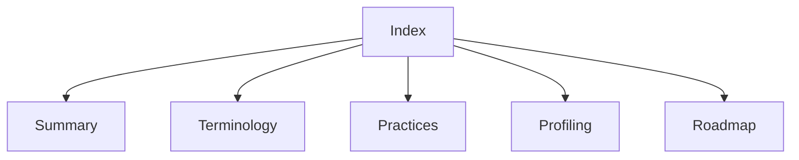

# Lode index

Read [summary.md](summary.md), [terminology.md](terminology.md), and [practices.md](practices.md) at session start.
For profiling changes, read [the serial engine](profiling/summary.md).
For sampled experiment accounting, read [the delay ledger](profiling/delay-ledger.md).
For live managed delay settlement, read [the cooperative runtime](profiling/cooperative-runtime.md).
For sample-to-ledger conversion, read [sample credits](profiling/sample-credits.md).
For a Linux CPU-event source, read [Linux perf feasibility](profiling/linux-perf.md).
For Windows and Linux CLR instrumentation, read [runtime probes](profiling/runtime-probes.md).
For the bounded native signal experiment, read [signal intervention](profiling/signal-intervention.md).
For signal delivery during runtime transitions, read [signal transitions](profiling/signal-transitions.md).
For sample credit and bounded request ownership, read [signal accounting](profiling/signal-accounting.md).
For the live sampled signal controller and capacity limit, read [sampled signals](profiling/sampled-signals.md).
For request timing and peak-debt evidence, read [service timing](../reliability/features/native-signal/service-timing.md).
For native queue, handler, and observation phases, read [native phase timing](../reliability/features/native-signal/phase-timing.md).
For controller allocation and ring snapshot reuse, read [the GC comparison](../reliability/features/native-signal/gc-and-ring-cache.md).
For unchanged-state peer checks and retained failures, read [peer cadence](../reliability/features/native-signal/peer-cadence.md).
For allocation in the full controller's accounting read, read [accounting read](../reliability/features/native-signal/accounting-read.md).
For native sleep and spin measurements, read [the wait comparison](../reliability/features/native-signal/wait-comparison.md).
For spin runtime transitions and sampled forced GC, read [spin reliability](../reliability/features/native-signal/spin-reliability.md).
For diagnostic clock markers and runtime suspension events, read [runtime suspension traces](profiling/runtime-suspension-trace.md).
For explicit failed-run boundaries and deterministic failure capture, read [abort trace evidence](../reliability/features/native-signal/abort-trace.md).
For request CPU bounds and pending requests while the controller runs, read [controller CPU intervals](../reliability/features/native-signal/controller-cpu.md).
For optional target CPU capture and native clock ownership, read [target CPU observations](profiling/target-cpu-observations.md).
For native clock read cost and sleeping-target checks, read [target clock measurement](../reliability/features/native-signal/target-cpu-clock.md).
For native Coz's check ordering and perf boundary behavior, read [signal sample cadence](../docsSrc/Research/signal-sample-cadence.md).
For build targets and CI, read [the MiniScaffold build](build/summary.md).
For scope expansion, read [the roadmap](plans/roadmap.md).
For the proposed runtime architecture, read [the Coz port and IL rewriting decision](../docsSrc/Research/coz-port-and-il-rewriting.md).
Keep this index aligned with the files. Session scraps belong in ignored `tmp/`.

```powershell
Get-Content lode/profiling/summary.md
```


