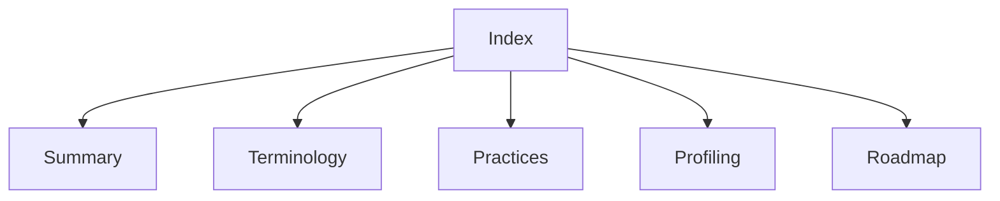

# Lode index

For owner/background one-CPU failures and the missing managed receipt endpoint, read [the constrained comparison](../reliability/features/native-signal/owner-drain-single-cpu.md).

For opt-in owner-thread draining and its first comparison, read [the collector contract](profiling/pausable-collector.md#owner-driven-mode).

For the managed one-CPU capacity failure and wall/CPU divergence, read [the scheduling evidence](../reliability/features/native-signal/cooperative-single-cpu.md).

For optional owner-thread CPU observations around cooperative child waits, read [the native contract](profiling/cooperative-interop.md#optional-cpu-records) and [its checks](../reliability/features/native-signal/cooperative-child-cpu.md).

For reuse of validated idle accounting results and debt snapshots, read [accounting reuse](profiling/accounting-reuse.md).

For the zero-speedup fixed-work reference and diagnostic runtime maps, read [observer overhead](profiling/observer-overhead.md).

For shared immutable counter snapshots and prefix validation, read [counter history](profiling/counter-history.md).

For the fixed-work cadence comparison, read [selected cadence](plans/selected-cadence.md).

For the opt-in two-slot payment draft and its verification gaps, read [selected-owner payment](profiling/selected-owner-payment.md).

For authoritative selected and peer debt, read [cooperative ledger observations](profiling/cooperative-debt.md).

For acknowledged drain ownership before selected payment, read [the pausable collector](profiling/pausable-collector.md).

For real selected samples driving bound peer waits, read [sample-driven cooperative payment](profiling/bound-sampled-payment.md).

For payment CPU exclusion and selected debt from peer overshoot, read [cooperative sample eligibility](../docsSrc/Research/cooperative-sample-eligibility.md).

For real CPU records through the bound map, read [bound sample collection](profiling/bound-samples.md).

For the bound native range contract and sample-admission limits, read [the map plan](plans/bound-native-map.md) and [the source comparison](../docsSrc/Research/bound-native-mapping.md).

For CLR lifetime checks around payment and receipts, read [bound cooperative payment](profiling/bound-cooperative.md).

For opt-in literal probe arguments and CLR invalidation, read [probe identity](profiling/probe-identity.md).

For injected identity and nonblocking CLR invalidation, read [the lifetime contract research](../docsSrc/Research/cooperative-clr-lifetime.md).

For the next finite experiment lifecycle and explicit residual states, read [the lifecycle plan](plans/experiment-lifecycle.md).

For recorded native wait overlap at frozen endpoints, read [timer wait membership](profiling/timer-wait-membership.md).

For observed source timestamps and endpoint ambiguity, read [sample membership](profiling/sample-membership.md).

For matched collection, frozen cost parsing, and unresolved attribution, read [matched prediction diagnostics](profiling/matched-prediction.md).

For fixed-work CPU calibration and its retained uncertainty, read [physical calibration](profiling/physical-calibration.md).

For shared timer/physical workers and the uninstrumented route, read [matched physical work](profiling/matched-physical.md).

For frozen measurement endpoints and shutdown separation, read [measurement boundaries](profiling/measurement-boundaries.md).

For native submission timing and the retained capacity failure, read [submission evidence](../reliability/features/native-signal/service-submission/README.md).
For owner preemption and upstream debt-payment differences, read [the scheduling comparison](../docsSrc/Research/native-owner-scheduling.md).
For the finite active-polling prototype and its retained capacity failures, read [owner polling](profiling/owner-polling.md).

For the portable target-local lease state machine, read [target-local leases](profiling/target-local-lease.md).
For target-thread cooperative service and explicit code revocation, read [the cooperative transport](profiling/cooperative-target.md).
For cooperative ABI ownership, receipt records, and production timing, read [cooperative interop](profiling/cooperative-interop.md).
For first managed cooperative receipts and ledger binding, read [managed cooperative interop](profiling/cooperative-managed.md).
For target-local timer delivery, read [the lease plan](plans/target-local-lease.md).
For repeated native timer generations, read [the reuse procedure](../docsSrc/How_Tos/run-target-lease-reuse.md).
For the timer C ABI and first managed receipt, read [timer interop](profiling/timer-interop.md).
For timer journal settlement, read [timer accounting](profiling/timer-accounting.md).
For timer controller ownership and portable failure checks, read [the controller reference](../docsSrc/Reference/timer-service-controller.md).
For real CPU samples driving timer leases, read [the first sampled timer evidence](../reliability/features/native-signal/timer-sampled.md).
For current sampled timer execution and support limits, read [sampled timers](profiling/timer-sampled.md).
For paid timer waits during managed arithmetic, read [the managed timer workload](profiling/timer-managed.md).
For timer runtime transitions and the selected-debt limitation, read [the retained matrix](../reliability/features/native-signal/timer-transitions.md).
For the 10 µs initial interval during runtime transitions, read [the short-interval matrix](../reliability/features/native-signal/timer-fast-transitions.md).
For selected-worker cleanup decisions and fault checks, read [the lifecycle evidence](../reliability/features/native-signal/timer-worker-lifetime.md).
Read [summary.md](summary.md), [terminology.md](terminology.md), and [practices.md](practices.md) at session start.
For profiling changes, read [the serial engine](profiling/summary.md).
For sampled experiment accounting, read [the delay ledger](profiling/delay-ledger.md).
For live managed delay settlement, read [the cooperative runtime](profiling/cooperative-runtime.md).
For sample-to-ledger conversion, read [sample credits](profiling/sample-credits.md).
For a Linux CPU-event source, read [Linux perf feasibility](profiling/linux-perf.md).
For cumulative counts and frozen endpoint ranges, read [the counter reference](../docsSrc/Reference/cpu-counter-evidence.md) and [retained evidence](../reliability/features/native-signal/cpu-counter.md).
For explicit sample timestamp selection and unresolved clock mapping, read [the CPU clock reference](../docsSrc/Reference/cpu-sample-clock.md).
For per-thread switch records and trailing loss, read [scheduler observations](profiling/scheduler-records.md).
For simultaneous scheduler and runtime capture, read [the combined trace](../reliability/features/native-signal/scheduler-runtime.md).
For Windows and Linux CLR instrumentation, read [runtime probes](profiling/runtime-probes.md).
For the bounded native signal experiment, read [signal intervention](profiling/signal-intervention.md).
For signal delivery during runtime transitions, read [signal transitions](profiling/signal-transitions.md).
For sample credit and bounded request ownership, read [signal accounting](profiling/signal-accounting.md).
For finite peer lease ownership and journal parsing, read [service accounting](profiling/signal-service.md).
For the portable native coordinator and shutdown contract, read [native service ownership](profiling/native-service-owner.md).
For the Linux signal adapter and target lifetime, read [Linux service transport](profiling/linux-service-transport.md).
For the C ABI and first managed receipt bounds, read [service interop](profiling/service-interop.md).
For native journal settlement in the managed ledger, read [the service accounting adapter](profiling/service-accounting-adapter.md).
For single-child selected request settlement, read [the selected service adapter](profiling/service-selected-adapter.md).
For fixed journal allocation and copy measurements, read [service accounting costs](profiling/service-accounting-cost.md).
For the combined native snapshot and managed receipt-cache path, read [snapshot costs](profiling/service-snapshot-cost.md).
For the live sampled signal controller and capacity limit, read [sampled signals](profiling/sampled-signals.md).
For the first native sampled service capacity failure, read [the retained run](../reliability/features/native-signal/sampled-service/README.md).
For controller startup CPU and JIT correlation, read [the startup evidence](../reliability/features/native-signal/service-startup/README.md).
For managed and native setup isolation and retained capacity failures, read [initialization](../reliability/features/native-signal/service-initialization/README.md).
For request timing and peak-debt evidence, read [service timing](../reliability/features/native-signal/service-timing.md).
For native queue, handler, and observation phases, read [native phase timing](../reliability/features/native-signal/phase-timing.md).
For controller allocation and ring snapshot reuse, read [the GC comparison](../reliability/features/native-signal/gc-and-ring-cache.md).
For unchanged-state peer checks and retained failures, read [peer cadence](../reliability/features/native-signal/peer-cadence.md).
For allocation in the full controller's accounting read, read [accounting read](../reliability/features/native-signal/accounting-read.md).
For native sleep and spin measurements, read [the wait comparison](../reliability/features/native-signal/wait-comparison.md).
For spin runtime transitions and sampled forced GC, read [spin reliability](../reliability/features/native-signal/spin-reliability.md).
For diagnostic clock markers and runtime suspension events, read [runtime suspension traces](profiling/runtime-suspension-trace.md).
For explicit failed-run boundaries and deterministic failure capture, read [abort trace evidence](../reliability/features/native-signal/abort-trace.md).
For request CPU bounds and pending requests while the controller runs, read [controller CPU intervals](../reliability/features/native-signal/controller-cpu.md).
For optional target CPU capture and native clock ownership, read [target CPU observations](profiling/target-cpu-observations.md).
For native clock read cost and sleeping-target checks, read [target clock measurement](../reliability/features/native-signal/target-cpu-clock.md).
For native Coz's check ordering and perf boundary behavior, read [signal sample cadence](../docsSrc/Research/signal-sample-cadence.md).
For build targets and CI, read [the MiniScaffold build](build/summary.md).
For scope expansion, read [the roadmap](plans/roadmap.md).
For the next bounded intervention prototype, read [native debt service](plans/native-debt-service.md).
For the proposed runtime architecture, read [the Coz port and IL rewriting decision](../docsSrc/Research/coz-port-and-il-rewriting.md).
Keep this index aligned with the files. Session scraps belong in ignored `tmp/`.

```powershell
Get-Content lode/profiling/summary.md
```


