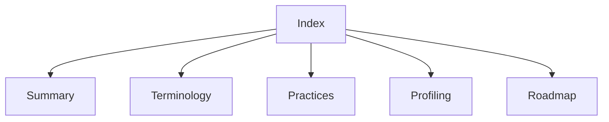

# Lode index

Read [summary.md](summary.md), [terminology.md](terminology.md), and [practices.md](practices.md) at session start.
For profiling changes, read [the serial engine](profiling/summary.md).
For scope expansion, read [the roadmap](plans/roadmap.md).
Keep this index aligned with the files. Session scraps belong in ignored `tmp/`.

```powershell
Get-Content lode/profiling/summary.md
```


