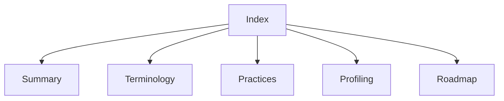

# Lode index

Read [summary.md](summary.md), [terminology.md](terminology.md), and [practices.md](practices.md) at session start.
For profiling changes, read [the serial engine](profiling/summary.md).
For sampled experiment accounting, read [the delay ledger](profiling/delay-ledger.md).
For build targets and CI, read [the MiniScaffold build](build/summary.md).
For scope expansion, read [the roadmap](plans/roadmap.md).
For the proposed runtime architecture, read [the Coz port and IL rewriting decision](../docsSrc/Research/coz-port-and-il-rewriting.md).
Keep this index aligned with the files. Session scraps belong in ignored `tmp/`.

```powershell
Get-Content lode/profiling/summary.md
```


