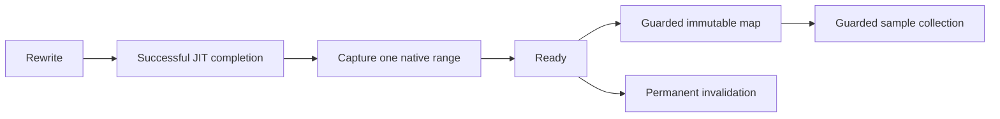

# Bound native mapping

Decision: capture one native method range in `JITCompilationFinished` before publishing the bound lifetime as Ready.
Use `GetCodeInfo2` under the existing disabled tiering, precompiled-image, and inlining policy.
Reject failed queries, multiple ranges, zero values, and overflow. Do not enable ReJIT.
Keep the legacy sampler separate. Bound stack sampling remains unsupported.

```cpp
COR_PRF_CODE_INFO code{};
ULONG32 count = 0;
auto result = runtime->GetCodeInfo2(function, 1, &count, &code);
```

The native record publishes its immutable range once.
Range queries compare every binding field and check lifetime before and after copying.
The managed map parses the range and uses the existing lifetime guard around capture and resolution.
An invalidated map rejects all resolutions, including addresses outside the former range.
These checks observe lifetime boundaries. They do not pin code or validate a sample collected before admission.
Sampling must start after capture. Completion must retain a final lifetime check.



Checks cover range boundaries, failed publication, foreign binding fields, repeated publication, and invalidation.
The native competing-publisher check detected guard removal in an isolated copy.
The [mutation record](../../reliability/mutations/bound-map-publication.md) retains the source fingerprints and exit-code evidence.
Live identity, duplicate-module, and collectible-unload cases check range admission and rejection on Windows and Linux.
Sampled payment capacity and prediction remain separate gates.

The [bound collection](../profiling/bound-samples.md) uses a fresh disabled source created after map capture.
Its initial drain must be empty. The source cannot be reused for a second epoch.
One collector checks owner identity, ordering, mapping, and lifetime for each provisional sample.
Completion disables the source, joins the collector, disposes the source, checks losses, and rechecks lifetime.
Failure retains cleanup diagnostics and rejects the epoch. It does not return accepted samples.
The source factory remains portable. Linux uses the existing task-clock backend with the bound map supplied explicitly.
This first epoch does not qualify measurement endpoints or generate payment credits.

See [bound payment](../profiling/bound-cooperative.md), [identity](../profiling/probe-identity.md), and [the lifecycle plan](experiment-lifecycle.md).
