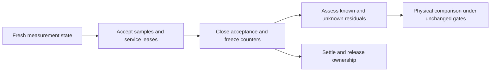

# Finite experiment lifecycle

Decision: retain application-time global accounting and frozen progress as estimator inputs.
Do not replace global delay with retrospective wait sums.
The primary-source comparison and arithmetic are in the [human explanation](../../docsSrc/Explanations/experiment-lifecycle.md).
This plan is not an implemented contract or an accuracy result.

## Existing entry boundary

`SampledTimerWorkload.Initialize` resets synthetic ledger state and counters.
The live controller is constructed after initialization and CPU warmup.
Workers wait for `work.Release` inside `measurement.Begin`.
There is no live sampled warmup generation to drain in this workload.
Do not add an unnecessary warmup drain or claim that it fixes the endpoint.

## Implementation sequence

1. Implemented: `DelayLedger.observe` returns a portable immutable observation for one registered thread.
   Preserve the distinction between runnable, delaying, and blocked states.
   It includes global and settled local values from the same immutable ledger.
   It rejects foreign and unregistered handles. Observation does not publish credit or change state.
2. Implemented: `SignalAccounting.captureThread` retains ledger and operation state at the frozen boundary.
   `MeasurementLedgerReading` preserves service identity and accepted unsettled wait separately.
   Checks distinguish prefix acceptance, release into local credit, and later global publication.
   A native release failure retains controller ownership without counting settled wait as unsettled again.
3. Define a parsed boundary assessment from those observations and native ownership.
   `SignalAccounting.completionRange` now bounds valid completion states of the existing finite service.
   Its conditional endpoints do not establish a bound on actual unreceived execution.
   Native closure and final-journal validation must qualify any use in an endpoint assessment.
   Distinguish known settled residuals from unknown native suffixes.
   Reject unsupported or unbounded states. Do not infer a bound from the requested child duration.
4. Integrate the assessment into the finite workload lifecycle.
   Close acceptance once, freeze before cleanup, and preserve failed capture.
   Preserve global correction, progress, capacity, debt, and handler gates.
5. Run one predeclared matched physical comparison after review.
   Retain all cases. Do not retry unchanged failures to obtain a pass.
   A failed gate rejects this prototype claim and directs the next intervention decision.

## Required evidence

Deterministic checks must distinguish accepted wait, released local credit, and published global credit.
They must cover partial payment, overshoot, concurrent credit, foreign handles, and failed transitions.
Frozen observations must survive subsequent release and catch-up without mutation.
Host and Linux checks establish portability of the model, not general CLR safety.
The physical comparison remains necessary for prediction accuracy.

```fsharp
let credited = DelayLedger.creditSample thread credit ledger
let published = credited |> Result.bind (DelayLedger.catchUp thread)
```



The first implementation is a ledger observation, not another offline membership analyzer.
No residual formula is accepted until its state transitions and unknown inputs are explicit.
The [live ledger capture](../../reliability/features/native-signal/ledger-boundaries.md) fails the existing handler gate and native closure in treatment.
The conditional model cannot qualify that run.
Address intervention capacity before using the model for prediction eligibility.
The next capacity candidate is opt-in cooperative delivery through existing entry/countdown probes.
Reuse `LeaseMailbox` generation ownership instead of adding a second request protocol.
The portable core now separates cooperative site identity from timer interrupted-IP admission.
The portable `CooperativeTarget` now binds the owner thread and supplies explicit code-revocation guards.
The cooperative C ABI now supplies production timing and native receipt records.
Next, add managed receipt parsing and ledger binding, then bind .NET probes and actual CLR code lifetime.
The [transport reference](../../docsSrc/Reference/cooperative-target.md) distinguishes implemented hooks from missing runtime integration.
Keep cooperative receipts distinct from the timer C ABI, which carries only interrupted addresses.
Each poll services at most one bounded child and returns to application work. Do not apply the existing 10 ms CPU cadence to pending service.
Keep all lease, child, receipt, debt, and prediction gates. Record instrumentation cost and retain failed runs.
The [human explanation](../../docsSrc/Explanations/experiment-lifecycle.md#cooperative-delivery-candidate) records the candidate and its limits.
Reuse the existing wait and scheduling evidence. Do not repeat unchanged timing cases to obtain a pass.
See [delay accounting](../profiling/delay-ledger.md), [timer accounting](../profiling/timer-accounting.md),
[measurement boundaries](../profiling/measurement-boundaries.md), and [the roadmap](roadmap.md).
