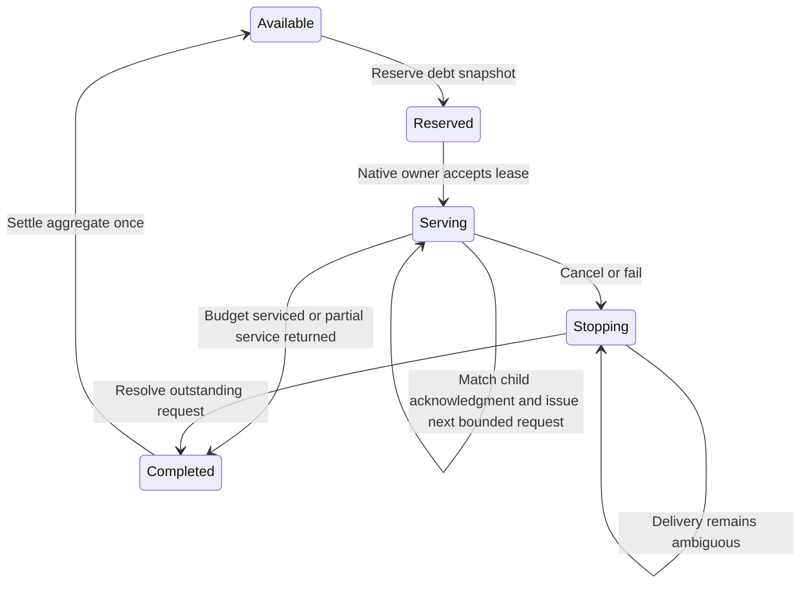

# Native debt service prototype

## Status and purpose

The [portable accounting model](../profiling/signal-service.md) implements reservation, submission binding, journal checks, cancellation receipts, and aggregate settlement.
The live workload still uses one managed controller for every bounded signal request.
The [portable native owner](../profiling/native-service-owner.md) passes fake-transport checks on Windows and Linux.
The [Linux transport](../profiling/linux-service-transport.md) passes controlled native delivery and lifetime checks.
Managed integration remains unimplemented.
The next experiment will test whether a native service owner reduces those controller round trips.
It will not change the public serial engine or claim general CLR signal safety.

The [combined trace](../../reliability/features/native-signal/scheduler-runtime.md) records both target and controller switched-out intervals.
Moving request service cannot eliminate target off-CPU time.
Runtime restart does not prove target execution and cannot clear unpaid debt.

## Alternatives

| Candidate | Effect | Decision |
| --- | --- | --- |
| Pay full debt inside one signal handler | Removes repeated delivery and managed round trips | Reject. It would relax the existing 50 microsecond request bound. |
| Subtract observed off-CPU time | Reduces reported debt without measured intervention | Reject. Scheduler records do not establish dependency credit. |
| Disable GC during the experiment | Removes one source of runtime suspension | Reject. It avoids the required forced-GC workload. |
| Native service owner with separate bounded requests | Removes managed observation between those requests | Prototype, subject to the ownership contract below. |
| Target-local sampled ledger | Moves credit and debt decisions closer to upstream Coz | Later option. It also changes sample ownership and ledger concurrency. |

Upstream [Coz delay processing](https://github.com/plasma-umass/coz/blob/256e3c389424d6a1691ee5d18b5ecb5a6c1001ec/libcoz/profiler.cpp#L678-L849) settles a debt snapshot locally.
CozNet's existing request cap remains mandatory. This prototype must preserve each bounded request instead of putting several waits in one handler.

## Ownership contract

The managed accounting owner reserves one finite debt snapshot for the unsampled peer as a service lease.
A lease is a distinct domain value. It is not a larger `SignalDelayRequest`.
It identifies the accounting generation, registration, and maximum debt to service.
Registration reuse cannot transfer an old lease to a new target.
Debt above the existing 2 ms gate remains a capacity failure. It does not authorize a larger lease.
Selected service retains one bounded request per qualified sample batch.
The native owner transports that selected request without extending its sampling exclusion across several waits.

The native service thread owns install, request, acknowledgment read, and restore operations.
The current native API requires the installing OS thread to perform those operations.
The managed controller must not call those operations concurrently with the native service owner.
Target registration and retirement remain target-thread operations.

Each lease permits at most one outstanding native request on its target.
Each native request asks for at most 50,000 ns and receives a distinct increasing native sequence.
The service thread must observe a matching acknowledgment before issuing another request.
It records every child's requested wait, measured wait, handler interval, instruction pointer, outcome, and native phase timestamps.
No request starts after service cancellation or lease termination becomes visible to the service owner.
Each child's 100 ms bound includes its first managed receipt. Native acknowledgment consumption alone is insufficient.
Retain child send times and use a conservative clock mapping for managed receipt. Do not restart the timeout at lease completion.

After each successful child, the remaining budget is the snapshot debt minus accumulated measured wait, bounded below by zero.
Measured overshoot remains in the result. It is not truncated to the requested wait or snapshot debt.
New global credit does not silently increase the lease budget.
The managed ledger retains debt that arrives during service.

The initial prototype stops a lease on a deferred or interrupted acknowledgment.
It returns any measured partial wait and permits the accounting owner to make the next decision.
This avoids adding an independent retry policy to the service change.
A native error or ambiguous delivery fails the isolated workload and retains ownership until delivery is resolved.



## Accounting boundary

The adapter must reserve debt before submitting a lease.
The adapter must settle that reservation exactly once with the sum of measured child waits.
Queue latency, controller observation delay, and handler metadata work are not measured waits.
The terminal result must match the lease generation and registration before settlement.
Duplicate and stale terminal results must fail without a ledger transition.

Peer service does not pause the selected sample stream.
The accounting owner can continue to process selected samples while peer service runs.
The existing selected request still changes its eligibility epoch and excludes the first observation after sampling resumes.

Let `L0` be the peer's local counter, `G0` the global snapshot, and `C` its confirmed cumulative measured wait.
While the lease continues, `C < G0 - L0`, so `L0 + C < G0 <= Gcurrent`.
No partial peer payment can require global-lead publication before the terminal child.
After that child, aggregate completion and ordinary catch-up preserve terminal overshoot and any new outstanding debt.
This is an accounting argument for a fixed child journal. It does not prove equivalent scheduling or experiment accuracy.

Debt diagnostics use committed waits plus the active lease's confirmed child prefix.
Accept a prefix only after validating its contiguous child identities, native sequences, bounds, outcomes, and exact cumulative sum.
A native cumulative counter without those records is insufficient.
At termination, one managed-owner transition commits the aggregate, completes the ledger, and removes the active prefix.
Do not publish an observation between those updates or count the prefix again after completion.
Keep the ledger reserved until that terminal transition. Do not add a separate partial-settlement ledger transition.

```fsharp
let settled =
    DelayLedger.completeDelay peer measuredTotal reservedLedger
    |> Result.defaultWith failwith
let nextAction, nextLedger =
    DelayLedger.catchUp peer settled
    |> Result.defaultWith failwith
```

`measuredTotal` is the full validated journal sum as `DelayTicks`. It is not another 50 microsecond request.

## Platform boundary

Keep the finite service budget and request state machine free of OS APIs and CLR callbacks.
Use an explicit transport interface for request submission, result observation, and target lifetime.
The first transport can reuse the controlled Linux x64 signal implementation.
An unsupported transport must fail explicitly before starting service.
Portable state-machine checks must not require Linux signals or a native timing workload.

## Required checks before a timing comparison

1. A debt larger than 50,000 ns produces separate requests. No request exceeds 50,000 ns.
2. Every child requires its exact native sequence before the next child starts.
3. Partial waits reduce the remaining budget. Overshoot remains in the terminal result.
4. Deferred and interrupted results stop the lease without discarding prior measured waits.
5. Cancellation before submission starts no child. Cancellation with a pending child retains ownership until its acknowledgment.
6. New selected credit remains unpaid debt after the original lease completes.
7. Duplicate, foreign, stale, and out-of-order results cannot settle debt twice.
8. Counter overflow fails without issuing another request or changing the last accepted state.
9. Both targets remain alive through outstanding service. Restore occurs only after retirement and join.
10. A bounded replay matches the existing ledger's local and global counters for the same child acknowledgments and credit ordering.

Retain the 5 ms measured handler, 100 ms acknowledgment, 2 ms observed debt, and 250 ms GC-call limits.
Keep the two-percentage-point physical-prediction gate.
Do not treat a passing protocol comparison as prediction accuracy.

## Next implementation boundary

Implement the C ABI and managed adapter next, including conservative first managed receipt timing.
Then connect the native owner to the sampled workload and retain every child acknowledgment in the workload record.
Only after replay and lifetime checks pass, compare managed and native service with the same workload and limits.
Retain all outcomes. Do not rerun unchanged timing cases to obtain a pass.

## Existing ledger evidence

Two `DelayLedgerTests.fs` cases exercise the fixed-journal arithmetic through the existing ledger:

- `Peer snapshot aggregate retains credit that arrives during child service` leaves 35,000 ticks unpaid after both settlement paths.
- `Peer snapshot terminal overshoot publishes once after aggregate settlement` preserves 200,000 ticks of global delay and 60,000 ticks of selected debt.

The fixed-journal checks and eight service-accounting cases pass in the deterministic library suite.
The first test launch failed because the inherited runtime root pointed to an incomplete installation.
The successful invocation scoped `DOTNET_ROOT` and `DOTNET_ROOT_X64` to the installed runtime for that child command.
These tests verify ledger arithmetic and parsed journal transitions. They do not verify native delivery or service capacity.

See [signal accounting](../profiling/signal-accounting.md), [sampled signals](../profiling/sampled-signals.md), and [the roadmap](roadmap.md).
