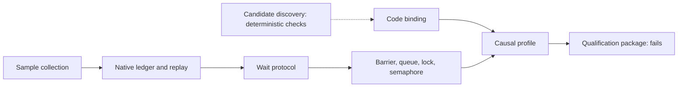

# Capability roadmap

The goal is a .NET implementation of sampled Coz semantics. CozNet has two engines:
- The public serial engine runs synchronous CPU regions one at a time. It is supported for that workload model only.
- The target-local profiler samples CPU with Linux `perf_event`, credits and pays delay in a native ledger, and runs causal profiles of two-thread programs. It is implemented and experimental. It is not qualified.

Implementation and qualification are separate. A capability is implemented when its code and deterministic checks exist. It is qualified only when a qualification package passes with `passed` and `treeClean` both true. No target-local package has passed.

The run chronology is in [the roadmap history](roadmap-history.md) and [the target-local status](target-local-status.md).

## Current state

Run counts are all retained runs in `artifacts/target-local-<suite>`, from 2026-10-18 to 2026-10-19, on many tree revisions. They describe history, not one tree. The package column is package `20261019T201321485-824b711b` on commit `6564ca2`, with `treeClean` false.

| Capability | Implemented scope | Verification evidence | Package result | Remaining blocker | Next action |
| --- | --- | --- | --- | --- | --- |
| Sample collection and dispatch | Linux x64 `perf_event` task-clock ring, one signal for each overflow, bounded dispatch. [Samples](target-local-samples.md), [dispatch](target-local-dispatch.md). | Native decoder, ring, and dispatch checks. A dispatch capture. | Used by every suite. Not qualified alone. | Linux x64 only. No callchain. | None now. |
| Native ledger and replay | Credit, immediate publication, measured spin payment, deferral, and the 2 ms, 50 µs, and 5 ms bounds. Managed replay. [Credit](target-local-credit.md). | `TargetDelayLedgerChecks`, replay checks. A replay mismatch invalidates an experiment. | Used by every suite. | Debt failures when the host deschedules a thread. | Keep the bounds. |
| Wait protocol | `post`, `waitBegin`, `waitEnd` with the release-token rule. [Blocking](target-local-blocking.md). | Native race and protocol checks, managed replay rules. | See the primitives below. | Intentional differences from upstream wake and publication timing. See [the latency model](target-local-latency-model.md). | None now. |
| Code binding and lifecycle | Method ranges from the perf map. Tiered code, ReadyToRun, moved ranges, and ReJIT are rejected. [Lifecycle](target-local-lifecycle.md), [ReJIT](target-local-rejit.md). | `transitions` suite: 31 of 42 runs pass. | `transitions` passes. | The caller must name each method. Method level only. | [Discovery](target-local-discovery.md) can rank candidates. |
| Fork/join prediction | `TargetLocalProfiler.run` and `runBound`. [Prediction](target-local-prediction.md). | `prediction` suite: 38 of 47 runs pass. | Fails: two blocks invalid from debt failures. | Capacity failures. | Open. |
| `TargetBarrier` | Lock-free barrier with release tokens. | `barrier` suite: 27 of 39 runs pass. | Fails: one block invalid from a debt failure. | Capacity failures. | Open. |
| Causal profile, end-to-end points | `TargetCausalProfile.run` with the `EndToEnd` progress point. [Causal profile](target-local-causal-profile.md). | `latency` suite (`artifacts/target-local-profile`): 13 of 19 runs pass. | Passes. | None in the package. | None now. |
| Causal profile, throughput points | `TargetProgressCounter.Visit`. [Throughput](target-local-throughput.md). | `throughput` suite: 16 of 19 runs pass. | Passes. | None in the package. | None now. |
| `TargetQueue` | Bounded blocking queue with release tokens and an optional spin. [Queue](target-local-queue.md). | `pipeline` suite: 9 of 18 runs pass. | Passes. | Earlier runs fail `peer` points by one block. | None now. |
| `TargetLock` | Lock with release tokens. [Lock](target-local-lock.md). | `lock` suite: 1 of 14 runs pass. | Fails: `selected-50` at -6.0 points in valid blocks. | Prediction error at the knee of the critical section. | Open. |
| `TargetLock` with a spin | 1 ms spin before a wait. [Spin lock](target-local-spin-lock.md). | `spinlock` suite: 0 of 12 runs pass. | Fails: a block with fewer than 100 visits. | Capacity failures. | Open. |
| `TargetSemaphore` | Semaphore with stored release tokens. [Semaphore](target-local-semaphore.md). | `semaphore` suite: 5 of 11 runs pass. | Passes. | Earlier runs fail one to five points. | None now. |
| Transaction latency | `Begin` and `End` with settlement before each stamp. [Transactions](target-local-transactions.md), [settlement](target-local-progress-settlement.md). | `transaction` suite: 0 of 13 runs pass. Diagnostics: two paired runs, a probe capture, and a boundary capture. | Fails: `selected-75` at -10.8 points in valid blocks. | Prediction error at 75%. Its cause is open, and the investigation is closed at its scope. | No more timing runs now. |
| Spin transaction latency | `Begin` and `End` with a consumer spin. [Spin queue](target-local-spin-queue.md). | `spintransaction` suite: 0 of 6 runs pass. | Fails: `peer-50` and `peer-75` at -5.5 and -5.7 points. | Prediction errors in valid blocks. | Open. |
| Qualification package | `native/QualifyTargetLocal.ps1` runs 11 suites on one tree. [Package](target-local-qualification-package.md). | One package. | Fails: 6 of 11 suites, and `treeClean` false. | Three capacity failures and three prediction errors. | A clean package after the open failures. |
| Candidate discovery and source anchors | Method ranking from samples, perf-map index, symbol format for a verified subset, and PDB source anchors. [Discovery](target-local-discovery.md). | 27 deterministic checks. [One live check](target-local-discovery-check.md) `20261020T015420785-8c8adf21` passed: both fixture methods ranked, anchored, and bound. | Not in the package. | Method level only, no callchain, and a bounded symbol subset. The live check reached only the in-scope class, in a two-method workload. | None now. |
| Other backends | Absent for target-local. Some portable native headers also build under MSVC. | Header checks only. | Not applicable. | Absent. | Not planned now. |

Two kinds of failure stay separate. A capacity failure is an invalid block, for example from a debt failure, too few visits, or a handler interval of at least 5 ms. A prediction error is a failed point in valid blocks.
The user decided on 2026-10-19 to keep the 2 ms debt bound, measured wall-time payment, the release-token rule, and all criteria. Failed runs stay failed. WSL2 stays unqualified where its evidence fails, and a bare-metal qualification is deferred.

## Model and diagnostic limits

- [The latency model](target-local-latency-model.md) is a deterministic model, not a CozNet execution. Payment overshoot is outside it. With `release` publication, a stamp at one instant reads G after all actions of that instant, so a single window is not a trace of source event order.
- The overshoot bound of 189 µs from an earlier audit is withdrawn. The retained records cannot bound overshoot. The claim that the settlement place keeps the total payment is withdrawn too.
- `release` publication removes the payment in the checked phase cases. In the 96 coarse phases without payment under `immediate`, both policies give the same gain. In the other coarse phases and in all fine phases, `release` is further from the real gain. It is not the upstream implementation and not a proposed fix.
- [The boundary export](target-local-boundary-export.md) gives upstream-like ordered reads, not a common-instant snapshot. Its one capture has a stop occupancy of 1 or 2, so a few samples cannot establish a stationary latency estimate.

## Next milestone

Method-level candidate discovery is implemented with deterministic checks. See [target-local discovery](target-local-discovery.md). The next milestone is not chosen.

## Original plan steps

1. Specify global and per-thread delay accounting, blocked intervals, wake outcomes, and thread lifecycle. Done for target-local in [credit](target-local-credit.md), [blocking](target-local-blocking.md), and [lifecycle](target-local-lifecycle.md).
2. Build a narrow CLR startup profiler spike with selective IL rewriting and original source maps. A research spike exists. The target-local profiler does not use IL rewriting.
3. Test long-loop probe coverage, disabled-probe overhead, zero-speedup overhead, and JIT effects. Open for IL probes. Target-local measures zero-speedup overhead in its suites.
4. Combine CPU sampling with cooperative delay checks. Done for target-local on Linux x64: payment runs in the signal handler and at explicit calls.
5. Compare sampled predictions with real CPU optimizations. Preserve raw observations and failed predictions. Done for the 11 suites, and not qualified.
6. Support named synchronization primitives only after dependency-wake and timeout accounting pass. `TargetBarrier`, `TargetQueue`, `TargetLock`, and `TargetSemaphore` exist. Their suites are in the table.
7. Add ReJIT and verify active-frame, inlining, source-map, and compilation-settling constraints. Open. Target-local rejects ReJIT of a bound method.
8. Separate request lifetime from CPU execution before async support. Open.

The serial sample runs with:

```powershell
dotnet run --project samples/CozNet.Serial -c Release -- artifacts/serial
```

Its acceptance target is two percentage points of prediction error. [The current physical run](../../reliability/features/serial/README.md) exceeds this target for the 50% case.



See [current engine](../profiling/summary.md), [research](../../docsSrc/Research/causal-profiling-dotnet.md), and [the port decision](../../docsSrc/Research/coz-port-and-il-rewriting.md).
