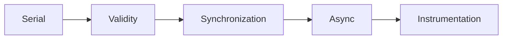

# Capability roadmap

The current scope is a serial experiment prototype. Validate it before expanding runtime coverage.

1. Prove null interventions, exact delay accounting, and session failure behavior.
2. Compare predictions with real CPU optimizations and preserve raw observations.
3. Measure instrumentation overhead and sensitivity to coverage, JIT state, GC, and CPU contention.
4. Design synchronization-aware delay credits before parallel support.
5. Separate request lifetime from CPU execution before async support.
6. Consider CLR instrumentation only after explicit regions pass the same proof cases.

```powershell
dotnet run --project samples/CozNet.Serial -c Release -- artifacts/serial
```

The sample's initial acceptance target is two percentage points of prediction error.
One machine cannot establish general accuracy. Retain failures and compare independent runs.
The [current physical run](../../reliability/features/serial/README.md) exceeds this target for the 50% case.
Resolve prediction stability before expanding the supported workload model.



See [current engine](../profiling/summary.md) and [research](../../docsSrc/Research/causal-profiling-dotnet.md).
