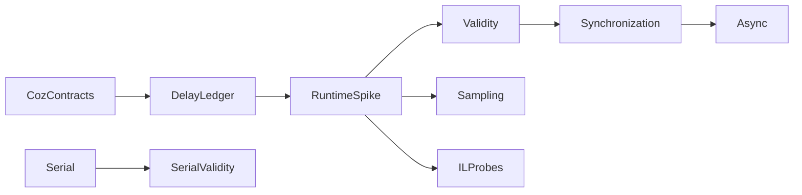

# Capability roadmap

The implemented scope is a serial experiment prototype. The goal is a .NET implementation of sampled Coz semantics.
Keep the serial model separate from the proposed sampled engine.

1. Specify global and per-thread delay accounting, blocked intervals, wake outcomes, and thread lifecycle.
2. Build a narrow CLR startup profiler spike with selective IL rewriting and original source maps.
3. Test long-loop probe coverage, disabled-probe overhead, zero-speedup overhead, and JIT effects.
4. Combine CPU sampling with cooperative delay checks. Keep platform sampling constraints explicit.
5. Compare sampled predictions with real CPU optimizations. Preserve raw observations and failed predictions.
6. Support named synchronization primitives only after dependency-wake and timeout accounting pass.
7. Add ReJIT and verify active-frame, inlining, source-map, and compilation-settling constraints.
8. Separate request lifetime from CPU execution before async support.

IL rewriting supplies intervention points. It does not supply CPU sampling or synchronization semantics.
The hybrid design remains provisional until measured coverage and overhead support it.
See [the port decision](../../docsSrc/Research/coz-port-and-il-rewriting.md) and [the implementation comparison](../../docsSrc/Research/managed-coz-implementations.md).

```powershell
dotnet run --project samples/CozNet.Serial -c Release -- artifacts/serial
```

The sample's initial acceptance target is two percentage points of prediction error.
One machine cannot establish general accuracy. Retain failures and compare independent runs.
The [current physical run](../../reliability/features/serial/README.md) exceeds this target for the 50% case.
Investigate prediction stability separately. Runtime experiments do not expand the library's supported workload model.



See [current engine](../profiling/summary.md) and [research](../../docsSrc/Research/causal-profiling-dotnet.md).
