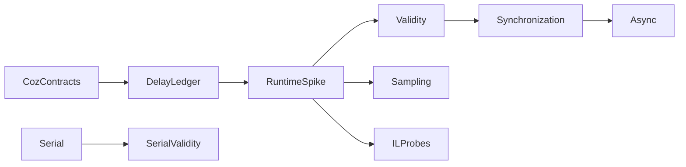

# Capability roadmap

The implemented scope is a serial experiment prototype. The goal is a .NET implementation of sampled Coz semantics.
Keep the serial model separate from the proposed sampled engine.


The [matched ownership comparison](../../reliability/features/native-signal/owner-controller-comparison.md) supports retaining owner/controller mode as an opt-in candidate.
Its shorter selected intervals do not qualify an overall speedup. Zero-speedup elapsed times vary substantially.
Measurement preparation now separates first-call capture work from the actual start. Its cost is observed, not bounded.
The prepared four-arm comparison still differs by about 42.6 percentage points between descriptive prediction and physical change.
The earlier arithmetic calibration uses unchanged method source but does not qualify the current instrumented program.
Next, investigate profiler overhead and sampled attribution. Repeating boundary preparation cannot resolve that mismatch.
The [idle-service comparison](../../reliability/features/native-signal/idle-service-cadence.md#four-arm-comparison-with-idle-reuse) completes four arms but retains a sampled slowdown of approximately 5.2% versus a physical reduction of approximately 49.8%.
Repeated idle service is removed from most checks. Owner draining and publication still precede the guard.
The [owner-drain diagnostic](../../reliability/features/native-signal/owner-drain-cost.md) measures a median paired 38.414 ms across 500,000 calls without application work or a peer.
It does not isolate the full-workload cost. The [8192 interval](../../reliability/features/native-signal/sparse-probe-interval.md) passes controlled Linux countdown and bound payment checks.
The [8192 four-arm comparison](../../reliability/features/native-signal/sparse-probe-comparison.md) now binds its plan to runtime interval evidence and preserves default 1024.
It completes but remains unqualified, with a 13.90%–14.43% sampled slowdown against a 46.56%–46.58% physical reduction.
Next, investigate first-use receipt work and recurring callback costs. The first peer request bracket is 27.378076 ms, without proof of its cause.
Keep all payment bounds and frozen ownership limits unchanged.
Source membership and instrumentation attribution require separate contracts before prediction qualification.
Do not repeat the unchanged controller comparison as a substitute for those contracts.

1. Specify global and per-thread delay accounting, blocked intervals, wake outcomes, and thread lifecycle.
2. Build a narrow CLR startup profiler spike with selective IL rewriting and original source maps.
3. Test long-loop probe coverage, disabled-probe overhead, zero-speedup overhead, and JIT effects.
4. Combine CPU sampling with cooperative delay checks. Keep platform sampling constraints explicit.
5. Compare sampled predictions with real CPU optimizations. Preserve raw observations and failed predictions.
6. Support named synchronization primitives only after dependency-wake and timeout accounting pass.
7. Add ReJIT and verify active-frame, inlining, source-map, and compilation-settling constraints.
8. Separate request lifetime from CPU execution before async support.

IL rewriting supplies intervention points. It does not supply CPU sampling or synchronization semantics.
The controlled Linux countdown comparison passes its accounting checks and substantially reduces dense-probe cost.
Native-range attribution remains unresolved for inline countdown instructions.
Raw rewritten-IL diagnostics separate the inspected loop ranges with empty-stack gate placement on both controlled methods.
Candidate exclusion and whole-method attribution both fail the physical-prediction gate in the controlled countdown loop.
The stage comparison identifies injected probes as the largest measured cost in the controlled loop.
Investigate a lower-cost intervention mechanism before changing sampled accounting.
A native signal experiment must measure GC effects and bound handler work before any claim of CLR safety.
The [bounded signal workload](../profiling/signal-intervention.md) passes the initial arithmetic and forced-GC checks.
The [transition workload](../profiling/signal-transitions.md) passes JIT, blocked-wait, managed/native-call, and pending-shutdown checks.
Keep abnormal target exit as an explicit process-lifetime limit.
The [signal accounting model](../profiling/signal-accounting.md) supplies bounded requests, matched acknowledgments, and required sampling epochs.
The [live sampled signal controller](../profiling/sampled-signals.md) connects CPU events to bounded requests.
Its first run generates causal credit and completes protocol checks, but fails the observed unpaid-debt limit.
Investigate overshoot settlement and sampling exclusions before adding physical-prediction checks.
Sample-driven selected checks recover credit in the cold experiment but retain its startup debt failure.
The first 250 ms warmup experiment fails the handler-duration bound. Keep this failure and investigate wait overshoot.
The three-block warm comparison passes all protocol checks but fails capacity in two of three 50-percent cases.
Measure wait overshoot, service gaps, and debt age before selecting another intervention actuator.
The [service timing run](../../reliability/features/native-signal/service-timing.md) exposes both wait overshoot and long pending requests that perform no wait.
The [native phase run](../../reliability/features/native-signal/phase-timing.md) places most of one long acknowledgment before the first handler clock reading.
Two of that run's three 50-percent cases pass capacity. A separate delay case still exceeds the 5 ms handler limit.
Investigate target scheduling and CLR suspension before choosing between delivery and actuator changes.
The [GC counter comparison](../../reliability/features/native-signal/gc-and-ring-cache.md) shows substantial controller allocation even after empty ring drains reuse snapshots.
Inspect repeated accounting work during idle polling. Keep GC causation and sampled capacity unresolved.
The [peer-cadence run](../../reliability/features/native-signal/peer-cadence.md) skips unchanged-state preparation and lowers allocation in completed cases.
It still fails one warmup handler bound and both completed 50-percent debt checks.
The [direct accounting read](../../reliability/features/native-signal/accounting-read.md) removes the full controller's per-iteration duration wrapper allocation.
Two treatment cases still exceed the handler limit during native waits.
The [wait comparison](../../reliability/features/native-signal/wait-comparison.md) passes three sampled spin treatments at higher process CPU cost.
The [spin reliability run](../../reliability/features/native-signal/spin-reliability.md) passes all transition and sampled protocol checks but retains two forced-GC debt failures.
The [combined trace](../../reliability/features/native-signal/scheduler-runtime.md) correlates runtime suspension and scheduler records while retaining a forced-GC capacity failure.
The next [native service prototype](native-debt-service.md) will test finite peer leases with separate bounded native requests.
Keep physical-change prediction as a separate unmet gate.
Keep acknowledgment polling continuous and distinguish signal delivery time from native wait time.
The original signal and transition experiments generate no causal credits.
See [component overhead](../../reliability/features/linux-perf/component-overhead.md) and [signal research](../../docsSrc/Research/native-signal-intervention.md).
See [attribution sensitivity](../../reliability/features/linux-perf/attribution-sensitivity.md).
Keep mixed boundaries and debugger limitations explicit. See [the attribution investigation](../../docsSrc/Research/injected-cpu-attribution.md).
The hybrid design remains provisional until measured coverage and overhead support it.
See [the port decision](../../docsSrc/Research/coz-port-and-il-rewriting.md) and [the implementation comparison](../../docsSrc/Research/managed-coz-implementations.md).

```powershell
dotnet run --project samples/CozNet.Serial -c Release -- artifacts/serial
```

The sample's initial acceptance target is two percentage points of prediction error.
One machine cannot establish general accuracy. Retain failures and compare independent runs.
The [current physical run](../../reliability/features/serial/README.md) exceeds this target for the 50% case.
Investigate prediction stability separately. Runtime experiments do not expand the library's supported workload model.



See [current engine](../profiling/summary.md) and [research](../../docsSrc/Research/causal-profiling-dotnet.md).
