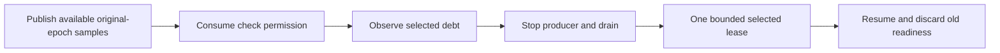

# Bound selected cadence comparison

The next diagnostic compares continuous and sample-qualified checks with fixed selected work.
Both modes publish available samples before the selected debt check.
The legacy duration-based commands retain their existing behavior.

`BoundSelectedCadencePlan` parses the speedup, cadence, and positive batch count before workload effects.
`BoundSelectedCheckCadence` admits one check after two current-epoch observations under the interval policy.
The nominal-event policy permits a check after one current-epoch event.
Qualification does not depend on numeric credit or selected-method mapping.
A check consumes readiness. A resumed source advances the epoch and discards final-drain readiness.
Samples from another epoch reject the run before they can authorize a check.

```csharp
var plan = BoundSelectedCadencePlan.Parse("50", "qualified-sample", "5000");
```



The comparison must preserve peer service, debt observations, receipts, source ownership, and all timing bounds.
It must record admission sample counts and epochs for independent replay.
Fixed selected work does not fix peer progress or establish prediction accuracy.
The experiment tests cadence and coverage. It does not isolate each observer cost.
The runtime integrates both modes through explicit cadence commands.
Schema 4 adds fixed-work settings, selected work timestamps, check counts, and each pause's admission prefix.
Replay checks the work count and checksum for completed runs.
It requires two original-epoch samples for interval credit, or one for [nominal-event credit](../profiling/nominal-event-credit.md), after the preceding final drain.
It does not replay checks that caused no pause or isolate individual observer costs.
The live comparison retains evidence in [the reliability record](../../reliability/features/native-signal/bound-selected-cadence.md).
The first run, `20261015T170543323-4b616aca`, retains continuous failures at the worker's five-second dispatch timeout.
The revised comparison queues the peer loop with `Worker.Start` and observes its returned task during selected work.
It retains separate five-second shutdown and join bounds and the external process watchdog.
Legacy commands retain their existing synchronous dispatch path.
The revised run `20261015T170928801-14ea2b74` passes both qualified treatments and one continuous treatment.
The remaining continuous treatment rejects an 8,910,149 ns child handler interval against the unchanged 5 ms bound.
All twelve records pass evidence replay, which preserves the runtime failure.
The comparison remains failed. It does not establish prediction accuracy or stable capacity.
`Read-BoundSampledOutcome` admits success only after parsing a Boolean result and matching the requested schema, cadence, and batch count.
Missing or malformed records, setting mismatches, and nonzero process exits cannot produce passing outcomes.
The runner snapshots this helper and its portable PowerShell checks before executing cases.

See [selected ownership](../profiling/selected-owner-payment.md) and [the index](../lode-map.md).
