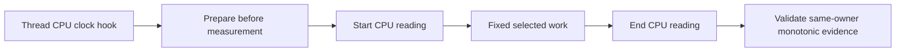

# Selected CPU measurement

The optional diagnostic records selected-thread CPU around fixed selected work in all four comparison arms.
It uses the existing `IThreadCpuClock` platform hook and managed timestamp brackets.
The Linux command supplies `LinuxThreadCpuClock`. Shared capture and replay remain portable.

`COZNET_SELECTED_CPU=1` requests capture. Absence or `0` disables it.
The capture prepares its clock before measurement, then records one start and one end reading inside the selected-work timestamps.
It rejects foreign managed threads, repeated transitions, negative readings, regressions, and missing platform hooks.
Clock errors retain failed capture state and invalidate the workload.

CPU deltas describe the whole selected loop, including profiling and selected payment CPU.
They do not isolate original application CPU or correct the causal estimator.
Wall brackets bound observation placement. Absolute CPU and wall timestamps are never subtracted from each other.
Legacy captures retain their existing replay result. Versioned plans bind activation to every arm.

`SelectedCpuCapture` prepares its clock before measurement and retains terminal capture failure.
`SelectedCpuEvidence.py` checks status, activation, version, endpoint ordering, and placement inside selected-work timestamps.
`VerifyCooperativeComparison.ps1 -SelectedCpu` binds all four arms, including the physical arms.
The comparison reports CPU advance and elapsed bounds separately from effective cost.
Managed capture checks, 38 comparison checks, 109 selected replay checks, and the controlled runner checks pass.
Versioned plans require the new replay helper in the hashed source manifest. Legacy plans remain unchanged.
Both adversarial reviewers clear the implementation with diagnostic overhead and failure-reporting limits recorded.

The [first Linux capture](../../reliability/features/native-signal/selected-cpu.md) completes all four arms with valid CPU evidence.
Sampled zero consumes 221.896700 ms CPU and sampled half consumes 276.967300 ms.
Their CPU and elapsed observation intervals differ by less than 0.025 ms each.
The descriptive causal result still underpredicts by about 30 percentage points.
Investigate recurring probe, drain, and service CPU before attributing this capture's difference to descheduling.
The observation does not isolate component cost or prove that one optimization resolves the gap.

```csharp
selectedCpu?.Start();
RunFixedSelectedWork();
selectedCpu?.Finish();
```



See [nominal evidence](../../reliability/features/native-signal/nominal-event-credit.md), [observer overhead](../profiling/observer-overhead.md), and [the index](../lode-map.md).
