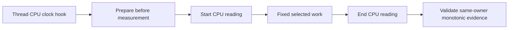

# Selected CPU measurement

The optional diagnostic records selected-thread CPU around fixed selected work in all four comparison arms.
It uses the existing `IThreadCpuClock` platform hook and managed timestamp brackets.
The Linux command supplies `LinuxThreadCpuClock`. Shared capture and replay remain portable.

`COZNET_SELECTED_CPU=1` requests capture. Absence or `0` disables it.
The capture prepares its clock before measurement, then records one start and one end reading inside the selected-work timestamps.
It rejects foreign managed threads, repeated transitions, negative readings, regressions, and missing platform hooks.
Clock errors retain failed capture state and invalidate the workload.

CPU deltas describe the whole selected loop, including profiling and selected payment CPU.
They do not isolate original application CPU or correct the causal estimator.
Wall brackets bound observation placement. Absolute CPU and wall timestamps are never subtracted from each other.
Legacy captures retain their existing replay result. Versioned plans bind activation to every arm.

`SelectedCpuCapture` prepares its clock before measurement and retains terminal capture failure.
`SelectedCpuEvidence.py` checks status, activation, version, endpoint ordering, and placement inside selected-work timestamps.
`VerifyCooperativeComparison.ps1 -SelectedCpu` binds all four arms, including the physical arms.
The comparison reports CPU advance and elapsed bounds separately from effective cost.
Managed capture checks, 38 comparison checks, 109 selected replay checks, and the controlled runner checks pass.
Versioned plans require the new replay helper in the hashed source manifest. Legacy plans remain unchanged.
Both adversarial reviewers clear the implementation with diagnostic overhead and failure-reporting limits recorded.

The [first Linux capture](../../reliability/features/native-signal/selected-cpu.md) completes all four arms with valid CPU evidence.
Sampled zero consumes 221.896700 ms CPU and sampled half consumes 276.967300 ms.
Their CPU and elapsed observation intervals differ by less than 0.025 ms each.
The descriptive causal result still underpredicts by about 30 percentage points.
Investigate recurring probe, drain, and service CPU before attributing this capture's difference to descheduling.
The observation does not isolate component cost or prove that one optimization resolves the gap.

The [density comparison](../../reliability/features/native-signal/selected-cpu-density.md) retains one 1024 capture followed by one 8192 capture.
Both use identical original input hashes and complete all arms without invalid records.
Sparse zero consumes 144.693300 ms less CPU. Sparse treatment consumes 158.148500 ms less CPU.
Treatment pauses change from 189 to 32. This also changes observation and payment scheduling.
Sparse prediction remains short by 14.5469–15.1196 percentage points.
Fixed run order and changed physical CPU costs prevent an isolated or repeatable improvement claim.
The next component experiment should distinguish pending-service CPU from source-drain CPU at a fixed probe interval.
Do not skip owner draining solely because managed accounting state is unchanged. New native samples can arrive independently.

`CooperativeComponentCpu` is an opt-in component observer under `COZNET_COMPONENT_CPU=1`.
It requires finite measurement and the existing `IThreadCpuClock` hook.
It brackets owner drains and service calls, including skipped service and failed calls.
Buckets retain CPU totals and maxima for all calls and the active measurement subset.
Regions cannot overlap. Invalid transitions or clock regression retain terminal diagnostic failure.
The diagnostic adds two CPU clock reads per call and can change sampling, scheduling, and capacity.
It does not adjust credit or payment.
Portable helper and replay checks pass on the host. Linux preflight repeats the helper checks.
The first component capture has changed source inputs and cannot qualify the final tree.
The runner binds component activation to every case and retains invalid captures.
The [final component capture](../../reliability/features/native-signal/component-cpu.md) passes all three expected outcomes with unchanged inputs.
Treatment measurement records 36.869900 ms drain CPU, 12.941700 ms pending CPU, and 11.163500 ms receipt CPU.
The largest receipt bracket records 5.364200 ms CPU. The cause remains unresolved.
Both completed cases make 100,000 drains for 50,000 selected batches.
Clock overhead prevents treating these totals as unobserved component costs.
Inspect pending and receipt work before choosing a cadence change. Preserve all native polls and debt gates until a controlled change establishes its contract.
Completed records must have zero failed component calls. Incomplete records can retain body failures without a diagnostic failure.
The outcome reader appends its component option to preserve legacy positional arguments.
Activity mapping checks use distinct durations and explicit expected buckets.

Accepted diagnostic risks: clock reads perturb execution, and capture failure stops the workload.
CPU completion failure can replace the original exception and prevent the service-timing record when both observers are enabled.
Combined replay rejects that incomplete evidence. This is accepted because failed diagnostics never qualify an experiment.
Helper checks do not inject failures through the actual workload wrappers.
Live captures cover successful wrapper integration. Failure classification still requires source review before wrapper changes.
This coverage limit is accepted for the opt-in diagnostic. It does not weaken any payment or validity gate.

```csharp
selectedCpu?.Start();
RunFixedSelectedWork();
selectedCpu?.Finish();
```



See [nominal evidence](../../reliability/features/native-signal/nominal-event-credit.md), [observer overhead](../profiling/observer-overhead.md), and [the index](../lode-map.md).
