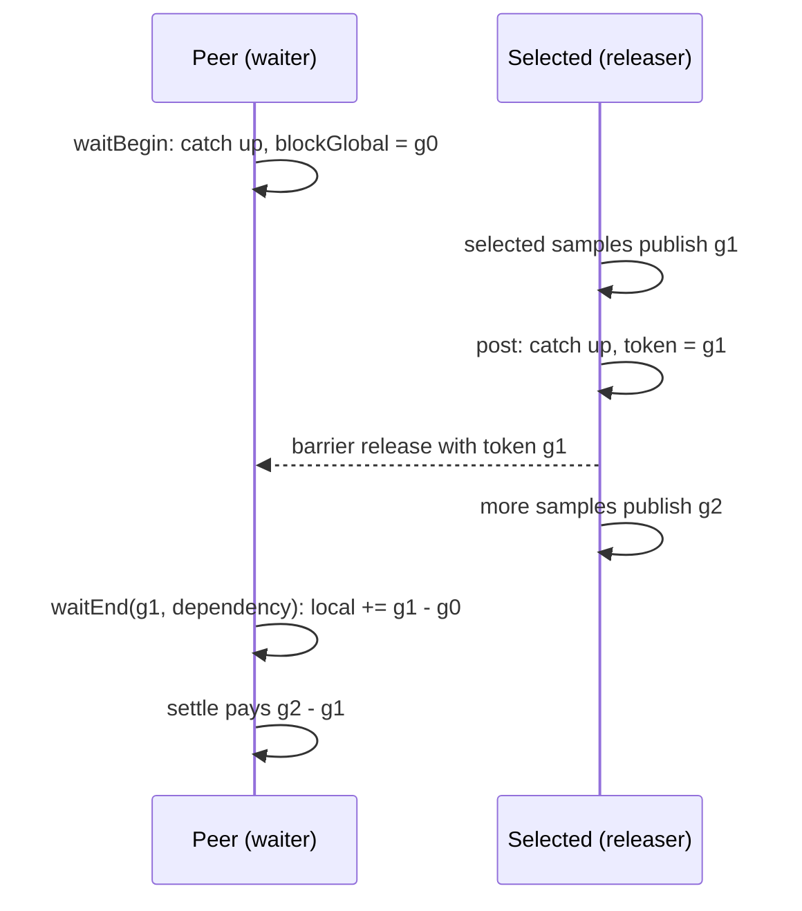

# Target-local blocking and wake accounting

Status: implemented. See [the status](target-local-status.md).

## Decision

The native ledger gets an explicit wait and release protocol. CozNet does not intercept .NET primitives.
The managed `TargetBarrier` is the first primitive that uses it. Other waits are unsupported.
Rationale: a woken thread must not owe delay that its waker inserted while it waited. Without this rule a barrier workload accrues false debt.

## Sources

Pinned Coz wraps each release in `catch_up()` before the real call, for example `pthread_mutex_unlock` and `pthread_cond_signal`
([libcoz.cpp](https://github.com/plasma-umass/coz/blob/256e3c389424d6a1691ee5d18b5ecb5a6c1001ec/libcoz/libcoz.cpp#L566-L576)).
Each wait calls `pre_block()`, the real wait, and `post_block(result == 0)`. A timeout therefore skips nothing.
`pre_block` records global delay. `post_block(true)` adds `global_now - pre_block_time` to local delay
([profiler.h](https://github.com/plasma-umass/coz/blob/256e3c389424d6a1691ee5d18b5ecb5a6c1001ec/libcoz/profiler.h#L187-L222)).
`add_delays` does nothing while `is_blocked` is set
([profiler.cpp](https://github.com/plasma-umass/coz/blob/256e3c389424d6a1691ee5d18b5ecb5a6c1001ec/libcoz/profiler.cpp#L678-L734)).
`DelayLedger.endBlock` uses the same rule: dependency adds `global - globalAtBlock`, and timeout or spurious adds 0.

## Rule

CozNet differs from Coz in one point. Coz skips to the global delay at wake time.
Credit that another thread publishes after the release, but before the woken thread runs, is then skipped without payment.
CozNet skips only to a release token, which is the global delay that the releaser has caught up to.

| Call | Thread | Effect |
| --- | --- | --- |
| `post` | Releaser | Mask the notification signal. Drain the ring and catch up. Return token = local delay. Append `post`. Unmask. Credit that another thread publishes after the catch-up can leave the token below global delay. |
| `waitBegin` | Waiter | Mask the signal. Drain and settle until caught up. Record `blockGlobal`. Append `block`. Stay masked. |
| `waitEnd(token, dependency)` | Waiter | Natively require `token <= global` and `token <=` the largest posted token. Add `max(0, token - blockGlobal)` to local delay. Append `wake`. Unmask. The replay requires an exact matching `post`. |
| `waitEnd(_, timeout or cancelled or spurious)` | Waiter | Add 0. Append `wake`. Unmask. Pending debt is then paid normally. |

## Invariants

1. A thread cannot block twice, or wake without a block. Each violation is the sticky `protocol` failure.
2. While blocked, settlement does nothing. No `publish`, `child`, or `deferred` event belongs to a blocked thread.
3. A dependency skip never exceeds `token - blockGlobal`. Credit published after the post is paid, not skipped.
4. A token is a value of global delay at its post. A token above current global delay is a protocol failure.
5. Debt that a thread owed when it blocked stays owed. The skip covers only delay inserted after the block.
6. A timeout, a cancellation, or a spurious wake skips nothing.
7. Every explicit call is a payment point at the worker's eligible payment address. Each settlement keeps the 50 µs child and 2 ms request limits.
8. `finish` fails while a thread is blocked.

## Replay

The managed replay adds three event kinds: `block`, `wake`, and `post`. It enforces invariants 1 to 6.
A dependency `wake` must name the amount of an earlier `post` event as its token.

## Qualification

The criteria are in [the prediction plan](target-local-prediction.md#barrier-qualification).

Revision: the status line and the `post` and `waitEnd` rows changed to match the implementation, before the barrier run that follows.
A worker that is preempted between its arrival and its block skips nothing for the delay inserted in that window. This biases the prediction low and forgives nothing.

See [target-local credit](target-local-credit.md) and [the delay ledger](../profiling/delay-ledger.md).
