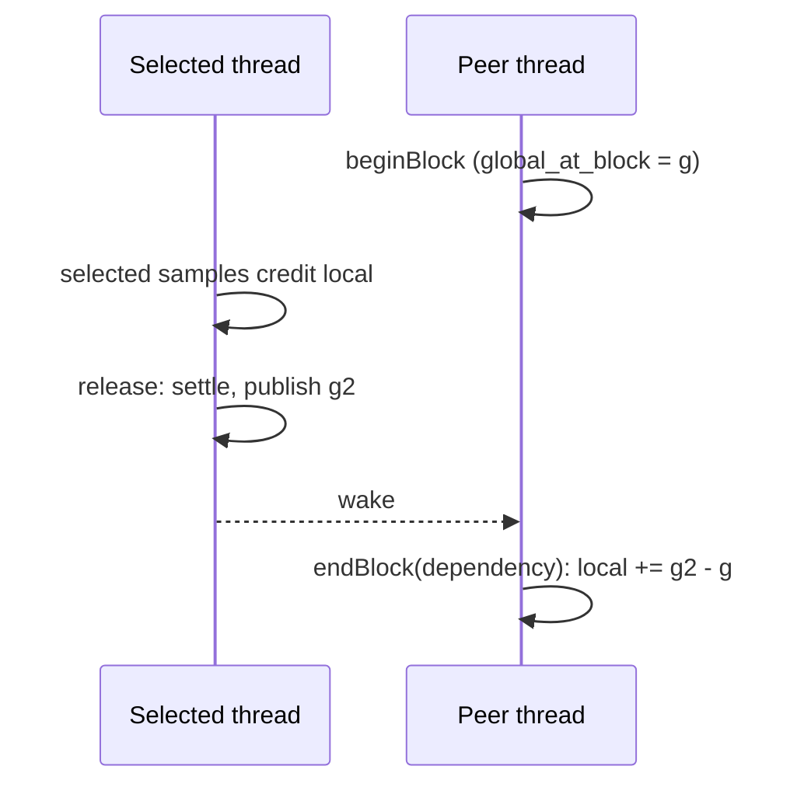

# Target-local blocking and wake accounting

Status: planned. No blocking or wake API exists yet.

## Decision

The native ledger gets the same blocking rule as `DelayLedger` and native Coz.
CozNet will support synchronization only through explicit CozNet wait and release calls. It does not intercept .NET primitives.
Rationale: a woken thread must not owe delay that the selected thread published while the woken thread waited for it.
Without this rule a barrier workload accrues false debt and fails the 2 ms gate.

## Rule

The pinned Coz barrier wrapper calls `catch_up()`, `pre_block()`, the real wait, and `post_block(true)`
([libcoz.cpp](https://github.com/plasma-umass/coz/blob/256e3c389424d6a1691ee5d18b5ecb5a6c1001ec/libcoz/libcoz.cpp#L566-L576)).
`post_block(true)` adds `global - pre_block_time` to local delay
([profiler.h](https://github.com/plasma-umass/coz/blob/256e3c389424d6a1691ee5d18b5ecb5a6c1001ec/libcoz/profiler.h#L187-L222)).

- `catchUp()`: with the notification signal blocked, the thread drains its ring in one bounded dispatch and settles.
  An explicit CozNet call is a payment point, independent of the instruction spans.
- `beginBlock()`: the thread records `global_at_block`. It runs no settlement until `endBlock`.
- `endBlock(reason)`: for `dependency`, local delay increases by `global - global_at_block`. For `timeout_or_spurious`, it does not change.
- `block` and `wake` events each take one sequence. A `wake` event keeps the skipped amount.

## Supported workload model

CPU-bound threads that wait only through CozNet calls. Each phase ends at a CozNet barrier, and the managed code counts progress after the barrier.
Prediction compares effective time per progress, `(elapsed - global delay) / progress`, at speedup s with the zero-speedup arm.
Actual optimization runs the same program with the selected work reduced by s.
Unsupported: .NET locks, tasks, async, blocking I/O, thread pool work, and any wait that bypasses CozNet calls.

See [target-local credit](target-local-credit.md) and [the delay ledger](../profiling/delay-ledger.md).
