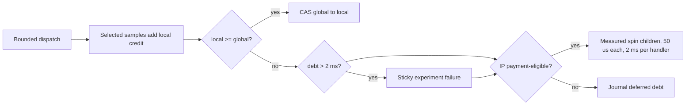

# Target-local credit and payment

## Decision

The native target-local ledger is the only live accounting owner during a native experiment.
Each sampled thread credits, publishes, and pays inside its own dispatch handler.
No managed controller runs for each sample or each payment.
Managed code receives the closed experiment journals once and replays them in `src/CozNet/TargetLocalReplay.fs`.
The native credit workload also keeps its own native replay.
A replay mismatch invalidates the experiment. Managed code never edits native credit.

Rationale: the nominal timer diagnostics show controller preemption before delayed credit publication.
Moving only decoding would keep that dependency. Two live owners would need a second reconciliation protocol during the run.

## Ledger rule

The credit and debt rule matches `DelayLedger` and native Coz. Payment differs: native Coz stops its sampler and sleeps. CozNet spins with sampling active. All values are nanoseconds.

- A selected sample adds `period * speedup / 100` to the thread's local delay. This is the nominal-event rule.
- After each dispatch, the thread catches up once. If local is not less than global, it publishes `global = max(global, local)`.
- If local is less than global, the debt is `global - local`. The thread pays the debt with measured spin children.
- Each child requests at most 50,000 ns. Local delay increases by the measured wait, including overshoot.
- One handler pays at most 2,000,000 ns of requested children. Unpaid debt stays for the next dispatch.
- A child starts only while the handler elapsed time stays below the 5 ms handler bound with margin for the child.
- An observed debt above 2,000,000 ns sets a sticky experiment failure. Payment continues. Nothing is forgiven.
- A payment starts only when the interrupted instruction pointer is in a payment-eligible range. Otherwise the debt is deferred and journaled.



## Journal and reconciliation

Each thread owns a fixed-capacity journal. Every ledger event takes a process-wide sequence from one atomic counter.
Event kinds: sample, publish, child, deferred, and failure. Each event keeps the observed global and the local value before the event.
A journal without free entries makes the dispatcher stop with `sink_full`. The samples stay in the ring. Closure also stops with `sink_full` before the final count read, so the epoch stays incomplete.
`accept` and `settle` set the sticky `journal_full` failure if they reach a full journal. No event is dropped silently.

At experiment close, the owner collects every journal once. The sequences must form one contiguous range with no duplicate.
The replay applies each event in sequence order. `TargetLocalReplay.replay` does it in managed code. The native credit workload has its own copy.
It requires the same prior local value for each event and recomputes each sample credit from the selected spans.
An observed global must be zero or a value that some publish produced. Final global delay is the largest publish. Sorted by value, each publish must observe the previous publish.
Each child must follow positive observed debt and must not request more than that debt.

## Experiment boundary

An experiment is one dispatch epoch on every registered thread. The controller acts only at boundaries.
At an end boundary, each target closes its own epoch. Final loss on any thread invalidates the experiment.
Effective duration is elapsed time minus the final global delay. Progress counts come from the workload.

## Required checks

Synthetic checks cover selected and unselected credit, partial and overshoot payment, deferred payment,
the debt failure, journal overflow, handler budget exhaustion, and gapless sequences.
Concurrent publication races and replay rejection of a corrupted journal have no synthetic check yet.
Live checks must show bounded handler time and zero sticky failure in a declared two-thread CPU workload.
Native success does not establish CLR safety. CLR checks must follow with the same journal and replay.

## Implemented state

`native/service/TargetDelayLedger.h` implements the plan, account, events, and `TargetCreditSink`.
`LinuxTargetSession<Sink>` settles after each dispatch at the interrupted instruction pointer. `LinuxSpinWaiter` pays.
A publish takes its sequence after its swap, so a replay takes global delay as the largest publish.
`TargetDelayLedgerChecks` covers credit, publication, payment, overshoot, deferral, debt failure, handler budget, failures, and sequences.
`TargetCreditWorkload` runs two native threads at 0% and 50%. The 50% run credits about 150 ms, and the peer pays it with valid replay.
See [the credit capture](../../reliability/features/native-signal/target-credit.md).

The replay currently runs in native code. A managed replay of the same journal comes with CLR integration.
Spin payment consumes thread CPU. Workloads must count work, not thread CPU, to see payment in wall time.

```cpp
TargetCreditSink<LinuxMonotonicClock, LinuxSpinWaiter> sink(account, clock, waiter);
LinuxTargetSession<decltype(sink)>::create({period, 8, budget}, sink, log, session);
```

See [target-local dispatch](target-local-dispatch.md), [nominal credit](../profiling/nominal-event-credit.md), and [the delay ledger](../profiling/delay-ledger.md).
