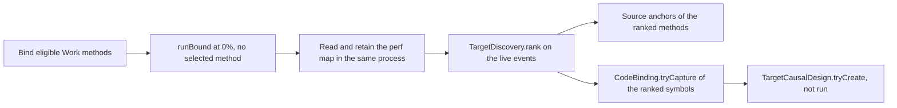

# Target-local discovery check

Status: approved on 2026-10-19. Plan and criteria recorded before the implementation.

## Decision

The supervisor approved an end-to-end functional check of [candidate discovery](target-local-discovery.md) on the Linux backend, followed by exactly one live capture after code review.
- It is a functional check. It does not qualify prediction accuracy, and it does not change the completed deterministic milestone.
- The capture runs once. A failed or inconclusive result is retained. It is not a reason to run again.
- All native bounds, lifecycle gates, the journal rules, and the public estimators stay the same. There is no warm-up change, no timing probe, and no capacity change.
- Live collection stops after the one capture.

## Path

1. The sample mode `discovery-check <out>` checks the configuration with `CodeBinding.configurationErrors`. It binds `Work.selectedName` and `Work.peerName` as the eligible methods, because a run needs payment-eligible ranges.
   These names are a bootstrap of the eligible ranges and the expected results of the check. The mode does not pass them to discovery as candidates.
2. It calls `TargetLocalProfiler.runBound` at speedup 0, with no selected method. Worker 0 runs `Work.selected 60000UL`, and worker 1 runs `Work.peer 30000UL`.
3. Before the process exits, it reads `/tmp/perf-<pid>.map` of its own process once. It writes those exact lines to `<out>.perf-map`, and it records the process id and the SHA-256 of the lines.
4. It calls `TargetDiscovery.rank` with the live `TargetProfileResult`, the scope `CozNet.TargetLocal.`, and a limit of 8.
5. For each ranked symbol, it looks for a method of the sample assembly whose `TargetSymbol.tryFormat` gives that symbol, and it calls `TargetSourceAnchor.tryFind`.
6. It calls `CodeBinding.tryCapture` with the ranked symbols over the retained lines. Then it calls `TargetCausalDesign.tryCreate` with those symbols as the eligible and candidate methods, speedup 50, one block, and `EndToEnd`. It does not run the design.

The current setup still needs a caller-supplied scope and eligible binding. This is discovery inside a scope, not automatic instrumentation of any application.

The portable part, steps 4 to 6 and the evidence record, is in `samples/CozNet.TargetLocal/DiscoveryCheck.fs`. The Linux part, steps 1 to 3, is in `Program.fs`. On a platform other than Linux x64, the mode writes `supported: false` and exits with code 4.

## Journal budget

The budget is fixed before the run. At 1 ms per sample, worker 0 runs about 1 s of CPU work and worker 1 about 0.5 s, from about 17 µs for each round.
A run at 0% adds no credit, so a worker journals only its samples and no publish, child, or deferred event. So each worker needs about 1000 entries, plus 45 for `settle_reserve`.
The sample keeps its journal capacity of 1,048,576 entries for each worker, which is more than 1000 times that need.

## Classification decisions

These decisions are fixed before the capture:
- A sample in another `CozNet.TargetLocal` method, for example a closure in `Program`, is in scope. It can be a ranked candidate. The check does not require or forbid such candidates.
- A ranked method without a supported symbol format has no anchor. The anchor criterion applies only to the two fixture methods.
- A sample in the runtime is unmapped, and a sample in `CozNet` code is out of scope. Neither changes the result.
- The ranking order and the sample ratio between the two fixture methods are not checked.
- The perf map is read after the run, in the same process. The check cannot prove that the map entries existed at each sample time. `CodeBinding.verify` inside `runBound` checks that the eligible ranges did not move.

## Runner

`native/VerifyTargetLocalDiscovery.ps1` reuses the structure of the bottleneck runner:
1. It hashes the sources and the build inputs of the Linux test step, builds the sample in Release on the host, and builds the native library in the compiler image.
2. It runs the discovery tests on Linux in the SDK image, without network access, with the host package folder mounted read-only. It records the command, the exit code, and the counts from a TRX file. A failure or a count of 0 stops the runner before the capture.
3. It runs the capture once, in the same container settings as the other suites.
4. It records the commit, `git status --porcelain`, and `treeClean`. Unrelated dirty files are recorded as they are, and the runner does not change them.
5. It writes the manifest, checks that the inputs did not change, and runs `native/AnalyzeTargetDiscovery.py`.

## Acceptance criteria

These criteria are fixed before the implementation. They add to criteria 1 to 176 and change none.

177. Deterministic checks of `native/AnalyzeTargetDiscovery.py` in `native/TargetDiscoveryAnalysisChecks.py` cover a passing record and each failure below, and the build runs them with the other analysis checks. The analyzer parses the record once, and a negative count or a malformed entry gives a failure reason, not an exception.
178. The discovery tests run on Linux in the runner with an executed count above 0 and no failure, before the capture. Otherwise there is no capture.
179. The capture runs exactly once. Its record, its retained perf map, its logs, and the manifest are kept, whatever the outcome. A configuration or binding error before the run also writes a record.
180. The run is valid: the exit code is 0, the record exists, the platform is supported, the configuration has no error, `rank` gives a result, and not `RunIncomplete` or `DelayAdded`, and the inputs did not change.
181. The map is from the run: the record holds the process id, the map path is `/tmp/perf-<pid>.map`, and the SHA-256 of the retained file equals the recorded hash.
182. The classes conserve: the four classes add up to the sample count, and the in-scope count equals the ranked samples plus the omitted samples. The sample count equals the `Sample` events in the run and the samples that the threads accepted. Review round 1 added the accepted samples.
183. Both fixture methods, `Work.selectedName` and `Work.peerName`, are ranked with more than 0 samples. Each ranked symbol is unique, and `CodeBinding.tryCapture` binds all ranked symbols to the ranked ranges.
184. The anchor of each fixture method is in `Work.fs`, at the first line of its body. For the hashed `Work.fs`, these are lines 7 and 17. The analyzer fails when the `Work.fs` that it reads differs from the hashed one.
185. `TargetCausalDesign.tryCreate` gives a valid design for the ranked symbols.
186. The outcome is `passed` only when criteria 180 to 185 hold. Otherwise it is `failed`, with each reason. A valid run without the expected samples is `failed`, and it is not a reason to run again.

See [target-local discovery](target-local-discovery.md) and [the roadmap](roadmap.md).
