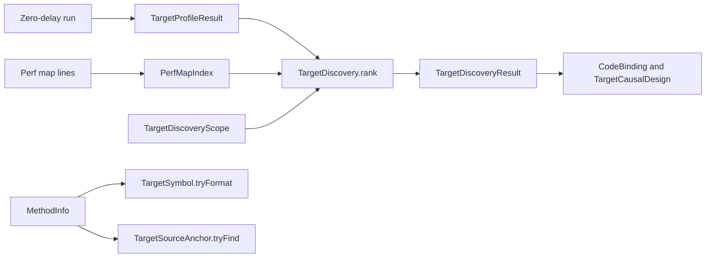

# Target-local candidate discovery

Status: approved on 2026-10-19 with the contract below, and implemented in `src/CozNet/TargetDiscovery.fs`. Its 27 checks are deterministic. One live functional check, [`20261020T015420785-8c8adf21`](target-local-discovery-check.md#result), passed.

## Gap

This section gives the state before the implementation.

Coz finds its experiment lines from samples. Before this milestone, the caller of `TargetCausalProfile.run` named every selected, candidate, and eligible method as a perf-map symbol, and nothing reported where a method is in the source.
- `TargetCausalDesign.tryCreate` takes a caller-supplied candidate list (`src/CozNet/TargetCausalProfile.fs:186`, `:228`). Every candidate and speedup runs in every block (`:278`).
- The sample and the analyzers fix the names `Work.selectedName` and `Work.peerName` (`samples/CozNet.TargetLocal/Work.fs:25-26`, `native/AnalyzeTargetProfile.py:22-24`).
- `src/CozNet` had no portable PDB reader. Only the test `tests/CozNet.Instrumentation/Program.cs` read sequence points.
- No Lode plan covered discovery, source locations, or a second backend.

## Upstream reference

Pinned Coz `256e3c389424d6a1691ee5d18b5ecb5a6c1001ec`, in `lode/tmp/upstream-coz`:
- Between experiments, the first sample in known code sets `_next_line`, unless it is a Coz header line (`libcoz_profiler.cpp:745-753`). So the next line is chosen with a probability that follows the sample counts.
- A sample matches a line by its IP, and then by each callchain frame (`:640-676`). The memory map limits the known code to the source scope.
- Each experiment then runs the chosen line at a random speedup (`:262-293`).

## Decision

The supervisor approved the milestone on 2026-10-19 with these contract requirements. The criteria below were changed to match them before any implementation.
- Discovery is a ranking of sampled methods. It is not source-line profiling.
- The source anchor of a method is the first visible sequence point of the method. It is not the location of a sampled instruction.
- No native change, and no live timing run. `CodeBinding`, `TargetCausalDesign`, and the existing estimators do not change.
- The managed code stays portable. Its checks are deterministic and do not prove anything about the live Linux backend.

## Perf-map grammar

A perf-map line is `<start> <size> <label>`. The start and the size are hexadecimal, with or without `0x`. The range is from the start to the start plus the size, so the end is exclusive, as in `PerfMap.tryRange` and the native `InstructionSpan.contains`.

A method label is `[instance ]<return type> [<assembly>] <canonical symbol>[<tier>]`. A label that does not have this form is a label that is not a method, for example a stub.

The labels below came from a .NET 10 runtime (SDK 10.0.400 image `sha256:cf3e50b742c6`) with tiered compilation and ReadyToRun off. They set the verified subset:

| Shape | Canonical symbol |
| --- | --- |
| Static method | `PerfProbe.Shapes::Selected(uint64)` |
| Instance method | `PerfProbe.Inst::Me(int32)`. The word `instance` is before the return type, not in the symbol. |
| Overloads | `PerfProbe.Shapes::Over(int32)`, `Over(int64)`, `Over(string)`, `Over(object)` |
| Primitive keywords | `bool`, `char`, `int8`, `uint8`, `int16`, `uint16`, `int32`, `uint32`, `int64`, `uint64`, `float32`, `float64`, `native int`, `native uint` |
| Arrays | `int32[]`, `string[]`, `object[]`, `uint32[]` |
| By reference | `int32&`, `int64&` for `out`, `float64&` for `in`, `string&`, `object&` |
| Pointer | `int32*` |
| Nested type | `PerfProbe.Shapes+Inner::Nested(int32)` |
| No parameters | `PerfProbe.Shapes::NoArgs()` |

These shapes are outside the verified subset, so `TargetSymbol.tryFormat` rejects them:
- Generic methods. `Gen<int>` and `Gen<string>` both have the label `PerfProbe.Shapes::Gen(!!0)`, so two code versions share one name.
- Generic types, for example `PerfProbe.Box`1[System.Int32]::Get(!0)`.
- Value types and classes other than `string` and `object`, for example `valuetype [System.Runtime]System.DateTime`, whose assembly is a reference assembly.
- Arrays of more than one dimension, constructors, and any composed shape such as `int32[]&`.

## Contract

The code goes in a new file `src/CozNet/TargetDiscovery.fs`, after `TargetCausalProfile.fs` in `src/CozNet/CozNet.fsproj`. The module `PerfMap` is in `TargetLocalProfiler.fs`, and an F# module cannot be reopened in another file. So the index has its own module.

`PerfMapIndex.tryCreate (lines: string seq): Result<PerfMapIndex, PerfMapIndexError>`
- It parses each line. A line that does not have a start, a positive size, and a label gives `MalformedLine` with its line number. An empty line is skipped.
- Two entries whose ranges overlap give `OverlappingRanges`. The index does not choose one of them.
- Each entry keeps its range, its label, and, for a method label, its assembly, canonical symbol, and tier.

`TargetDiscoveryScope.tryCreate (include: string list) (exclude: string list): Result<TargetDiscoveryScope, TargetDiscoveryScopeError>`
- The caller must give at least one include prefix. There is no default include.
- An empty or blank prefix is an error.
- A symbol is in scope when it starts with an include prefix and with no exclude prefix, by ordinal comparison. An exclude prefix wins over an include prefix.
- Methods of the profiler assembly, `CozNet`, are always out of scope. The test uses the assembly in the label, not a symbol prefix, so the methods of `CozNet.TargetLocal` can be in scope.

`TargetDiscoveryLimit.tryCreate (count: int)` requires a count of at least 1.

`TargetDiscovery.rankEventsUnchecked scope index (events: TargetLedgerEvent array) limit: Result<TargetDiscoveryResult, TargetDiscoveryError>`
- It is a pure diagnostic function. It does not check where the events came from or whether the run completed.
- It counts only `Sample` events. Each sample falls in exactly one of four classes, tested in this order:
  1. `Unmapped`: no entry holds its address.
  2. `NotBindable`: the entry is not a method label, its tier is not `[Optimized]`, or `CodeBinding` cannot bind its symbol to exactly this range. The last case covers a symbol with a second entry in any tier, and a symbol that is part of another label. Each reason has its own count.
  3. `OutOfScope`: the entry is bindable, but the scope or the profiler assembly rule excludes it.
  4. `InScope`: the entry is bindable and in scope.
- The four class counts add up to the sample count. Bindability calls `CodeBinding.tryCapture`, which also rejects a second entry of the symbol in another tier, so each ranked symbol binds with `CodeBinding.tryCapture` over the same lines.
- One ranked method is one entry, so the samples of two code versions never join under one name.
- The ranking is by sample count, then by ordinal symbol. The limit keeps the first methods. `OmittedMethods` and `OmittedSamples` give what the limit removes, so the in-scope count equals the ranked samples plus `OmittedSamples`.
- No sample event gives `NoSamples`. No in-scope sample gives `NoSamplesInScope` with the class counts.

`TargetDiscovery.rank scope index (run: TargetProfileResult) limit`
- It gives `RunIncomplete` with each reason, and it does not rank, when any of these is true: `Passed` is false, `BindingError` is set, `CloseCode` is not 0, the experiment failure code is not 0, a thread failure code is not 0, a thread finish code is not 0, or the replay is an error.
- A full journal appends no event (`native/service/TargetDelayLedger.h:131-134`). So only these codes show `journal_full`.
- It gives `DelayAdded` when `GlobalNs` is not 0 or a sample event has a credit above 0. It checks that the run added no delay. The result does not record the speedup, so `rank` cannot check the speedup itself.
- It cannot check that the perf map lines came from the same process and the same time as the run. The caller must read them from that process after the run.
- The journal of each worker must hold its samples, plus `settle_reserve` (45 entries, `TargetDelayLedger.h:116`), plus its other events. The API reference states this budget.

`TargetSymbol.tryFormat (method: MethodInfo): Result<string, TargetSymbolError>`
- It gives the canonical symbol of a method in the verified subset: `<declaring type full name>::<name>(<parameters>)`.
- It gives `GenericMethod`, `GenericType`, `UnsupportedParameter` with the position and the type, or `NoDeclaringType` for a method outside the subset.

`TargetSourceAnchor.tryFind (method: MethodBase): Result<TargetSourceAnchor, TargetSourceAnchorError>` and `TargetSourceAnchor.tryFindIn (assemblyPath: string) (metadataToken: int)`
- The anchor is the document, the line, and the column of the first sequence point of the method that is not hidden.
- An embedded portable PDB is supported, and it is used first.
- An external portable PDB is used only when its id equals the id in the CodeView entry of the assembly. The reader tries only the file next to the assembly with the CodeView file name. A file with the right name and the wrong id gives `PdbMismatch`.
- The reader does not use the CodeView path, which is a path on the build machine. A copied assembly without its PDB then gives `PdbNotFound`, not an anchor from a build output.
- The errors are explicit: `NoAssemblyFile`, `NoDebugDirectory`, `NotPortablePdb`, `PdbNotFound`, `PdbMismatch`, `PdbMalformed`, `PdbUnreadable`, `AssemblyMalformed`, `AssemblyUnreadable`, `MethodNotInPdb`, and `OnlyHiddenSequencePoints`. A file that cannot be read or parsed gives an error, not an exception. A method of a dynamic assembly gives `NoAssemblyFile`.

Intentional differences from upstream:
- Method level, not source-line level. A sub-method range needs IL-to-native maps, and the target-local path has none.
- The interrupted IP only, with no callchain. A sample in a callee does not count for its caller.
- Discovery ranks candidates for the balanced design. It does not choose one line at random for each experiment.

## Acceptance criteria

These criteria were fixed after the approval and before the implementation. They add to criteria 1 to 168 and change none.

169. `PerfMapIndex.tryCreate` checks use real labels from the capture: a static, an instance, a nested, a generic, and a stub label, an address with and without `0x`, the first and the last address of a range, the end address, an address between ranges, a malformed line with its number, and overlapping ranges.
170. `rankEventsUnchecked` checks use hand-built events. Each of the four classes and each reason of `NotBindable` is reached, the classes add up to the sample count, events of other kinds are ignored, and the worker counts add up to each method count.
171. A fixed set of permutations of the events gives the same result. Ties rank by ordinal symbol. `OmittedMethods` and `OmittedSamples` are correct, and the in-scope count equals the ranked samples plus `OmittedSamples`.
172. The scope checks cover no include prefix, a blank prefix, an exclude prefix that wins, ordinal case, and a `CozNet` profiler method that stays out of scope while a `CozNet.TargetLocal` method is in scope. Two optimized entries with the same symbol, and an optimized entry with a second tier of its symbol, are `NotBindable` and are not joined. Review round 1 added the second case.
173. `rank` gives `RunIncomplete` for each failure field, including a `journal_full` failure code, and `DelayAdded` for a delay or a credited sample. `NoSamples`, `NoSamplesInScope`, and a limit below 1 give their own errors.
174. `TargetSymbol.tryFormat` gives the canonical symbol of each verified shape in the table, defined again in the test assembly, and of an F# module function with the shape of `Work.selected`, which gives `<module>::selected(uint64)` as in `Work.selectedName`. It rejects a generic method, a generic type, a value type, a class, a multi-dimensional array, and a composed shape.
175. `TargetSourceAnchor` checks cover an external PDB, an embedded PDB in a fixture assembly, a missing PDB, a PDB with the right name and the wrong id, a malformed PDB, and a method without sequence points. Review round 1 added an assembly that is not a PE image, a locked assembly on Windows, a dynamic assembly, and a method token with row 0. The skip of hidden sequence points is checked on the selection function, with hand-built points.
176. A ranked symbol binds with `CodeBinding.tryCapture` over the same lines and builds a valid design with `TargetCausalDesign.tryCreate`. All checks are deterministic and run with an executed count above 0. They run on every platform, except the locked-file check, which runs only on Windows and is skipped elsewhere. No live timing run is part of this milestone.

## Test strategy

- Expecto tests in `tests/CozNet.Tests/TargetDiscoveryTests.fs`, as in the other target-local tests.
- A fixture library `tests/CozNet.DiscoveryFixture` with an embedded portable PDB, for criterion 175.
- Real perf-map labels from the capture, and hand-built `TargetLedgerEvent` arrays. No profiler run.
- A fixed set of permutations, not random inputs.
- `dotnet test tests/CozNet.Tests --no-restore --filter "FullyQualifiedName~target discovery"`, with `DOTNET_ROOT="C:/Program Files/dotnet"`. The report gives the executed count.

## Implementation

- `src/CozNet/TargetDiscovery.fs` holds `PerfMapIndex`, `TargetDiscoveryScope`, `TargetDiscoveryLimit`, `TargetDiscovery`, `TargetSymbol`, and `TargetSourceAnchor`. It makes no native profiler call. The source anchors read files.
- `tests/CozNet.Tests/TargetDiscoveryTests.fs` holds 27 checks. One of them, a locked file, runs only on Windows and is skipped elsewhere. `tests/CozNet.DiscoveryFixture` is a library with an embedded portable PDB.
- `dotnet test tests/CozNet.Tests --no-restore --filter "FullyQualifiedName~target discovery"` runs 27 checks, and all pass.
- Two mutations were checked by hand. An end-inclusive range fails 5 checks, and a PDB id check that always passes fails 1.
- The reference is [the API reference](../../docsSrc/Reference/target-local-api.md#candidate-discovery), and the limits are in [the discovery explanation](../../docsSrc/Explanations/target-local-discovery.md).

## What this leaves open

- Every qualification blocker: the capacity failures of `prediction`, `barrier`, and `spinlock`, the prediction errors of `lock`, `transaction`, and `spintransaction`, and a package with `treeClean` true.
- Source-line attribution inside a method, callchain attribution, and random selection for each experiment.
- Generic methods and types, and parameter types outside the verified subset.
- Backends other than Linux x64, and any live check of discovery on the Linux backend.

See [the roadmap](roadmap.md), [target-local causal profile](target-local-causal-profile.md), and [target-local lifecycle](target-local-lifecycle.md).
