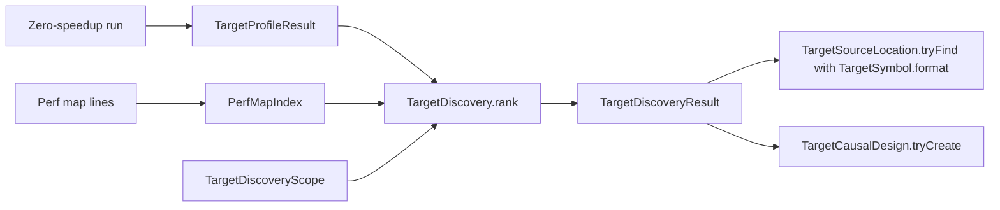

# Target-local candidate discovery

Status: proposed on 2026-10-19. It needs supervisor approval before any implementation. No code exists for it.

## Gap

Coz finds its experiment lines from samples. Today the caller of `TargetCausalProfile.run` names every selected, candidate, and eligible method as a perf-map symbol, and nothing reports where a method is in the source.
- `TargetCausalDesign.tryCreate` takes a caller-supplied candidate list (`src/CozNet/TargetCausalProfile.fs:186`, `:228`). Every candidate and speedup runs in every block (`:278`).
- The sample and the analyzers fix the names `Work.selectedName` and `Work.peerName` (`samples/CozNet.TargetLocal/Work.fs:25-26`, `native/AnalyzeTargetProfile.py:22-24`).
- `src/CozNet` has no portable PDB reader. Only the test `tests/CozNet.Instrumentation/Program.cs` reads sequence points.
- No Lode plan covers discovery, source locations, or a second backend.

## Upstream reference

Pinned Coz `256e3c389424d6a1691ee5d18b5ecb5a6c1001ec`, in `lode/tmp/upstream-coz`:
- Between experiments, the first sample in known code sets `_next_line`, unless it is a Coz header line (`libcoz_profiler.cpp:745-753`). So the next line is chosen with a probability that follows the sample counts.
- A sample matches a line by its IP, and then by each callchain frame (`:640-676`). The memory map limits the known code to the source scope.
- Each experiment then runs the chosen line at a random speedup (`:262-293`).

## Proposal

Add method-level discovery from the samples of a zero-speedup run, with the source location of each method. Discovery only ranks candidates. The existing balanced design then runs them.

The interfaces go in a new file `src/CozNet/TargetDiscovery.fs`, after `TargetCausalProfile.fs` in `src/CozNet/CozNet.fsproj`.
The existing module `PerfMap` is in `TargetLocalProfiler.fs`. An F# module cannot be reopened in another file, so the index gets its own module:
- `PerfMapIndex.tryCreate: string seq -> Result<PerfMapIndex, PerfMapIndexError>`. It parses every well-formed line and rejects overlapping ranges.
  The existing parser gives each entry the range from its start to its start plus its size, so the end is exclusive. `PerfMapIndex.TryFind ip` uses the same rule as the native `InstructionSpan.contains`: begin inclusive, end exclusive.
- A perf-map label holds a return type, an assembly, a canonical symbol, and a tier, for example `uint64 [CozNet.TargetLocal] CozNet.TargetLocal.Work::selected(uint64)[Optimized]`.
  The index extracts the canonical symbol, `CozNet.TargetLocal.Work::selected(uint64)`, which is the form that `CodeBinding` takes. It keeps the label and marks whether the tier is `[Optimized]`.
- `TargetDiscoveryScope.tryCreate (include: string list) (exclude: string list)`. Each item is a prefix of the canonical symbol, for example `CozNet.TargetLocal.Work::`. The default exclude list holds the `CozNet.` profiler symbols outside the include list.
- `TargetDiscovery.rankEvents scope index (events: TargetLedgerEvent array) limit: Result<TargetDiscoveryResult, TargetDiscoveryError>` ranks a complete event set.
- `TargetDiscovery.rank scope index (run: TargetProfileResult) limit` first checks the run. A run that did not pass, or that has an experiment or thread failure code, gives `RunIncomplete` with that code, and `rank` does not rank it. A full journal appends no event, so only these codes show it (`native/service/TargetDelayLedger.h:131-134`). Otherwise `rank` calls `rankEvents` with `run.Events`.
  - `TargetDiscoveryResult` holds `InScope`, `OutOfScope`, `NotOptimized`, `Unknown`, `RemovedByLimit`, and `Candidates: DiscoveredCandidate array`.
  - `DiscoveredCandidate` holds `Symbol`, `Samples`, and `WorkerSamples`.
  - It counts only `Sample` events. Each sample falls in exactly one class: in scope, out of scope, not optimized, or unknown.
  - Its result gives the totals of the four classes, the count of candidates that the limit removes, and each candidate symbol with its sample count and its count for each worker. It ranks by count, then by ordinal symbol.
- `TargetSourceLocation.tryFind (method: MethodBase): SourceLocation option`. It reads the portable PDB, separate or embedded, with `System.Reflection.Metadata`, and gives the document and the first sequence point that is not hidden.
- `TargetSymbol.format (method: MethodInfo): Result<string, string>` gives the perf-map name of a method, so a source location can be joined to a symbol. An overload that it cannot tell apart is an error.

The caller supplies the zero-speedup run and its binding, with no selected method. `LedgerPlan.parse` requires at least one eligible method. A zero-speedup run adds no credit, so the eligible set does not change which samples the run records.

Dependencies: `System.Reflection.Metadata`, which is in the shared framework. No native change, no change to the ledger, the payment, the estimator, the exports, or the qualification suites.

Intentional differences from upstream:
- Method level, not source-line level. A sub-method range needs IL-to-native maps, and the target-local path has none.
- The interrupted IP only, with no callchain. A sample in a callee does not count for its caller.
- Discovery ranks candidates for the balanced design. It does not choose one line at random for each experiment.

## Acceptance criteria

Proposed. They would add to criteria 1 to 168 and change none.

169. `PerfMapIndex.tryCreate` checks cover a well-formed map, a malformed line, overlapping ranges, an IP at the begin and at the end of a range, an IP between ranges, and an entry that is not `[Optimized]`.
170. `TargetDiscovery.rankEvents` checks use hand-built events. The four sample classes add up to the sample count, the result reports each class total and the candidates removed by the limit, events of other kinds are ignored, and worker counts add up to each candidate count.
171. A permutation of the events does not change the ranking, and ties are ranked by ordinal symbol.
172. No sample events, no sample in scope, and a limit below 1 each give their own error. `rank` gives `RunIncomplete` for a run that did not pass or that has a failure code, for example `journal_full`, and it does not rank its events.
     Each sample takes one journal entry. `accept` also keeps `ThreadDelayAccount::settle_reserve` free, which is 45 entries (`TargetDelayLedger.h:116`, `:131-134`).
     So the journal capacity of each worker must be above its expected samples, plus 45, plus its other events: publish, child, deferred, failure, block, wake, and post. A new section on discovery in `docsSrc/Reference/target-local-api.md` must state this budget.
173. `TargetSourceLocation.tryFind` gives the document and line of a test method with a known first line, and `None` for a method without a PDB.
174. `TargetSymbol.format` gives `Work.selectedName` and `Work.peerName` for the sample methods, and an error for an overload that it cannot tell apart.
175. Discovered symbols build a valid design with `TargetCausalDesign.tryCreate`. A symbol that the binding cannot capture gives the existing binding error.
176. The checks are deterministic and run on every platform. No live timing run is part of this milestone. A functional live check on Linux would need a separate approval.

## Test strategy

- Unit tests in a new file `tests/CozNet.Tests/TargetDiscoveryTests.fs`, with Expecto, as in the other target-local tests.
- Synthetic perf-map lines and synthetic `TargetLedgerEvent` arrays. No profiler run.
- A permutation check of the ranking over fixed seeds.
- The source location of a method in the test assembly, read from its own portable PDB.
- `dotnet test tests/CozNet.Tests --no-restore --filter "TargetDiscovery"`, with `DOTNET_ROOT="C:/Program Files/dotnet"`.

## What this leaves open

- Every qualification blocker: the capacity failures of `prediction`, `barrier`, and `spinlock`, the prediction errors of `lock`, `transaction`, and `spintransaction`, and a package with `treeClean` true.
- Source-line attribution inside a method, callchain attribution, and random selection for each experiment.
- Backends other than Linux x64.

See [the roadmap](roadmap.md), [target-local causal profile](target-local-causal-profile.md), and [target-local lifecycle](target-local-lifecycle.md).
