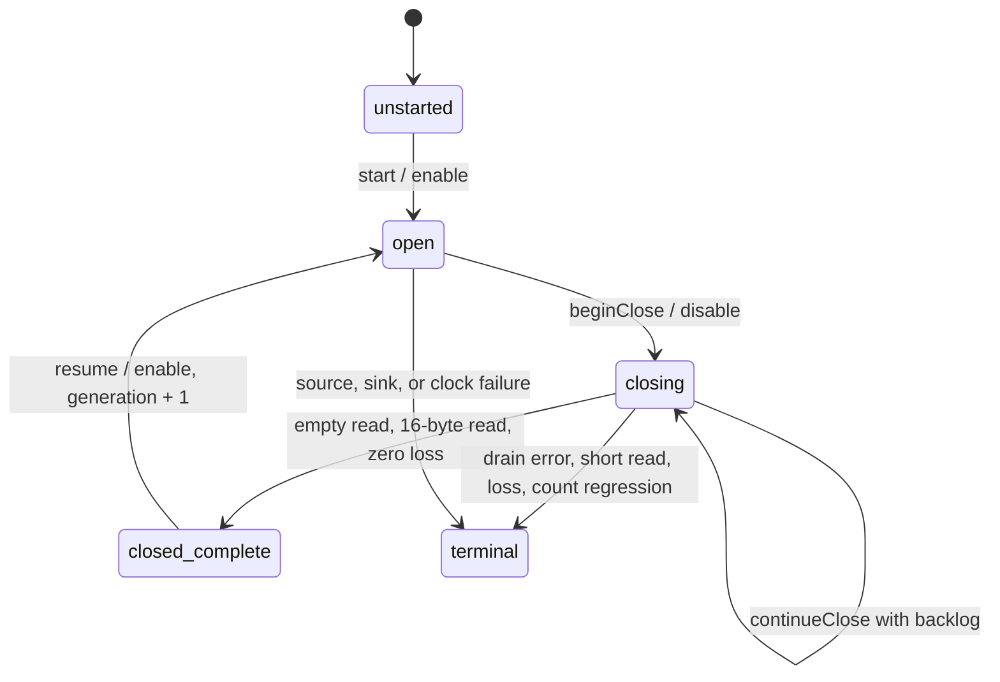

# Target-local sample dispatch

## Decision

Each perf sample overflow notifies the sampled target thread through fasync.
The fd uses `F_SETOWN_EX` with `F_OWNER_TID`, `F_SETSIG` with a real-time signal, and `O_ASYNC`.
The kernel then requests one signal for each overflow, independent of `wakeup_events`. Two overflows before the deferred kernel work runs produce one signal ([core.c](https://github.com/microsoft/WSL2-Linux-Kernel/blob/linux-msft-wsl-5.15.153.1/kernel/events/core.c#L9434-L9437)).
Each signal carries `si_code = POLL_IN` and `si_fd`. A full signal queue falls back to plain `SIGIO` ([fcntl.c](https://github.com/microsoft/WSL2-Linux-Kernel/blob/linux-msft-wsl-5.15.153.1/fs/fcntl.c#L733-L785)).
The session installs a `SIGIO` handler that counts each fallback as a lost notification. The samples stay in the ring.

With a 1 ms sample period and no masking, one notification holds one sample in the live capture.
At 50% speedup, a future credit sink would publish 0.5 ms for that sample. This stays inside the 2 ms debt bound.
A masked thread can still find many samples in one dispatch. The record and elapsed budgets bound that dispatch.

A per-thread `CLOCK_THREAD_CPUTIME_ID` timer, as in upstream Coz, was the first trigger.
On the verified kernel it expired every 10 ms of thread CPU with overrun 4 at a 2 ms setting.
Each notification then held about ten samples, which can publish 5 ms of credit at 50% speedup.
See [the dispatch capture](../../reliability/features/native-signal/target-dispatch.md).

## Portable dispatcher contract

`native/service/TargetSampleDispatch.h` holds the portable core. It makes no OS calls and does not allocate.
The source, clock, and sink are template parameters. Each call is `noexcept`.

- `DispatchBudget::parse(records, elapsed)` requires 1–4096 records and 1 ns to less than 5 ms.
  The dispatch is a part of the 5 ms handler bound, not the complete bound.
- Before each read, the dispatcher checks cancellation, the record budget, the elapsed budget, and sink capacity.
  A read publishes the tail, so a sample that the sink cannot hold stays unread in the ring.
- `drained_snapshot` means only that the last read reached the head that it acquired. It never proves source closure.
- `records_exhausted` and `time_exhausted` report backlog `remaining` because the last read did not complete its snapshot.
  A stop before any read reports backlog `unknown`.
- The first source, sink, or clock failure is terminal. Later calls return the terminal outcome and accept nothing.
- A notification is `{generation, sequence}`. A wrong generation or a sequence that does not increase is a counted `stale_notification`.
- An active dispatch makes a second entry a counted `reentered` result. Closure uses the same exclusion.
- Cancellation is permanent. It stops notification dispatch and prevents resume. Closure still drains.

```cpp
TargetSampleDispatcher<Source, Clock, SampleJournal> dispatcher(source, clock, journal);
dispatcher.start();
auto result = dispatcher.notify({dispatcher.generation(), ++sequence}, *budget);
```

## Epoch closure



`beginClose` disables the source. `continueClose(budget)` drains in bounded steps and can return backlog many times.
Only a completed snapshot after disable allows the final count/loss read.
The epoch completes only with zero loss and a final value not less than the last sample's cumulative CPU.
An incomplete epoch is terminal. The journal keeps every accepted sample with its epoch generation.
The epoch record marks the generation incomplete. The accounting owner must invalidate that experiment. It must not relabel or forgive credit.

## Linux backend ownership

The Linux session owns the perf fd, the mapping, the fasync registration, the dispatcher, and the journal.
It allocates all of them before the first arm. All lifecycle calls run on the target thread.

1. Block the signal. Handler quiescence then follows from the signal mask on the target thread.
2. Disable the event, which stops new overflows. Drain pending signals to `EAGAIN` with identity checks.
3. Close the epoch in counted bounded steps. Resume, or continue to retirement.
4. At retirement, clear `O_ASYNC`, drain again, and unregister the session.
5. Read the raw count/loss if the epoch did not close, then unmap, close the fd, and restore the mask.

Each failed step records the first error in `TargetRetirement`. A failed block or disable keeps the signal mask blocked.
`LinuxTargetSampleSession::Handle` deletes the session only after handler quiescence. After a quiescence timeout it keeps the session memory allocated.
`closeEpoch` repeats bounded steps only after a record or elapsed budget stop. A `sink_full` result ends the call. A later call continues a closing epoch.
`restore()` returns `EBUSY` while a session is registered or while the calling thread has a pending `SIGIO` or notification signal. Signal provenance requires `POLL_IN`, `si_fd`, and the target thread id.
The handler finds a session by comparing registry entries. It never dereferences a value from the signal.
A late signal after unregistration counts as foreign. A reused fd number can cause one extra bounded drain of the new session's own ring.
The ring identity checks still reject samples from another thread.

CLR code binding is a later sink contract. A binding generation must stay valid until handler quiescence, then the owner revokes it.

## Verified state

`target-sample-dispatch` runs synthetic dispatcher checks on Windows and Linux.
`LinuxPerfRingVerify` runs `TargetDispatchWorkload` in `bounded`, `backlog`, `incomplete`, and `cancel` modes.
In `bounded`, 272 notifications each drain one sample. The maximum handler interval in any mode is 12,680 ns.
`backlog` stops 29 dispatches with remaining backlog and closes in 5 steps. `incomplete` stays terminal with 198 lost samples.
A second session on one thread returns `EBUSY` before any side effect.
`cancel` reads nothing after cancellation, closes completely, and refuses resume. No live mode reaches the elapsed budget.
See [the dispatch capture](../../reliability/features/native-signal/target-dispatch.md).


Next, the sink becomes native credit publication. It must keep one accounting owner and the existing debt, lease, and handler bounds.
Signal-handler execution inside CLR-managed code remains unverified.

See [the sample plan](target-local-samples.md), [target leases](target-local-lease.md), and [the decoder reference](../../docsSrc/Reference/native-perf-decoder.md).
