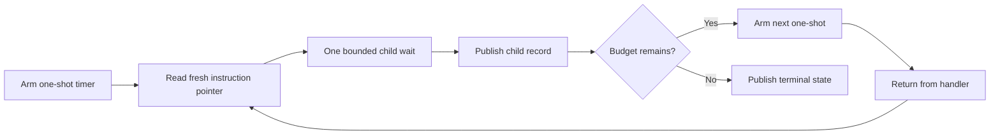

# Target-local lease delivery

The owner polling comparison retains a scheduling dependency between bounded children.
A Linux one-shot timer can request the next intervention without another owner iteration.
This is a delivery feasibility experiment, not an integrated service backend.

The first fixture uses a finite 500,000 ns budget and requests at most 50,000 ns per handler.
Each handler reads a fresh interrupted instruction pointer, records measured wait, and returns.
Only eligible instructions permit a wait. Measured overshoot stays in the journal.
A subsequent one-shot expires after 10,000 ns. This delay is not credited as intervention.
The fixture retains the 5 ms handler and 100 ms first observer receipt gates.
The owner sleeps while the target consumes the lease. It does not authorize each child.

The Linux backend owns timer creation, direct syscalls, signal context, and retirement.
No shared engine API acquires Linux types. Other platforms need an equivalent delivery backend.

```cpp
itimerspec next{};
next.it_value.tv_nsec = 10000;
```



Timer deletion alone cannot prove that no pending signal remains.
The retirement fixture must block the signal on the target, prevent rearm, delete the timer,
and drain pending records before the target exits and the process restores the handler.
Signal provenance includes `SI_TIMER` and a stable generation cookie.
A positive timer interval does not guarantee application progress between handlers.
The fixture must record application progress without claiming that it proves a scheduling guarantee.

The [portable lease core](../profiling/target-local-lease.md) defines cancellation during an active child and single-owner child publication.
Before integration, define concurrent immutable prefix publication,
receipt timing, stale generation rejection, selected-thread sample exclusion, and CLR transitions.
The timer fixture does not establish those contracts or physical prediction accuracy.

See [owner polling](../profiling/owner-polling.md) and
[the timer research](../../docsSrc/Research/target-local-timer-delivery.md).

The [timer-only fixture](../../reliability/features/native-signal/service-submission/target-timer.md) passes both cases.
Its chain records ten children, 500,019 ns measured wait, and a 62,028 ns maximum measured handler interval.
The pending-retirement case drains one timer record after deletion.
This evidence permits work on the lease protocol. It does not permit sampled or CLR support claims.

The native fixture now consumes the portable core. Both native cases pass in run `20261014T183138470-d4c55999`.
The core suite and five existing owner scenarios pass on Windows and Linux.
Immutable prefix publication and portable .NET receipt tracking are implemented.
The next backend work must test physical cancellation/rearm races and connect the tracker through a native timer C ABI.

## Reuse lifecycle before interop

The proposed mailbox protocol requires target-side disarm and complete pending-signal drain before release publication of a quiescent generation.
Publication must be the old handler's final shared-state action for that lease.
The controller must exclude old journal readers before storage reuse and publish new configuration before arming.
Generation-bearing transitions must serialize submission, cancellation, and retirement without wrapping identities.
Lease quiescence does not establish handler return or permit registration release.
The [source analysis](../../docsSrc/Research/target-local-timer-delivery.md#reusing-one-timer-across-leases) is conditional on pinned Linux sources, not installed-kernel verification.

Before a live C ABI, checks must cover expiration concurrent with disarm, queued delivery before drain, immediate rearm, and repeated generations.
They must also cover cancellation before delivery, arm and drain failures, and a reader held across attempted reuse.
Failure must retain ownership. An old handler must not access reused storage after quiescence publication.
The 50 microsecond child, 5 ms handler, 100 ms first managed receipt, and 2 ms debt bounds remain unchanged.
Disarm, drain, and timer gaps do not count as intervention waits.

The `cancel-rearm` native fixture injects cancellation after successful rearm in the first handler.
It observes the blocked expiration, disarms the timer, drains to `EAGAIN`, and preserves the completed child.
Its handler timing includes cancellation work. This controlled boundary does not establish concurrent cancellation or mailbox reuse.

The portable `LeaseMailbox` implements generation claims, cancellation preservation, and reader exclusion.
The native reuse fixture supplies a disarm/drain proof, retires the core, and makes mailbox quiescence publication its final old-storage access.
It exercises 16 generations with one child each, one timer, and one lease storage slot.
Its next integration steps are concurrent cancellation, failed-arm recovery, and a live timer C ABI with managed receipt tracking.
