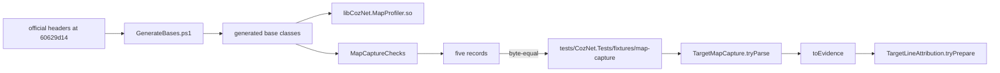

# Target-local map acquisition

Status: approved on 2026-10-20 with the contract in the Decision section. The library, the checks, and the parser are implemented, and criteria 220 to 223 pass. No profiler was started.

## Goal

A small Linux CLR profiler component reads the native-to-IL map of one selected method and gives it, unchanged, to the existing [line attribution resolver](target-local-line-attribution.md). The facts are in [the research note](../../docsSrc/Research/clr-native-to-il-mapping.md), sections "Profiler APIs that return the map" and "Facts for map acquisition", pinned to dotnet/runtime `v10.0.0`.

## Scope of the first increment

- One method, selected by the caller before startup: a module file name and a MethodDef token.
- The method is not generic, its IL is not rewritten, and it is compiled once as optimized code. `DOTNET_TieredCompilation=0` and `DOTNET_ReadyToRun=0` stay required, as `CodeBinding` checks.
- Startup loading only. Attachment to a running process is out of scope.

## Loading and interfaces

- Startup loading uses `CORECLR_ENABLE_PROFILING=1`, `CORECLR_PROFILER={GUID}`, and `CORECLR_PROFILER_PATH`, as `native/rejit/ReJitProbe.Linux.cpp` and `native/VerifyTargetLocalTransitions.ps1:60-62` already do in the Linux container.
- Callback interface: the object answers `IUnknown`, `ICorProfilerCallback`, and `ICorProfilerCallback2`, because the runtime refuses a profiler without `ICorProfilerCallback2`. It answers no later callback version. So the runtime never calls the ReJIT callbacks of `ICorProfilerCallback4`.
- Info interface: in `Initialize`, the component asks the given `IUnknown` for `ICorProfilerInfo9`, which holds `GetNativeCodeStartAddresses`, `GetILToNativeMapping3`, and `GetCodeInfo4`. Without it, the outcome is `InfoUnavailable`, and the component asks for no events.
- Event mask: `COR_PRF_MONITOR_JIT_COMPILATION`, for `JITCompilationFinished`, and `COR_PRF_MONITOR_MODULE_LOADS`, for `ModuleUnloadStarted`. No high event mask. No `COR_PRF_DISABLE_INLINING`, `COR_PRF_ENABLE_REJIT`, `COR_PRF_DISABLE_ALL_NGEN_IMAGES`, or enter-leave flags.
- The selection is read once in `Initialize`, from `COZNET_MAP_MODULE` and `COZNET_MAP_TOKEN`. A missing or malformed value gives `SelectionInvalid`, and the component asks for no events.

## When it reads, and where

All reads run inside `JITCompilationFinished`. A profiler callback is a thread where the info calls are allowed, and the runtime sets the native address before the callback.
1. `GetFunctionInfo2` gives the module id and the token. A token that is not the selected one returns at once.
2. `GetModuleInfo2` gives the module file name. A name that is not the selected one returns at once.
3. `GetModuleMetaData(moduleId, ofRead, IID_IMetaDataImport)` and `GetScopeProps` give the MVID.
4. `GetNativeCodeStartAddresses(functionId, 0, 2, &count, starts)`.
5. `GetCodeInfo4(starts[0], 2, &regionCount, regions)`.
6. `GetILToNativeMapping3(starts[0], 0, &entryCount, nullptr)`, and then a second call with a buffer of that count.

Nothing runs in the perf signal handler. The callback copies into storage that the component allocates once in `Initialize`, with a capacity of 4096 map entries. It takes no lock of its own. Two threads can compile the selected method at the same time, and only one body is published. So the first callback claims the record with one atomic compare-exchange, and a later callback only sets `SecondNotification`. A later reader sees a record only after its claimant marks it complete with a release store.

## Outcomes

The Decision section supersedes this section where they differ.

The component keeps one record. Each failed step keeps its HRESULT and stops the capture. Nothing is retried.

| Outcome | Cause |
| --- | --- |
| `NotSeen` | No selected method finished compilation. |
| `Captured` | All steps succeeded. |
| `InfoUnavailable` | No `ICorProfilerInfo9`. |
| `SelectionInvalid` | The selection variables are missing or malformed. |
| `MetadataFailed hr` | Step 3 failed. |
| `StartsFailed hr` | Step 4 failed, including `ERROR_INSUFFICIENT_BUFFER` for more than two bodies, with the count kept. |
| `CodeInfoFailed hr` | Step 5 failed. |
| `MapFailed hr` | Step 6 failed, including `CORPROF_E_DEBUGGING_DISABLED`. |
| `MapTooLarge count` | The map has more than 4096 entries. |
| `MapCountChanged first second` | The count of the second map call differs from the first. |
| `SecondNotification` | A second `JITCompilationFinished` for the selected method, from a concurrent compilation or a later one. The first record stays, and this flag is added. Step 4 of the first record shows the published bodies at its own time. |

The component does not drop, sort, or merge map entries, and it keeps every region and the body count. A second body, a cold region, a zero-length entry, and a gap stay in the evidence for the resolver to reject or report.

## Lifecycle

The Decision section supersedes this section where they differ.

- JIT completion: the only capture point.
- Unloading: `ModuleUnloadStarted` for the module of a captured record sets `UnloadedBeforeRead`. The first increment uses a module that is not collectible, so this flag is expected to stay false.
- ReJIT and code replacement: the component cannot request ReJIT. Tiering is off. Another body would show as a body count above 1 at capture time. A body that appears after capture is not detected. The record states the time of capture and claims nothing after it.
- Shutdown: `Shutdown` sets `Closed`. A read after it gives the record with `Closed` set.

The capture identity is the function id, the module id, the MVID, the token, the code start, the regions, and the body count at capture time. It does not prove the code lifetime. It does not prove that the code stayed at that address for the sampled run.

## Evidence transfer

The Decision section supersedes this section where they differ.

- The component exports one C function, `coz_map_read(CozMapCapture* out, CozMapEntry* entries, uint32_t capacity, uint32_t* count)`. It copies the record and the raw entries. `CozMapCapture` starts with a layout version and its own size.
- The sample loads the library from `CORECLR_PROFILER_PATH` with `NativeLibrary.Load`, after `runBound` returns. So the read stays out of the timed work. The selected method compiles when `bind ()` calls it once, before the run.
- A new portable parser, `TargetMapCapture.tryParse`, turns the copied bytes into `TargetCodeEvidence`. It checks the layout version and size, and it keeps the raw `uint32` entries. Its label is `captured: pid <pid> profiler <library sha256>`.
- The evidence then goes through `TargetLineAttribution.tryPrepare` with the discovery outcome of the same run. The existing checks compare the region with the bound perf-map range, the MVID and the token with the PE, and the map with the IL body.

## Observer effects

- `JITCompilationStarted`, `JITCompilationFinished`, and `JITInlining` callbacks run for every method that compiles. They add JIT time. The component answers `JITInlining` with `TRUE`, so it keeps every inline decision.
- The first `GetILToNativeMapping3` call initializes the lazy data of the debugger interface under its lock.
- A loaded profiler is present for the whole process. The source audit found no JIT flag that `COR_PRF_MONITOR_JIT_COMPILATION` sets. Other effects of a present profiler on the timed run are not measured.

## Decision

The supervisor approved on 2026-10-20 the native acquisition component, the portable parser, and deterministic checks, with contract changes that this section records before the implementation.
- No CLR profiler startup and no live capture. The component is a separate library, `libCozNet.MapProfiler.so`. The existing target-local native backend and the legacy profiler do not change.

## ABI

- The component includes the official declarations of the pinned runtime checkout `60629d14374c56f1cb51819049ad1fa529307f8d`: `src/coreclr/pal/prebuilt/inc/corprof.h`, the MIDL output of `corprof.idl`, and `src/coreclr/inc/cor.h`. It defines no vtable slot or IID constant of its own.
- The profiler class derives from the official `ICorProfilerCallback2`. The fake info class of the checks derives from the official `ICorProfilerInfo9`, and the fake metadata class from the official `IMetaDataImport`. The compiler then checks every slot order, parameter type, return type, and `STDMETHODCALLTYPE`.
- The IIDs come from `src/tests/profiler/native/guids.cpp` of the same checkout and from `cor.h`. The runner checks independently that each IID it uses equals the `MIDL_INTERFACE` uuid string in `corprof.h`.
- A generator writes the base classes from the official headers. Each generated method returns `E_NOTIMPL`, or `S_OK` for a callback. A callback with an output parameter is not left to a generated body: the profiler overrides `JITInlining`, which sets `*pfShouldInline = TRUE`, and `JITCachedFunctionSearchStarted`, which sets `*pbUseCachedFunction = TRUE`. The generator fails when a callback with a pointer output is not in that list.
- The object answers `IUnknown`, `ICorProfilerCallback`, and `ICorProfilerCallback2`, and `E_NOINTERFACE` for every other IID. The info interface is a separate contract: `Initialize` asks for `ICorProfilerInfo9` only.
- The class factory rejects aggregation with `CLASS_E_NOAGGREGATION`. `DllGetClassObject` gives `CLASS_E_CLASSNOTAVAILABLE` for another CLSID. Reference counts are atomic, and the object deletes itself at 0.
- No C++ exception crosses a callback or an export. Each one catches every C++ exception and records `InternalError` when it holds the claim. A process fault is not recoverable, and the component does not claim to recover from one.

## State and read consistency

The state is one `std::atomic<uint32_t>`: `NotSeen`, `Capturing`, or `Complete`.
- `Initialize` failures set `Complete` with their outcome. `Initialize` still returns `S_OK`, so the library stays loaded and its record stays readable.
- The first selected `JITCompilationFinished` claims the record with a compare-exchange from `NotSeen` to `Capturing`. Only the claimant writes the storage. It then stores `Complete` with release order. The storage never changes after that.
- The invalidation flags are a separate `std::atomic<uint32_t>`, set with `fetch_or` at any time: `SecondNotification`, `UnloadDuringCapture`, `UnloadedAfterCapture`, and `Closed`. A flag never changes the primary outcome or its HRESULT.
- Every `ModuleUnloadStarted` increments an atomic counter. A callback reads the counter at entry, and the claimant compares it before it stores `Complete`. A change sets `UnloadDuringCapture` for any module, so an overlap is reported, not judged. After `Complete`, an unload of the captured module sets `UnloadedAfterCapture`.
- `coz_map_read` loads the state with acquire order. During `Capturing`, it gives `NotReady` and copies nothing. Otherwise it serializes the storage and the current flags.

## Queries and bounds

Each step is checked, and its counts are kept even on `S_OK`.
- `JITCompilationFinished` with `fIsSafeToBlock` false increments a counter and reads nothing.
- `GetFunctionInfo2` failure, `GetModuleInfo2` failure, and a module name longer than 260 UTF-16 units each increment their own counter. The record then shows that a selection could have been missed.
- After the claim: a failed JIT status gives `JitFailed`. A metadata or `GetScopeProps` failure gives `MetadataFailed`. An MVID other than the selected `COZNET_MAP_MVID` gives `MvidMismatch`, with the actual MVID kept.
- `GetNativeCodeStartAddresses` with a buffer of 2 keeps the reported and the copied count. A failure, including `ERROR_INSUFFICIENT_BUFFER`, gives `StartsFailed`. A count of 0 gives `NoNativeBody`, and 2 gives `MultipleBodies` with both starts kept. The capture continues only with one reported and one copied body.
- `GetCodeInfo4` with a buffer of 2 keeps both counts. A failure gives `CodeInfoFailed`, a count of 0 `NoCodeRegion`, and a count above 2 `CodeInfoUnexpectedCount`. A cold region is kept raw.
- `GetILToNativeMapping3` first asks for the count. A failure gives `MapFailed`, 0 gives `MapEmpty`, and a count above 4096 gives `MapTooLarge`. The second call gives `MapCountChanged` when its count differs, with both counts kept. The entries are kept raw.
- Each metadata pointer is released on every path. The info pointer is released when `Initialize` fails and in `Shutdown`, which the runtime sends last.

## Transfer layout, version 1

Little-endian. The writer stores each field at its offset in a zero-filled buffer, so no C++ padding or stale byte reaches the output.

| Offset | Size | Field |
| ---: | ---: | --- |
| 0 | 4 | magic `CZMP` (`0x504D5A43`) |
| 4 | 2 | version 1 |
| 6 | 2 | header size 704 |
| 8 | 4 | total size, header plus 12 bytes for each copied entry |
| 12 | 4 | state |
| 16 | 4 | outcome |
| 20 | 4 | outcome HRESULT, signed |
| 24 | 4 | flags |
| 28 | 4 | detail: the first map count for `MapCountChanged`, else 0 |
| 32 | 8 | function id |
| 40 | 8 | module id |
| 48 | 16 | MVID, in the byte order of the `GUID` structure |
| 64 | 16 | selected MVID |
| 80 | 4 | MethodDef token |
| 84 | 8 | body count reported, copied |
| 92 | 8 | region count reported, copied |
| 100 | 8 | entry count reported, copied |
| 108 | 4 | entry capacity, 4096 |
| 112 | 16 | two body starts |
| 128 | 32 | two regions: start and size |
| 160 | 16 | counters: function info failures, module info failures, name truncations, unsafe callbacks |
| 176 | 8 | name units reported, copied |
| 184 | 520 | module name, 260 UTF-16 units |
| 704 | 12 each | entries: raw IL offset, native start, native end |

`int32_t coz_map_read(uint8_t* buffer, uint32_t capacity, uint32_t* required)` gives 0 when it wrote the record, 1 for `NotReady`, 2 when the capacity is below `*required`, and 3 when `required` is null. It writes no record byte for 1, 2, and 3. It sets `*required` to 0 for 1 and to the record size for 2.

## Parser

`src/CozNet/TargetMapCapture.fs`:
- `TargetMapCapture.tryParse bytes` checks the magic, the version, the header size, the total size, the zero reserved bytes, the state and outcome values, and that each copied count is at most its reported count and its buffer. It gives a `TargetMapCaptureRecord` for every outcome, so a failure record stays a diagnostic record.
- `TargetMapCapture.toEvidence source record` gives `TargetCodeEvidence` only for state `Complete`, outcome `Captured`, and no flag. Every other record gives its own error.
- `source` is `SyntheticCapture label` or `LiveCapture (processId, librarySha256)`. The evidence label is `synthetic: ...` or `captured: pid ... profiler ...`. Only CozNet assemblies can construct a live source. No test gives a live label to a record.

## Byte compatibility

The native checks write the records of fixed scenarios to the build folder. The runner compares them byte for byte with the committed fixtures in `tests/CozNet.Tests/fixtures/map-capture`. The F# checks parse the same committed files. So the export and the parser use the same bytes, and the fixtures are labeled synthetic.

## Acceptance criteria

These criteria replace the proposed criteria 220 to 223, before the implementation. They add to criteria 1 to 219 and change none.

220. The library and its checks build in the compiler image from the official pinned headers. The runner checks each used IID against the `MIDL_INTERFACE` uuid in `corprof.h`, and the generator fails for an unlisted callback with a pointer output.
221. The native checks run in the compiler image with a pass count above 0, also under ThreadSanitizer. They cover QueryInterface, aggregation rejection, reference counts, `JITInlining` and `JITCachedFunctionSearchStarted` outputs, each `Initialize` failure with cleanup, each outcome with its HRESULT and counts, a read during capture, a second notification during and after capture, an unload during and after capture, shutdown during capture, repeated reads, a small read buffer, and raw retention of a cold region, two bodies, special values, zero-length entries, and gaps.
222. The native checks write the records of fixed scenarios, and the runner requires them to equal the committed fixtures byte for byte. The F# checks parse those fixtures, keep every failure record, give evidence only for a complete clean capture, and pass one through `TargetLineAttribution.tryPrepare` with a matching synthetic outcome. They run in Release with a pass count above 0.
223. No profiler startup, no change of the existing native libraries, and no live run.

## Implementation

- `native/mapprofiler` holds the library, the checks, its own `CMakeLists.txt`, the generator, and `VerifyMapProfiler.ps1`. The build target is `MapProfilerVerify`. The legacy `native/CMakeLists.txt` does not build it.
- The generator compares the parsed method count of each interface with its declared count, and it stops on a difference. It checks the IIDs of `IUnknown`, `IClassFactory`, `ICorProfilerCallback` to `ICorProfilerCallback3`, and `ICorProfilerInfo9` against the `MIDL_INTERFACE` uuids. `IID_IMetaDataImport` is the `EXTERN_GUID` of `cor.h`, which has no uuid string.
- The runtime include folders are `SYSTEM` includes, because `cor.h` and `corprof.h` fail `-Werror`. Standard headers come before them, because PAL macros break `<chrono>`.
- `SetEventMask` failure gives `EventMaskFailed`, outcome 4. The other outcome values follow the order of the Decision section. The full table is in [the API reference](../../docsSrc/Reference/target-local-api.md#map-capture).
- The compiler image has no clang TSan runtime. The `thread` variant compiles with clang 18 `-fsanitize=thread` and links the GCC `libtsan.so.2` of the same image. The runner checks that both objects reference `__tsan_` symbols, and it keeps the commands and the runtime hash in `evidence.txt`.
- `GetModuleInfo2` gets null base, assembly, and flags outputs. At the pinned revision, a base address or an assembly that is not ready gives `CORPROF_E_DATAINCOMPLETE` even when the name is valid. A name above 260 units gives `HRESULT_FROM_WIN32(ERROR_INSUFFICIENT_BUFFER)`, which counts as a name truncation.
- The state and the unload counter share one `std::atomic<uint32_t>`: bits 0 and 1 hold the state, and the other bits count unloads. `ModuleUnloadStarted` adds 4 with `fetch_add`, so it reads the state in the same atomic step. It sets `UnloadDuringCapture` when that state is `Capturing`. The claimant stores `Complete` with a compare-exchange, and it sets `UnloadDuringCapture` before the store when the count differs from its entry count. So each unload is either before the completion and flagged, or after it and judged by module.
- `coz_map_read` loads the state, the flags, and the state again, and it repeats until both states are equal. The state only moves forward, so the flags belong to that state. This invariant has no deterministic check: a change that removes the second state load still passes the native checks.
- `Capture::capture`, `selected`, and `initialize` are not `noexcept`, so their callers catch a C++ exception and record `InternalError` with `E_FAIL`.
- The generator requires that the callbacks with a MIDL `[out]` parameter are exactly `JITInlining` and `JITCachedFunctionSearchStarted`.
- The `thread` variant also runs `MapCaptureChecks --seeded-race`. The runner requires a ThreadSanitizer data race report and exit code 66, so the mixed clang and GCC pair is shown to detect a race.
- The native checks write 24 records, one for each reachable outcome and the flag cases. `TargetMapCapture.tryParse` checks the field shape of each outcome. `TargetMapCaptureSource.tryLive` is internal, so only CozNet assemblies can give a live label.
- The committed fixtures have MVID `11223344-5566-7788-99AA-BBCCDDEEFF01` and token `0x06000012`. The F# check that reaches `tryPrepare` writes the test assembly MVID and the `LineFixture.Loop` token into a copy of `captured.bin`. The unchanged fixture gives `IdentityMismatch` for the MVID.

## Accepted risks

- The MVID check runs after the claim, in the step order of the plan. If another module with the same file name compiles the same token first, the record is `MvidMismatch` and stays so. The first increment selects one module that has a unique name. A later change can read the MVID before the claim, because that query runs only for a matching token and file name.
- `Closed` blocks evidence. The sample reads after `runBound` returns, before `Shutdown`.
- The counters show missed notifications, but `toEvidence` does not reject them. A live integration must decide how to use them before it trusts a capture.
- An exception before the claim leaves no trace, because the version 1 layout has no free counter. A `NotSeen` record stays `NotSeen`. A complete clean capture stays clean, so a later compilation that throws before the claim does not set `SecondNotification`. Before a live run trusts a record, a version 2 layout needs a counter for this case.
- The window between the unload counter check and the `Complete` store has no deterministic check. The fake cannot run a callback inside that window. The single atomic word removes the window by construction.
- The TSan runtime path is fixed to GCC 13 in the compiler image. A new image fails the build, not the check.

## What this leaves open

- Late attachment, ReJIT bodies, tiered code, cold code, shared generics, and dynamic methods.
- A measurement of the observer effect on the timed run.
- Every qualification blocker.

See [target-local line attribution](target-local-line-attribution.md) and [the research note](../../docsSrc/Research/clr-native-to-il-mapping.md).
