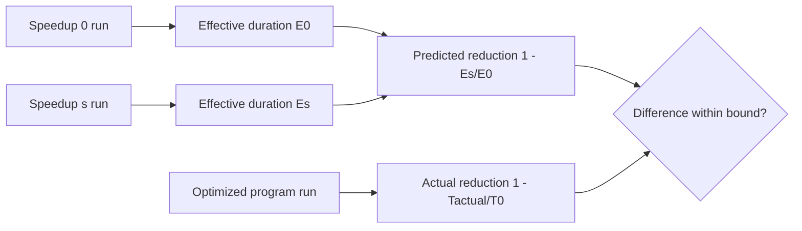

# Target-local CLR prediction

## Decision

The first integrated workload is a managed fork/join program on Linux x64.
A selected thread runs managed work A. A peer thread runs managed work B. The program ends when both threads finish.
No thread blocks before the final join, so the current ledger needs no blocking rule for this model.
Rationale: this model has a known exact answer under Coz semantics, and it contains both a speedup that helps and one that does not.

## Prediction rule

Native Coz subtracts the global delay from the measured time ([Coz paper, section 3](https://arxiv.org/abs/1608.03676)).
For one run at speedup s, the effective duration is `elapsed - global`.
With A on the selected thread and peer debt D paid by B, effective duration is `max(A, B + D) - D`.
If A > B, a real optimization of A by s reduces the program by about `min(s * A, A - B)`.
If A < B, no optimization of A changes the program. Coz predicts no change because B pays D.



## Integration

- `native/service/TargetLocalApi.Linux.cpp` exports a C ABI over `LinuxTargetSession<TargetCreditSink>`.
- The managed program reads method ranges from the runtime perf map, with tiering and ReadyToRun disabled.
  The selected span is the selected method. The eligible spans are both work methods.
- Each worker thread registers itself, runs, closes its epoch, settles, retires, and copies its own journal. The main thread replays all journals.
- `src/CozNet/TargetLocalReplay.fs` replays the journals in managed code. A mismatch invalidates the run.
- The managed program writes one JSON result for each run.

## Acceptance criteria

These criteria are fixed before any qualification run.

1. Configurations: `selected-longer` (A = 2B), `peer-longer` (A = B / 2), and `selected-dominant` (A = 4B). Speedup s = 50%.
   In `selected-dominant`, A(1 - s) is larger than B. Over-credit then shows as an overprediction, which the first two configurations cannot show.
2. Each block runs, in random order: speedup 0, speedup s, the original program, and the program with A reduced by s.
3. Run 5 blocks for each configuration. Keep every block, including failed ones.
4. A block is valid only if every run has a complete epoch, zero loss, a valid managed replay, no ledger failure, and handler time below 5 ms.
5. The predicted reduction is `1 - Es / E0`. The actual reduction is `1 - Topt / Torig`.
6. Pass: in each configuration, the median of the 5 differences is within 5 percentage points, and every valid block is within 10.
7. Overhead: report the ratio of the speedup 0 elapsed time to the original program elapsed time. It is reported, not gated.
8. Any invalid block fails the qualification. Do not rerun an unchanged block to replace it.
9. The analyzer requires exactly 5 blocks, the three named configurations with their round counts, speedup 50, one record per arm,
   the expected arguments for each arm, matching fields in each result, and no record outside the known blocks.
10. Both arms measure elapsed time from the earlier thread start after a shared barrier to the later thread finish.
    Each result records the managed start and finish timestamps of both threads.
    The profile arms finish after `coz_target_finish`, so the closing payment is inside the measurement.

Revision: criterion 1 gained `selected-dominant`, and criteria 9 and 10 were added after review of the first run.
Criterion 10 then changed from the later to the earlier thread start after the second review, before the third run.
The first run used the two-configuration criteria and is kept as superseded evidence. The runner hashes this file.

## Verified state

`samples/CozNet.TargetLocal` and `native/service/TargetLocalApi.Linux.cpp` implement the integration. `TargetLocalPredictionVerify` runs it.
`native/AnalyzeTargetPrediction.py` applies the criteria above and writes `summary.json`.
See [the qualification](../../reliability/features/target-local/prediction.md) for the current result.
The closing call of each worker pays remaining debt at the start of its own work method, which is an eligible address.

```sh
dotnet run --project build/build.fsproj -- -t TargetLocalPredictionVerify
```

## Support boundary

Supported: Linux x64, CPU-bound managed threads that each register through the CozNet API, with no blocking before the final join.
Unsupported: Windows, macOS, locks, tasks, async, thread pool work, blocking I/O, GC-heavy work, and threads that the program does not register.

See [target-local credit](target-local-credit.md), [target-local blocking](target-local-blocking.md), and [the roadmap](roadmap.md).
