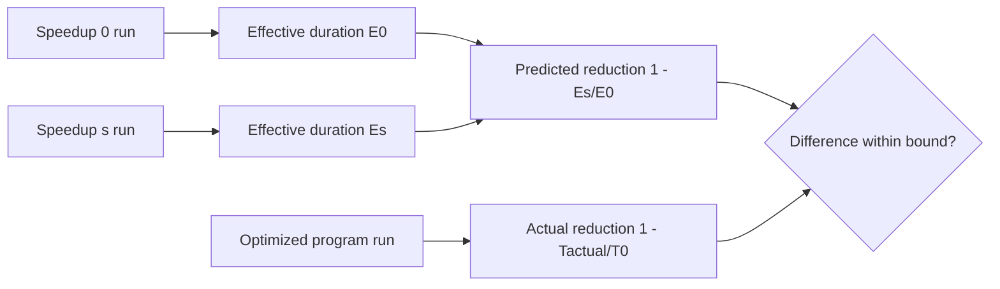

# Target-local CLR prediction

## Decision

The first integrated workload is a managed fork/join program on Linux x64.
A selected thread runs managed work A. A peer thread runs managed work B. The program ends when both threads finish.
No thread blocks before the final join, so the current ledger needs no blocking rule for this model.
Rationale: this model has a known exact answer under Coz semantics, and it contains both a speedup that helps and one that does not.

## Prediction rule

Native Coz subtracts the global delay from the measured time ([Coz paper, section 3](https://arxiv.org/abs/1608.03676)).
For one run at speedup s, the effective duration is `elapsed - global`.
With A on the selected thread and peer debt D paid by B, effective duration is `max(A, B + D) - D`.
If A > B, a real optimization of A by s reduces the program by about `min(s * A, A - B)`.
If A < B, no optimization of A changes the program. Coz predicts no change because B pays D.



## Integration

- `native/service/TargetLocalApi.Linux.cpp` exports a C ABI over `LinuxTargetSession<TargetCreditSink>`.
- `src/CozNet/TargetLocalLinux.fs` binds the ABI and holds the Linux run-queue and thread-usage readers. `src/CozNet/TargetLocalProfiler.fs` resolves perf-map ranges and runs a fork/join profile with managed replay. The sample uses it.
- The managed program reads method ranges from the runtime perf map, with tiering and ReadyToRun disabled.
  The selected span is the selected method. The eligible spans are both work methods.
- Each worker thread registers itself, runs, closes its epoch, settles, retires, and copies its own journal. The main thread replays all journals.
- `src/CozNet/TargetLocalReplay.fs` replays the journals in managed code. A mismatch invalidates the run.
- The managed program writes one JSON result for each run.

## Acceptance criteria

These criteria are fixed before any qualification run.

1. Configurations: `selected-longer` (A = 2B), `peer-longer` (A = B / 2), and `selected-dominant` (A = 4B). Speedup s = 50%.
   In `selected-dominant`, A(1 - s) is larger than B. Over-credit then shows as an overprediction, which the first two configurations cannot show.
2. Each block runs, in random order: speedup 0, speedup s, the original program, and the program with A reduced by s.
3. Run 5 blocks for each configuration. Keep every block, including failed ones.
4. A block is valid only if every run has a complete epoch, zero loss, a valid managed replay, no ledger failure, and handler time below 5 ms.
5. The predicted reduction is `1 - Es / E0`. The actual reduction is `1 - Topt / Torig`.
6. Pass: in each configuration, the median of the 5 differences is within 5 percentage points, and every valid block is within 10.
7. Overhead: report the ratio of the speedup 0 elapsed time to the original program elapsed time.
   Also report the handler share: the sum of all handler intervals divided by elapsed time, in both profile arms. Both are reported, not gated.
8. Any invalid block fails the qualification. Do not rerun an unchanged block to replace it.
9. The analyzer requires exactly 5 blocks, the three named configurations with their round counts, speedup 50, one record per arm,
   the expected arguments for each arm, matching fields in each result, and no record outside the known blocks.
10. Both arms measure elapsed time from the earlier thread start after a shared barrier to the later thread finish.
    Each result records the managed start and finish timestamps of both threads.
    The profile arms finish after `coz_target_finish`, so the closing payment is inside the measurement.

Revision: criterion 1 gained `selected-dominant`, and criteria 9 and 10 were added after review of the first run.
Criterion 10 then changed from the later to the earlier thread start after the second review, before the third run.
Criterion 7 gained the handler share before the run that follows the move of the profiler into `src/CozNet/TargetLocalProfiler.fs`.
The first run used the two-configuration criteria and is kept as superseded evidence. The runner hashes this file.

## Open failure

Run `20261018T182717084-bb88b1d8` fails criterion 6. One `peer-longer` block differs by 12.75 points.
Its `profile-speedup` arm runs 11 ms longer than its sibling blocks, while both plain arms stay within 3 ms.
Transition run `20261018T182834143-78a15e0b` also fails: its peer accepts no sample while the selected thread accepts six.
Hypothesis: the host deschedules one profiled thread. Each profile result now records thread CPU (`cpuNs`) and wall time (`wallNs`).
The analyzer reports the largest `wallNs - cpuNs` for each profile arm. The pass rule does not change.

## Run-queue delay diagnostic

Barrier run `20261018T191852956-237f7bf8` fails criterion 5 in `peer-bound` block 5. The peer accepts no sample while the selected thread accepts five.
No forced GC runs in that workload. The peer wall time exceeds its counted CPU by about 5.5 ms.
Hypothesis: the host scheduler leaves the runnable peer off CPU. Each worker now records the change in kernel run-queue delay
(`/proc/thread-self/schedstat`, field 2) across its work. A failure with a run-queue delay near the sample gap supports the hypothesis.
The pass rules do not change.

## SMT diagnostic

Barrier run `20261018T203120679-31605bcf` fails `peer-bound` with all five differences positive (+3.0 to +7.3 points) and a median overhead ratio of 1.006.
The positive sign holds in every block, but the arm durations do not order the same way in every block. The peer is the critical thread.
The host has two physical cores with two SMT threads each (CPUs 0-1 and 2-3).
Hypothesis: while the peer spins to pay delay, it competes less for its SMT sibling, so its work runs faster than in the plain run.
Test: run the same barrier suite once with `-CpuSet 0,2 -EvidenceDirectory artifacts/target-local-barrier-cpuset`, one thread per physical core.
The hypothesis predicts that `peer-bound` differences lose their positive sign bias. The pass rules do not change, and this run does not replace the failure.
Revision: after review, the second sentence was corrected to match the block records. The hypothesis and the test are unchanged.

## Barrier qualification

These criteria are fixed before the first barrier qualification run. The runner is `TargetLocalBarrierVerify`.

1. Workload: two registered threads run 10 phases. Each phase runs selected work A and peer work B, then both meet at a `TargetBarrier`.
2. Configurations, in rounds of A and B for each phase:
   - `barrier-alternating`: phases alternate (2400, 600) and (300, 600). The expected real reduction is about 40%.
   - `barrier-selected-dominant`: (2400, 600) in every phase. The expected real reduction is about 50%.
   - `barrier-peer-bound`: (300, 600) in every phase. The expected real reduction is about 0%.
3. Each block runs, in random order: `profile-phases 0`, `profile-phases 50`, `plain-phases <pattern> 100`, and `plain-phases <pattern> 50`.
4. Run 5 blocks for each configuration with seed 20261018. Keep every block.
5. A block is valid only if every run exits 0, both epochs complete with zero loss, the managed replay is valid,
   no ledger failure occurs, every handler interval is below 5 ms, all 10 phases complete, and at least one dependency wake occurs.
6. Predicted reduction is `1 - Es / E0`. Actual reduction is `1 - T50 / T100`.
7. Pass: in each configuration, the median absolute difference is at most 5 percentage points, and every block is within 10.
8. Report the skipped delay, the handler share at 0%, and the elapsed ratio. They are not gated.
9. Any invalid block fails the qualification. Do not rerun an unchanged block to replace it.

The exploratory smoke runs before these criteria used the earlier pattern names and are not part of any result.

## Verified state

`samples/CozNet.TargetLocal` and `native/service/TargetLocalApi.Linux.cpp` implement the integration. `TargetLocalPredictionVerify` runs it.
`native/AnalyzeTargetPrediction.py` applies the criteria above and writes `summary.json`.
See [the qualification](../../reliability/features/target-local/prediction.md) for the current result.
The closing call of each worker pays remaining debt at the start of its own work method, which is an eligible address.

```sh
dotnet run --project build/build.fsproj -- -t TargetLocalPredictionVerify
```

## Support boundary

Supported: Linux x64, CPU-bound managed threads that each register through the CozNet API, with no blocking before the final join.
Unsupported: Windows, macOS, locks, tasks, async, thread pool work, blocking I/O, GC-heavy work, and threads that the program does not register.

See [target-local credit](target-local-credit.md), [target-local blocking](target-local-blocking.md), and [the roadmap](roadmap.md).
