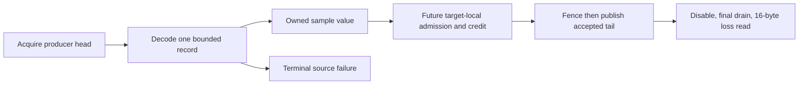

# Target-local CPU sample processing

## Decision

The nominal timer scheduler diagnostic identifies managed controller preemption before delayed credit publication.
Move toward target-local source processing and payment ownership in separate verifiable steps.
The first component is a native decoder for the existing task-clock sample ABI.
It cannot call managed code, allocate, resolve symbols, or acquire locks during record decoding.
The shared decoder is portable C++20. Platform adapters own ring mapping, memory barriers, signal provenance, and thread lifetime.

## Decoder contract

Parse the ring layout, process identity, target identity, fixed nominal period, and read format before use.
Decode at most one sample per call, including a wrapped record.
`PerfSampleReadFormat::count` requires 48-byte records. `count_and_loss` requires 56-byte records with zero embedded loss.
The format parameter has no default. An unnamed enum value rejects at parse.
Require user-mode IP, matching process/thread, positive timestamp, fixed period, and nondecreasing timestamp and cumulative CPU.
Reject invalid ring bounds, truncated records, unknown records, loss, and throttling.
The first error is terminal. Failed calls cannot advance the accepted tail or repair earlier failures.
An empty ring is distinct from failure. Accepted sample values contain no borrowed pointers.

```cpp
auto plan = PerfSampleRingPlan::parse(bytes, processId, threadId, period, PerfSampleReadFormat::count_and_loss);
PerfSampleRingReader reader(*plan, initialTail);
auto result = reader.read(acquiredHead);
```

## Linux adapter contract

`native/service/PerfRing.Linux.h` consumes a borrowed, writable Linux x64 perf mapping with one exclusive reader.
`LinuxPerfRingPlan::attributes(period)` builds the only accepted 96-byte task-clock attributes with `PERF_FORMAT_LOST`.
`parse` requires byte-identical attributes, so sideband, wakeup, watermark, and reserved fields cannot differ.
It also requires page alignment, matching `data_offset` and `data_size`, and zero head and tail.
`read()` acquires `data_head`, decodes one record, then issues a full fence and a relaxed tail store.
A release store is a valid alternative under the Linux tools contract. The current code uses the full fence.
Each result distinguishes snapshot completion from remaining backlog. Neither result proves source closure.
The caller owns event disable, final drain, the 16-byte count/loss read, and mapping lifetime.
`LinuxPerfCountLoss::parse` accepts only a 16-byte return.
No older-kernel fallback can claim complete loss evidence.

```cpp
auto attr = LinuxPerfRingPlan::attributes(1000000);
auto plan = LinuxPerfRingPlan::parse(mapping, pageSize, attr, getpid(), gettid());
LinuxPerfRing ring(*plan);
auto next = ring.read();
```



## Verified state

`ServiceOwnerVerify` on Windows passes 18 checks. A Linux x64 build with `PERF_FORMAT_LOST` headers adds `perf-ring`.
`LinuxServiceOwnerVerify` passes 19, including `perf-sample-ring`, `target-sample-dispatch`, and `perf-ring`.
`LinuxPerfRingVerify` runs `normal`, `overflow`, and `epochs` live on `5.15.153.1-microsoft-standard-WSL2`.
Evidence and its limits are in [the perf ring capture](../../reliability/features/native-signal/perf-ring.md).
The live overflow mode decodes 73 samples, finds no loss record, and reads positive final loss.
The producer runs on the consumer's CPU. Cross-CPU head and tail visibility is not observed.
The embedded loss check is a second guard. A `PERF_RECORD_LOST` record precedes the next sample after loss.

The `PerfRingWorkload` drain loop is unbounded. [Target-local dispatch](target-local-dispatch.md) tests budget-limited live drains.
The synthetic decoder checks do not enumerate every `misc` mode and flag combination.
`PERF_FORMAT_LOST` on the verified kernel is a backport. Probe each executing kernel. Do not infer support from its version.
The managed `tests/CozNet.LinuxPerf` path uses `read_format = 0` and does not consume this adapter.

## Remaining contracts

[Target-local dispatch](target-local-dispatch.md) defines notification, bounded dispatch, and epochs over this adapter.
[Target-local credit](target-local-credit.md) adds native credit and bounded payment. [Target-local prediction](target-local-prediction.md) adds managed replay and the CLR qualification.
Retain cancellation, code revocation, delivery quiescence, first receipt, and failed-prefix evidence.
Keep the 2 ms debt, 2 ms lease, 50 us requested child, 5 ms handler, and 100 ms receipt bounds unchanged.
Do not divide retrospective credit or claim that target-local sampling alone fixes capacity.

See [nominal timer evidence](../../reliability/features/native-signal/timer-nominal-credit.md), [target leases](target-local-lease.md), and [the index](../lode-map.md).
