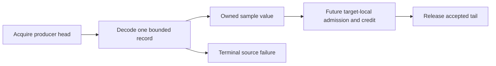

# Target-local CPU sample processing

## Decision

The nominal timer scheduler diagnostic identifies managed controller preemption before delayed credit publication.
Move toward target-local source processing and payment ownership in separate verifiable steps.
The first component is a native decoder for the existing task-clock sample ABI.
It cannot call managed code, allocate, resolve symbols, or acquire locks during record decoding.
The shared decoder is portable C++20. Platform adapters own ring mapping, memory barriers, signal provenance, and thread lifetime.

## Decoder contract

Parse the ring layout, process identity, target identity, and fixed nominal period before use.
Decode at most one 48-byte sample per call, including a wrapped record.
Require user-mode IP, matching process/thread, positive timestamp, fixed period, and nondecreasing timestamp and cumulative CPU.
Reject invalid ring bounds, truncated records, unknown records, loss, and throttling.
The first error is terminal. Failed calls cannot advance the accepted tail or repair earlier failures.
An empty ring is distinct from failure. Accepted sample values contain no borrowed pointers.
The platform adapter publishes only the decoder's accepted tail after the required barrier.
The adapter must bound records and elapsed work per dispatch. A remaining backlog is explicit, never silently treated as a valid completed drain.

```cpp
auto plan = PerfSampleRingPlan::parse(bytes, processId, threadId, period);
PerfSampleRingReader reader(*plan, initialTail);
auto result = reader.read(acquiredHead);
```



## Remaining contracts

`ServiceOwnerVerify` and `LinuxServiceOwnerVerify` each pass all 17 native checks, including `perf-sample-ring`.
The decoder checks cover physical wrap, owned values, malformed records, producer bounds, and terminal prefix preservation.
These synthetic checks do not exercise a live perf mapping or concurrent kernel publication.

The wire format is little-endian. A live adapter must verify producer endianness and the exact sample and read formats.
The decoder cannot infer that configuration from record lengths alone.
Synthetic coverage currently checks user mode and kernel-mode rejection, but does not enumerate every `misc` mode and flag combination.
This coverage limit is accepted for the isolated decoder. Live integration needs source-configuration and mode fixtures.

The decoder does not establish concurrent ring-read safety, target-local dispatch, or CLR signal safety.
Before live use, implement a Linux adapter with the documented perf head/tail barrier contract and bounded work.
Then define source disable/drain/resume epochs, native credit publication, bounded target payment, and exact-once managed reconciliation.
Retain cancellation, code revocation, delivery quiescence, first receipt, and failed-prefix evidence.
Keep the 2 ms debt, 2 ms lease, 50 us requested child, 5 ms handler, and 100 ms receipt bounds unchanged.
Do not divide retrospective credit or claim that target-local sampling alone fixes capacity.

See [nominal timer evidence](../../reliability/features/native-signal/timer-nominal-credit.md), [target leases](target-local-lease.md), and [the index](../lode-map.md).
