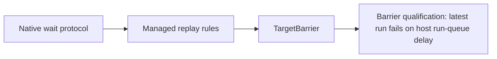

# Target-local verification status

The qualification runners hash [the prediction plan](target-local-prediction.md), [the transition plan](target-local-transitions.md),
and [the blocking plan](target-local-blocking.md). Those files change only before a run. This file holds the state after the latest runs.

## Wait protocol

The wait protocol is implemented. `TargetBarrier` is the only primitive that uses it.

- `ThreadDelayAccount` has `catchUp`, `post`, `beginBlock`, and `endBlock`. `settle` returns `blocked` while blocked.
- `LinuxTargetSession` has `suspendNotifications`, `resumeNotifications`, and `drainNow` for explicit calls on the session thread.
- The C ABI has `coz_target_post`, `coz_target_wait_begin`, and `coz_target_wait_end`.
- `TargetBarrier` in `src/CozNet/TargetLocalProfiler.fs` is lock-free. The last arriver posts. Other arrivers block, wait on the phase event, and wake with its token.
  An arriver that blocks after the release has a block global at or above the token, so it skips nothing.
- `TargetLocalReplay` checks `block`, `wake`, and `post` events.
- A post does not require local delay to equal global delay, because another thread can publish between catch-up and post.
- The native wake check requires a token no larger than the largest posted token. The replay proves exact match.
- Any worker failure cancels a run-wide token. Barrier waits observe it, so a failed worker cannot leave a peer waiting forever.

```fsharp
let barrier = TargetBarrier 2
let work () = for phase in phases do runPhase phase; barrier.SignalAndWait()
```

Deterministic checks cover dependency, timeout, cancellation, and spurious wakes, debt at block, the post race, and each protocol violation.
A mutation that skips to the wake-time global delay fails the native race check.
The latest [barrier qualification](../../reliability/features/target-local/barrier.md) fails `barrier-alternating`. Earlier barrier runs pass.



## Open failures

Prediction run `20261018T182717084-bb88b1d8` and transition run `20261018T182834143-78a15e0b` fail on the tree before the CPU diagnostics.
Transition run `20261018T190118893-b2109c5d` fails 1 of 10 runs on the current tree. Both threads show about 8 to 9 ms of wall time above counted CPU in that run.
The passing run 7 shows 3 to 5 ms. The forced GCs pause both threads, so the coarse value cannot separate the two threads.
In both, one profiled thread loses time: an 11 ms longer profiled arm, and a peer with no samples while the selected thread accepts six.
Profile results now record counted thread CPU and wall time. The counted CPU stops at disable, and the wall time includes the closing payment, so their difference is coarse. The next runs pass, so they do not test the descheduling hypothesis yet.
Barrier run `20261018T191852956-237f7bf8` shows the same signature with no forced GC: in `peer-bound` block 5, the runnable peer accepts no sample for about 5 ms.
That makes forced GC an unlikely sole cause. Each worker now records its kernel run-queue delay from `/proc/thread-self/schedstat`.
The runs after that change all pass. A 50% arm records at most 0.76 ms of run-queue delay. A 0% arm records 10.2 ms, which cannot break the bound because a 0% arm publishes no credit.
The host therefore does deschedule runnable profiled threads for several milliseconds.
Barrier run `20261018T193110908-a2f5b436` confirms the effect on prediction. Its two blocks outside the 10-point limit each have one long run-queue delay:
81.3 ms in a 0% arm (+11.73 points) and 17.1 ms in a 50% arm (-10.77 points). The other blocks have small delays.
Next hypothesis: dedicated CPUs remove the delay. Test it with a container `--cpuset` on an idle host, with criteria fixed before the run.
No debt failure has been captured with this diagnostic yet.
The prediction run `20261018T192337237-ab4134f4` passed with a `selected-longer` median difference of 4.09 points. The latest run `20261018T193237454-cc14a621` passes with 2.95 points.

See [the roadmap](roadmap.md) and [the summary](../summary.md).
