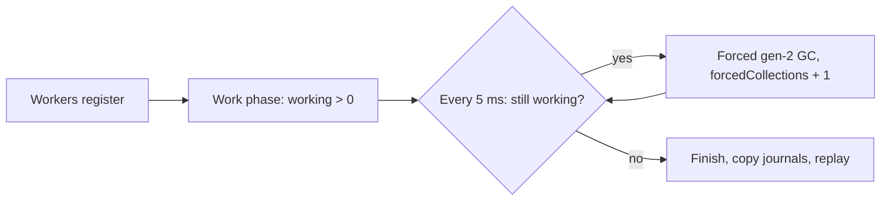

# Target-local runtime transitions

## Decision

The first runtime-transition check forces blocking full GCs while both profiled threads run and pay delay.
GC suspension is the CLR transition most likely to interact with a signal handler that spins at a managed address.
A thread inside the handler cannot reach a GC safe point until the handler returns. The handler is bounded below 5 ms.

## Acceptance criteria

These criteria are fixed before the first run.

1. `profile-gc 50 6000 3000 5`: while at least one worker is in its work phase, the main thread sleeps 5 ms and then calls
   `GC.Collect(2, Forced, blocking)` if a worker is still working. Registration and journal copying are outside that window.
2. Run 10 times. Keep every run.
3. Each run must exit 0 and write a passing profile result: complete epochs, zero loss, valid managed replay, and no ledger failure.
4. Each run must record at least 10 forced collections inside the work window (`forcedCollections`).
5. Each handler interval must stay below 5 ms.
6. No run is repeated to replace a failure.
7. `cleanup`: one profile whose monitor throws must raise `AggregateException` with that failure.
   A second profile in the same process must then pass. This shows that the first run closed its experiment.

Revision: criteria 1 and 4 changed after review of the first run, before the second run.
The first run counted collections from thread start to join. At least 5 ms passes between its forced collections, so its 42 to 66 collections
needed 210 to 330 ms of thread lifetime. Its timed work lasted about 110 ms, so most collections fell outside profiling.



These checks do not test prediction accuracy under GC. They do not cover JIT, tiering, ReJIT, thread abort, or process exit.

```sh
dotnet run --project build/build.fsproj -- -t TargetLocalTransitionsVerify
```

Revision: criterion 7 was added before the run that follows the cleanup changes in `TargetLocalProfiler.run`.
Revision: the sample now runs through `TargetLocalProfiler.run`. The work-window counter moved into the library with no change to criteria 1 to 6.

See [target-local prediction](target-local-prediction.md) and [the signal transition history](../profiling/signal-transitions.md).
