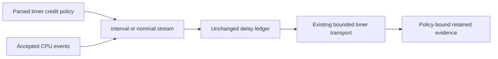

# Nominal-event credit for timer intervention

## Decision

Add an opt-in nominal-event policy to the existing timer workload before another timer prediction series.
Both paths support this rule. The timer default still uses cumulative periods and excludes the first accepted event in each epoch.
Native Coz credits the selected event's nominal period, including first events. This is a semantic mismatch, not proof of the timer prediction gap's cause.
The timer actuator avoids IL loop probes but retains its separate CLR safety, scheduling, ownership, and capacity limits.

## Evidence

The callback-reuse four-arm block completes with a 9.9977–10.0364 percentage-point shortfall.
All treatment credit is source-inside. This does not bound missing observations or exact attribution.
Further callback allocation tuning cannot be assumed to resolve inline instrumentation effects.
See [the retained block](../../reliability/features/native-signal/receipt-callback-reuse.md#matched-physical-comparison).

Audit `artifacts/timer-estimator-audit/20261016T124139832024` replays nine retained timer treatments without changing their credit.
It checks every recorded credit and the frozen total under the current interval rule.
The three completed treatments in the old matched series exclude 27, 23, and 36 selected first events.
At 50% speedup, their excluded event weights are 13.5, 11.5, and 18 ms.
The other six cases retain workload failures. No subset prediction or alternative execution is inferred.
This accounting audit does not replay source counters or establish source-time membership.

## Implementation contract

1. Parse the policy before setup effects. Keep interval behavior as the default and reject unsupported declarations.
2. Reuse the existing nominal stream and ledger APIs. Keep a fixed 1,000,000 ns live period and reject mismatched observations.
3. Permit one selected check after a first nominal event. Preserve interval cadence and avoid repeated checks without a new event.
4. Prepare the nominal path with separate synthetic state. The current synthetic source emits an 80,000 ns period and starts at epoch zero.
   Nominal preparation needs a positive epoch and an explicitly matching synthetic period. Live state must restart with period 1,000,000 ns.
5. Bind policy, version, and period metadata to the runner and retained replay. Preserve legacy interval records and failed-workload diagnostics.
6. Update counter/credit and membership consumers together. Unknown policy or partial declarations must reject before comparison.
7. Check initial and resumed events, unmapped observations, period mismatch, epoch regression, and fractional remainder.
8. Run one declared timer capture with the new policy before proposing a matched series. Retain every outcome without timing retries.

```fsharp
SignalAccounting.registerNominal 50 1000000UL (SignalAccounting.create ())
```

This existing ledger API supplies event credit. It does not supply source admission or native payment safety.



Keep measured wall-time payment and all debt, lease, child, handler, and receipt bounds unchanged.
Do not replace recorded credit with retrospective alternate weights or claim that nominal credit will fix capacity or accuracy.
The implementation supplies the policy, cadence, synthetic reset, and policy-bound replay.
Managed checks, counter replay, membership replay, and matched-plan rejection checks pass.
Both adversarial reviews clear the fixed live-period declaration. Injected preparation failure remains an accepted test gap.
The [declared capture](../../reliability/features/native-signal/timer-nominal-credit.md) passes both replays but retains a 2,361,731 ns treatment peer-debt failure.
Successful preparation and live reset are verified on Linux x64. Native safety, stable capacity, and prediction accuracy remain unverified.
Investigate the retained failure before another matched series. Do not retry the unchanged capture.
The matched timer protocol remains interval-only.
See [nominal credit](../profiling/nominal-event-credit.md), [sampled timers](../profiling/timer-sampled.md), and [the roadmap](roadmap.md).
