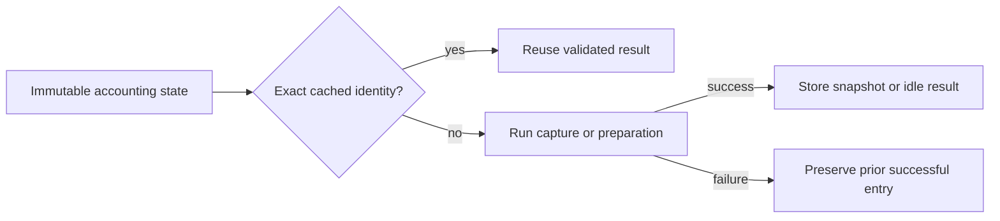
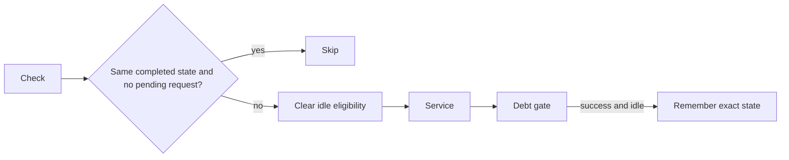

# Immutable accounting reuse

`CooperativeAccountingCache` binds selected and peer handles in the controlled bound sampled workload.
The selected owner alone mutates the accounting variable and uses the cache.
No native state, receipt acceptance, source ownership, or CLR admission is cached.

```csharp
var prepared = accounting.PreparePeer(state);
state = prepared.State;
var debt = accounting.Observe(state);
```

`Observe` caches one successful `CooperativeDebtSnapshot` by exact `SignalAccounting` reference.
Different state objects require full capture even if debt numbers agree.
`PreparePeer` caches only the resulting state from a successful no-lease preparation.
It skips repeated preparation only for that exact resulting state.
A reservation clears the idle entry. Exceptions do not replace successful entries.
The F# accounting model remains immutable and does not change its behavior.



Peer overshoot is published through the full catch-up operation before its idle result is cached.
Pending and settled service states are different objects, so their observations cannot reuse older operation data.
Fresh debt records retain current timestamps and enforce the unchanged 2 ms gate.
`BoundSampledPaymentWorkload.Debt` is a readonly value record with nine signed 64-bit fields.
Each observation still reads the current timestamp and accounting snapshot.
Nullable peak, final, and failure observations retain value copies without one heap object per observation.
`ObservePeaks` selects each debt maximum independently and retains the original timestamp on ties.
Its direct check covers initial absence, independent increases, decreases, and ties.
The JSON shape retains the same nine properties and null for an absent observation.
The calling-thread allocation check detects 880,000 bytes over 10,000 observations with the earlier reference record.
It requires zero bytes for the value-record construction and retention path.
This removes allocation, not the observation, native polling, or debt gate.
The [live integration](../../reliability/features/native-signal/debt-value-observations.md) passes zero, 50-percent, and expected-invalidation cases.
The final helper and allocation checks pass on Windows and Linux. Full-workload timing benefit remains unmeasured.
The debt error message is formatted only when the gate fails.
`CooperativeAccountingCacheChecks` covers reuse, new credit, pending and unsettled service, overshoot publication,
equal-debt distinct state, foreign-state rejection, and recovery of the previous valid cache entry.
Fresh idle and post-overshoot checks compare cached results with full model preparation and capture using structural equality.
They protect the required idempotence of idle preparation, including fields outside numeric debt.

## Idle service cadence

`CooperativeServiceCadence` skips service only for the exact immutable state from a successful idle completion.
The selected owner exclusively owns both cadence and accounting state.
Pending peer requests always execute service, including receipt timeout checks.
An executing check clears prior eligibility before any operation can fail.
Only completion after the debt gate records an idle state. Pending completion records none.
Source draining, native probe polling, sample publication, and selected payment remain outside this skip.
New sample states still run their per-sample debt gates and force the next service check.
Frozen measurement can suppress new requests but cannot suppress service of a pending request.

```csharp
if (!serviceCadence.ShouldRun(state, pending is not null)) return;
// Service completion follows the successful debt gate.
serviceCadence.Completed(state, pending is not null);
```



Skipped service does not refresh `lastObservedDebt.Timestamp` or peak timestamps.
Failure capture retains the latest actual observation. Final debt still has an explicit observation.
The serialized `serviceCadence` counts checks, executions, and skips. Checks equal executions plus skips.
These diagnostic counters include final draining after measurement freeze. Replay does not validate them.
The focused checks cover incomplete service, pending service, failure, equal-valued distinct states, new credit, and counters.
Host focused checks and all four Linux managed groups pass.
Capture `artifacts/idle-service-payment/20261016T054616424-5a308ffc` passes zero, 50-percent, and expected-invalidation cases with unchanged inputs and bounds.
Zero speedup skips 500,000 of 500,350 checks. Treatment skips 423,869 of 500,392 checks.
The invalidation case skips 1,342 of 1,392 checks and retains its expected CLR lifetime failure.
These counts do not establish timing benefit or prediction accuracy.
The four-arm capture `artifacts/idle-service-comparison/20261016T055259832-46175858b67647b092ab034e16bc742d` completes all arms without invalid records or changed inputs.
Its sampled reduction is −5.1888% to −5.1302%, versus 49.7434% to 49.7670% physically.
It remains unqualified. Separate earlier blocks do not isolate the performance effect of reuse.
Owner draining and sample publication still precede the guard and need separate component measurement.
See [the retained checks and preceding comparison](../../reliability/features/native-signal/idle-service-cadence.md).

The baseline component run `artifacts/accounting-cost/20261015T182853729` retains 672 bytes per debt capture,
328 bytes per idle preparation, and 1,000 bytes per combined call.
These isolated measurements do not establish their share of full profiler overhead.
The seven-stage run `artifacts/accounting-cost/20261015T183419066` measures zero allocation for repeated-state cache hits.
The same-process uncached combined stage retains 1,000 bytes per call.
The zero-speedup live reference capture retains a median paired ratio of 2.95 with all 16 records valid.
The live cadence matrix passes all twelve cases without changing a bound.
Continuous treatments still perform 19,173 and 10,504 pauses with only 2 and 12 mapped complete intervals.
This single successful matrix does not establish stable capacity or prediction accuracy.
See [the retained comparison](../../reliability/features/native-signal/accounting-reuse.md).
See [ledger debt](cooperative-debt.md), [observer overhead](observer-overhead.md),
[the reference](../../docsSrc/Reference/cooperative-managed.md), and [the index](../lode-map.md).
