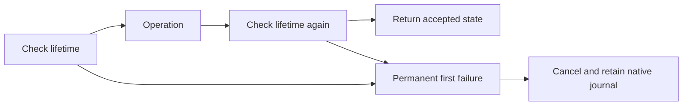

# CLR-bound payment boundary

`BoundCooperativeClient` composes the native cooperative client with `ClrProbeLifetime`.
`ClrProbeBinding` parses copied CLR identities. Availability remains a separate runtime observation.
Every guarded operation checks lifetime before and after execution. The first failure is permanent and thread-safe.
Each check compares all captured CLR identity fields, not only the instrumentation generation.
The native Ready state also requires successful capture of one valid native method range.
Controller operations use cached static delegates with value-tuple arguments. Probe guards do not allocate a closure per call.

```csharp
var generation = client.Submit(0, command, budget);
var accepted = client.ReadAndAccept(0, adapter, state);
```

Typed bound callbacks receive the injected generation/site directly.
The entry site cannot pay a loop lease. The loop site uses the registered worker and admitted generation.
Owner identity cannot be replaced by a second registration attempt.
If post-operation validation fails, native ownership remains available for cleanup.
If receipt settlement is rejected after computation, the caller retains the old immutable ledger state.



Cleanup bypasses lifetime acceptance, never ownership checks.
Cleanup polls require a successful controller cancellation and do not establish injected-origin evidence.
`BeginCleanup` attempts each slot even if an earlier slot fails. It reports those failures together after all cancellation attempts.
`CooperativeCleanupCancellation` owns this sequence and each slot's polling permission.
Permission follows successful cancellation return. A failed retry preserves any earlier successful cancellation.
Its injected pending, visibility, and cancellation operations permit deterministic failure checks without native API calls.
Completion requires close after owner join and another lifetime check.
Invalidation after accepted settlement rejects completion without rolling back the returned ledger.
Completion is a point-in-time boundary, not a code pin.

The live fixture invalidates through a second matching module at four lifecycle boundaries.
The paid case verifies independent generation reuse. Pure checks cover invalidation during a guarded operation and after computed settlement.
Live invalidation during a native wait, sampled capacity, overhead, and prediction remain unverified.
Windows run `artifacts/cooperative-interop/20261015T112241819-7b31dbc2` and Linux run `artifacts/cooperative-interop/20261015T112452730-5b8ebd59` pass twenty cases with unchanged inputs.
Both runs exercise the full native identity comparison and reject altered captured bindings.
Both also pass the managed guard/receipt checks and twelve native checks.
The managed checks reject both directions of legacy/bound callback replacement and helper mismatch.

See [reference](../../docsSrc/Reference/bound-cooperative.md), [procedure](../../docsSrc/How_Tos/verify-bound-cooperative.md), [probe identity](probe-identity.md), and [managed receipts](cooperative-managed.md).
