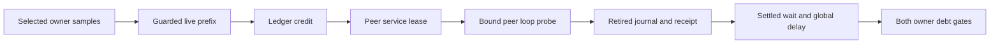

# Sample-driven cooperative peer payment

`BoundSampledPaymentWorkload` composes the bound collection, `SignalAccounting`, and `BoundCooperativeClient`.
The selected owner also runs the controller. Its event excludes the separate peer's payment CPU by thread ownership.
Both owners execute the bound method. Only the peer services loop-site requests.

```csharp
var incoming = collection.ReadProvisional(samples.Count);
var observed = SignalAccountingModule.observe(selected, observation, state);
var accepted = client.ReadAndAccept(0, adapter, state);
```

The selected producer uses fixed eligibility epoch 1 and excludes its first observation as a baseline.
It credits selected nominal periods, not the cumulative source counter delta.
The source retains cumulative counters independently for final reconciliation.
Per-sample processing advances its offset only after the ledger accepts the observation.
Final source acceptance compares the consumed prefix and processes the retained tail.



Peer overshoot can create selected debt. The selected owner does not pay it.
Selected catch-up runs only when credit covers global delay. Outstanding selected debt remains visible and bounded by 2 ms.
The controller does not subtract unconfirmed partial wait from peer debt.
It accepts the retired journal once, then copies and releases native ownership.
The native adapter retains the existing 50 us child, 5 ms handler, and 100 ms receipt gates.

`LastAccountingObservation` retains the receipt parser's latest result even when later acceptance fails.
It is reset before each active attempt and does not establish accepted state by itself.
Successful payments retain that observation and the separate cleanup copy.
Submission sets the reported generation to zero until a native generation is returned.
Native ownership can still exist after failed submission and remains available through client cleanup.

The zero-percent case requires no credit or payment. The 50-percent case requires real selected samples and positive accepted payment.
The invalidation case loads a duplicate matching module after payment and requires both completion paths to reject.
Expected peer lifetime rejection is retained separately from unexpected cleanup errors.
Native payment remains irreversible after final evidence rejection.

JSON serialization includes native struct fields. Empty objects cannot support payment analysis.
`AnalyzeBoundSampledPayment.py` checks nominal credit, native children, receipts, release copies, and recorded debt arithmetic.
Its fifteen portable checks reject missing fields, altered credit/payment, missing or inconsistent debt evidence, duplicated cases, broken continuation, and incomplete cleanup.
They also bind child requests to remaining budgets, first receipt captures to snapshots, and final cleanup to pending or released ownership.
The analyzer preserves runtime failure even when the retained partial evidence is internally consistent.

## Retained runs

`artifacts/bound-sampled-payment/20261015T122927095-b5d2f150` passes both initial runtime cases.
The 50-percent case reports 787,000,000 ns credit and 1,574 accepted payments.
Its native fields serialized as empty objects, so the JSON cannot independently establish child accounting.
`artifacts/bound-sampled-payment/20261015T123306031-043ee6ac` retains the same serialization defect.
Its zero-percent and after-payment invalidation checks pass, but the 50-percent case rejects 2,499,933 ns observed peer debt.
The record retains 259 earlier payments and a pending command 260. Missing native fields prevent attributing that pending request's delay.
Do not use the earlier passing case to erase this capacity failure.

`artifacts/bound-sampled-payment/20261015T123957055-78443f07` retains native fields and passes all three cases plus independent replay.
It includes 1,990 normal 50-percent source records, 808,500,000 ns credit, and 1,617 payments totaling 808,500,078 ns.
Observed peak debt is 467,524 ns selected and 999,929 ns peer. Final selected residual debt is 78 ns.
The invalidation case retains one 500,083 ns payment and rejects both completion paths.
At that time, both managed contract groups, twelve native checks, and five analyzer checks passed.
The current analyzer has fifteen passing checks. Its retained replay uses the same live records with updated Python source hashes.
This establishes restricted live integration in that run, not stable capacity across scheduling conditions.
Windows run `artifacts/cooperative-interop/20261015T124752598-94a63709` passes twenty existing bound payment/lifetime cases with the shared client change.
It does not run the Linux-only sampled workload.

This is a capacity diagnostic, not a complete Coz engine. General eligibility, selected-owner payment, overhead, and prediction remain unverified.
The controller and source factory are portable. Only the Linux CPU source is wired to the live command.
See [the reference](../../docsSrc/Reference/bound-sampled-payment.md), [the procedure](../../docsSrc/How_Tos/run-bound-sampled-payment.md),
[bound samples](bound-samples.md), [bound payment](bound-cooperative.md), and [eligibility research](../../docsSrc/Research/cooperative-sample-eligibility.md).
