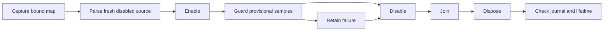

# Bound CPU sample collection

`BoundSampleCollection` owns one source and one collector after capturing a CLR-bound native map.
The source factory receives the map explicitly. Linux no longer needs a runtime perf map for this route.
The existing default Linux map path remains available to earlier callers.

```csharp
collection.Start((map, sink) => new LinuxCpuEventSession(sink, map));
var accepted = collection.Complete();
```

`BoundCpuEpoch` parses a new disabled source with zero CPU count and no transitions.
The initial drain must be empty. A reused source is rejected even if its ring has been drained.
The source epoch is not a thread eligibility epoch. This collection does not issue causal credits.
The sink guards sample validation before and after execution. It checks owner, ordering, counter evidence, and exact range labels.
Failed post-validation does not append the proposed sample.
All samples remain provisional until final closure and lifetime acceptance.



Cleanup retains ownership after admission or collection fails. Each stage runs even when another stage fails.
The final snapshot retains source cleanup state after disposal. A source adapter must keep its counter journal readable after disposal.
Completion requires one successful enable/disable pair, the same source identity, zero losses, and matching sample/count metadata.
The final counter covers the retained sample counters. Source transitions and counter readings retain their timestamp ordering.
Diagnostics become available only after collector completion. They are not accepted experiment input after rejection.
Collection is one-shot. A later epoch requires a new source and collection object.

The live fixture uses interval 1024 with runtime perf-map output disabled.
It checks normal collection and duplicate-module invalidation before enable, during collection, and after closure.
The shared factory is the extension point for other platforms. Windows has portable checks, not a CPU-event backend.
Source clock error bounds, measurement membership, eligibility, per-sample overhead, payment capacity, and prediction remain unverified.

## Retained evidence

`artifacts/bound-samples/20261015T120104364-2f5d3686` passes portable checks and all four live cases.
Normal collection retains 2,009 samples, including 1,924 selected-method samples, with no reported loss or throttling.
`FreshEpochAndFinalDrain` withholds its records until disable to verify final-drain ordering.
The legacy map regression passes under `artifacts/linux-perf/bound-samples-legacy-regression`.
The three invalidation cases reject completion and retain collector-join and source-disposal evidence.
Rejected diagnostics can exceed the last published batch when a drain fails after provisional sample acceptance.
They do not establish complete sample accounting.

`artifacts/bound-samples/20261015T114827002-d70442ac` retains the initial evidence serialization failure.
`System.Text.Json` cannot serialize `System.UIntPtr` in the binding.
The workload projects module and function identifiers to `ulong` for JSON evidence.
This failure is not a timing or capacity result.

See [the reference](../../docsSrc/Reference/bound-samples.md), [the procedure](../../docsSrc/How_Tos/verify-bound-samples.md),
[the map contract](probe-identity.md), and [bound payment](bound-cooperative.md).
