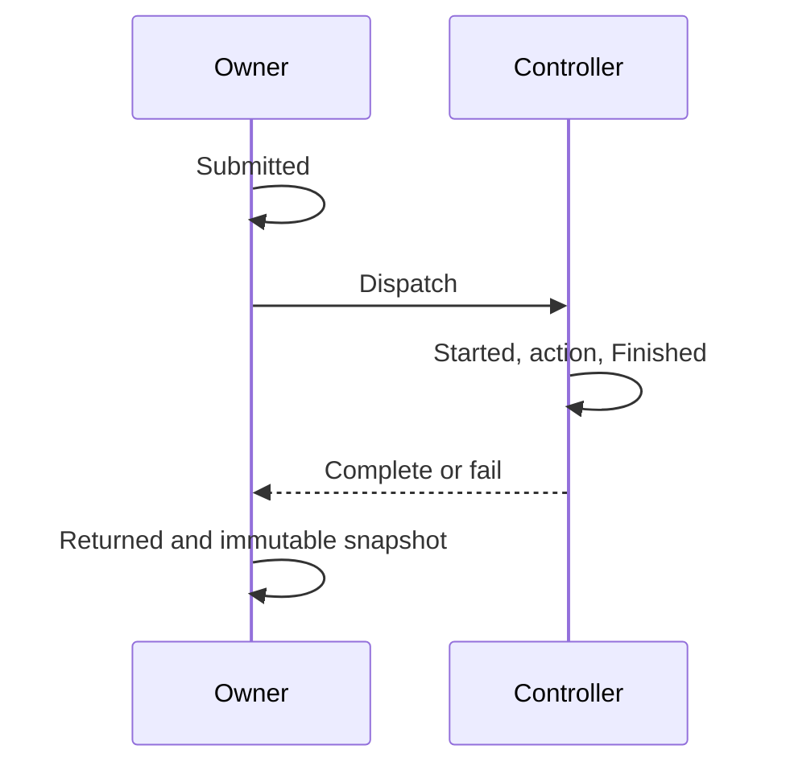

# Cooperative controller dispatch timing

`COZNET_DISPATCH_TIMING=1` enables timing on the selected-payment workload's controller calls.
`CooperativeDispatchTiming.Parse` returns no observer for an absent value or `0`.
The shared observer uses `Stopwatch` and managed synchronization. It has no platform-specific API.
The live sampled source remains Linux-only.

```csharp
var timing = CooperativeDispatchTiming.Parse("1")!;
var result = timing.Run(CooperativeDispatchOperation.PeerRead, command, generation,
    ReadReceipt, action => controller.Run(action));
```

Each record retains operation, command, generation, sequence, and four managed timestamps.
`Submitted` precedes dispatch. `Started` precedes the controller action. `Finished` follows the action, including an action failure.
`Returned` follows caller observation of dispatch completion or failure.
Queue time is `Started - Submitted`. Action time is `Finished - Started`. Return time is `Returned - Finished`.
These brackets include clock, synchronization, and exception-handling cost.
They do not measure pure scheduling latency or CPU time.
The return bracket includes worker result/fault publication, not only caller wakeup.
`Returned` precedes journal and maximum updates. The total bracket excludes this final observer work.



The observer retains the first 32 and latest 128 snapshots and independent longest total, queue, action, and return records.
`PrefixEvidenceVersion=1` binds the required `Prefix` array to the first `min(Calls, 32)` sequences.
Legacy evidence without both fields remains readable. Overlapping retained sequences must have identical observations.
Legacy compatibility permits omission of both prefix fields. There is no independent runner requirement for prefix evidence.
Attribution must inspect the actual prefix and request identity, not infer their presence from replay success.
Replay includes prefix records in count, ordering, maximum, and direct-readiness checks.
Peer-progress analysis can find an evicted submit in the prefix.
It counts all calls, dispatch failures, and incomplete actions.
A failed dispatch can have no start or finish. A later callback cannot change its immutable snapshot.
`Run` requires its owning thread. Controller callbacks update only their private timestamp bracket under a lock.
The workload records create, request, header, receipt, release, failure-capture, and cleanup operations separately.
Submit records retain generation zero because the native generation is not yet returned.
Global session operations retain zero command and generation.

Timing does not change exception wrapping, payment acceptance, native ownership, or timing limits.
It adds allocations, locks, and clock reads when enabled. Capacity results cannot isolate this observer cost.
The current clock provider must be monotonic and nonthrowing. Runtime capture uses `Stopwatch.GetTimestamp`.
Controlled checks use a deterministic clock and exercise both deferred and active dispatch failures.
Replay checks timestamps, sequence, bounded history, counts, duplicate identity, and extrema against retained observations.
Count reconciliation includes unique maxima records that have left recent history.
Unretained incomplete calls must fit within unretained failures. A completed workload cannot contain failed dispatches.
Evicted observations cannot be independently reconstructed.
Replay does not bind diagnostic request identities to payment or failure-boundary records.
Operation labels and the selected/peer identity mapping have source review, not isolated workload-wiring checks.
Header polling can evict submit records. Global maxima can belong to setup or cleanup.

The [8192 first-request capture](../../reliability/features/native-signal/sparse-first-receipt-timing.md) demonstrates this retention gap.
Its 810 treatment calls retain only sequences 683–810 and session creation as all four maxima.
The first peer request lasts 21.742797 ms, but its submit/read/release dispatches are absent.
Current prefix retention addresses this gap for calls within the first 32 sequences.
Later first-request phases still require a controlled component diagnostic or another retention policy.
The follow-up capture retains command 1 in prefix sequences 2–4, with 759 total calls.
Its first request lasts 22.820403 ms. The peer read action bracket lasts 10.731190 ms.
Receipt observation and accounting acceptance need separate measurement. Descheduling remains inside the action bracket.
`FirstManagedReceiptUpper` uses the native clock. Request and dispatch brackets use `Stopwatch`.
Do not subtract their absolute timestamps without a verified clock mapping.

The [finite cost capture](../../docsSrc/Explanations/cooperative-pause-cost.md) records 1,344 treatment dispatches and 146 complete pauses.
Pause totals are 39,796,340 ns. Publication through callback return totals 26,240,063 ns.
Its recent tail contains 126 complete dispatches wholly inside conservative measurement endpoints.
Queue and return sums exceed action sums for each retained operation. Do not extrapolate to evicted calls.
The diagnostic leaves both completed measurements unqualified and intended invalidation invalid.

The [owner/controller design](../../docsSrc/Research/cooperative-owner-controller.md) now has a native mode with an immutable reserved slot.
Its narrow mode retains one creator/controller and permits that thread to own the selected slot.
Native entry guards reject reentrancy before locking.
`BoundControllerPlan` parses `COZNET_OWNER_CONTROLLER` and rejects selected-payment absence, scheduler capture, and dispatch timing when enabled.
The sampled mode creates no separate controller worker and reserves slot 1 for the selected caller.
Acceptance, receipt interval validation, and release retain their existing sequence.
The controlled CLR runner can use caller-owned slot 0 for payment and invalidation checks.
Twenty owner/controller CLR cases pass on Windows and Linux. Sampled two-thread execution passes its bounded diagnostic.
The [matched comparison](../../reliability/features/native-signal/owner-controller-comparison.md) passes twelve expected checks with identical input identities.
Owner groups have shorter selected receipt and callback intervals. Zero-speedup elapsed variation prevents an overall savings claim.
The mode stays opt-in. Unqualified source membership, attribution, and residual accounting still prevent prediction qualification.
Shared scheduler identity and direct-operation timing records remain unsupported.
Default role separation and all accounting bounds remain required. Direct execution does not imply zero controller cost.

The earlier unrestricted treatment completes 50,000 batches with 29,456 calls. All three cases pass.
The one-CPU treatment fails at 19,944 batches with a 6,167,752 ns native child.
Its failed peer read has a 0.316728 ms action bracket and 115.427269 ms return bracket.
This separates recorded phases but does not isolate observer cost or a scheduling cause.
See [the evidence](../../reliability/features/native-signal/controller-dispatch.md), [managed receipts](cooperative-managed.md), [sample publication](sample-publication.md), and [the index](../lode-map.md).
