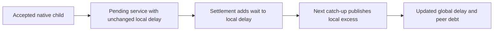

# Cooperative ledger debt observations

`CooperativeDebtSnapshot.Capture` retains selected and peer snapshots from one immutable `SignalAccounting` value.
It rejects duplicate handles and foreign-ledger handles. Its private constructor prevents arbitrary numeric debt construction.
Each remaining debt is the nonnegative difference between the observed global and local ledger values.
The snapshot retains each thread's operation and phase, including a pending service.

```csharp
var observed = CooperativeDebtSnapshot.Capture(selected, peer, state);
Require(observed.Selected <= 2000000 && observed.Peer <= 2000000, "Observed debt exceeded its bound.");
```

The sampled bound workload uses this observation for its debt gate.
It no longer reconstructs local delay from the sample-credit and peer-payment totals.
Those totals remain in the legacy peer-only JSON and its replay rules.
The [selected-owner payment draft](selected-owner-payment.md) writes version 3 evidence with local ledger values and eligibility epochs.
Its analyzer checks local debt arithmetic and settled totals independently.
The retained format does not contain a complete journal of every ledger transition.



`CooperativeDebtChecks` verifies zero debt, unsettled wait exclusion, selected settlement, overshoot publication, immutable snapshots, and handle ownership.
The selected case pays 12,000 ns against 10,000 ns of debt. Local delay rises from 50,000 ns to 62,000 ns.
Global delay remains 60,000 ns until catch-up publishes 62,000 ns. The peer then owes 2,000 ns.
Before settlement, the selected owner still owes the original 10,000 ns despite the accepted child journal.

The checks run in both cooperative managed command groups on Windows and Linux.
`SelectedPaymentPreservesEpochRemainder` checks the selected lease's epoch advance and rejection of old-epoch samples.
It also checks that resume excludes the baseline and retains the fractional credit remainder.
Settlement and overshoot publication are separate transitions. Tests must exercise both.
This does not establish native selected payment, stable capacity, or profiler CPU exclusion.
Two immutable thread captures per observation add unmeasured controller cost.

See [the sampled payment path](bound-sampled-payment.md), [the ledger](delay-ledger.md), and [pausable collection](pausable-collector.md).
