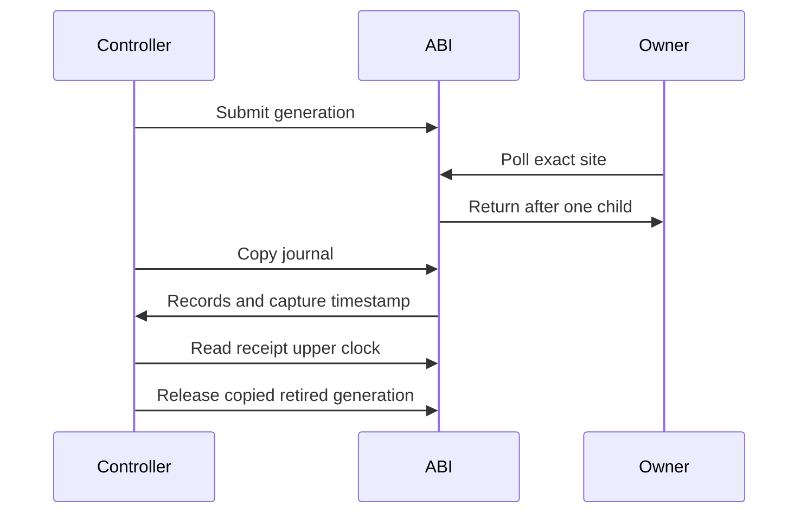

# Cooperative native boundary

`CozNet.Cooperative` exposes the portable target transport through a separate C ABI.
One process can open one session. A shared API lifetime guard excludes registration and close from active calls.
Controller operations retain thread affinity. Each target registers, polls, and retires on its owner thread.
Polls can execute together. Shared API and code locks add unmeasured overhead.

The ABI parses nonzero site identities into `CooperativePollSite` before registration or polling.
Generation arguments must fit 32 bits and match outstanding ownership. No narrowing occurs before this check.
All status codes are platform-independent. The boundary translates C++ exceptions.
Both record layouts are 88 bytes. Cooperative children retain worker, code-version, and site identity, not interrupted addresses.

```cpp
uint64_t generation{};
auto status = coz_cooperative_submit(session, 0, 1, 50000, &generation);
```

The native snapshot uses preallocated scratch storage and copies into caller-owned records.
An insufficient buffer receives only the header. It does not authorize release.
The ABI separately tracks successful retired-copy authorization because the internal scratch copy can already observe retirement.
A successful copy captures the native clock after copying. A future managed client must read it again after return.
Failed journals remain available for cleanup, without ledger acceptance.

`CooperativeSpinTiming` uses Linux `CLOCK_MONOTONIC` and Windows QPC in integer nanoseconds.
POSIX clocks provide a port hook. Only executed platforms qualify support claims.
Spin requests remain 1 through 50,000 ns. Failed or regressing clocks fail the wait.
One million clock reads bound frozen-clock iteration, not scheduling delay or a stuck clock call.
The existing transport measures returned waits and applies all duration limits.



The [managed client](cooperative-managed.md) supplies receipt tracking and ledger binding for manual owner polls.
CLR code-lifetime integration and injected probe binding remain next steps.
The 100 ms receipt gate, 2 ms debt gate, and physical prediction checks must remain unchanged.
See [the reference](../../docsSrc/Reference/cooperative-interop.md), [the transport](cooperative-target.md), and [timer receipt semantics](timer-interop.md).
