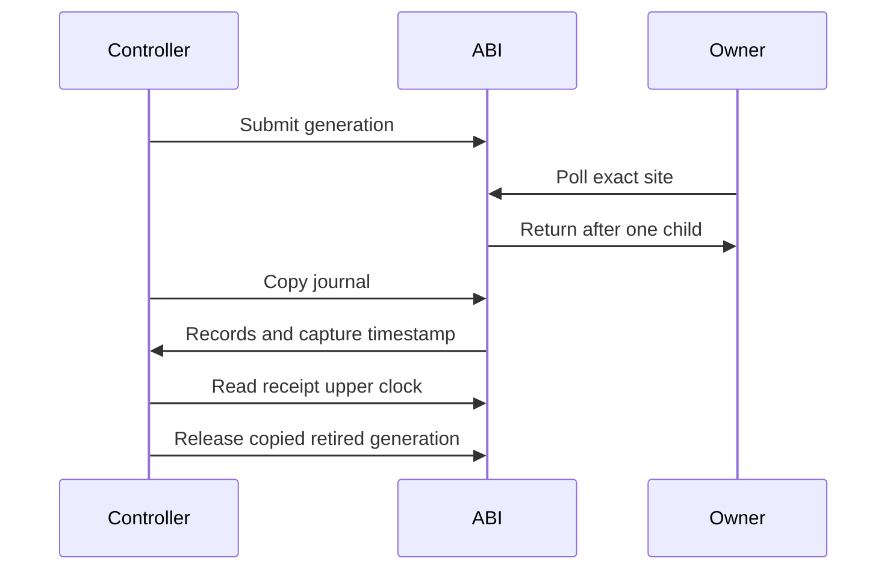

# Cooperative native boundary

`CozNet.Cooperative` exposes the portable target transport through a separate C ABI.
One process can open one session. A shared API lifetime guard excludes registration and close from active calls.
Controller operations retain thread affinity. Each target registers, polls, and retires on its owner thread.
`coz_cooperative_open_owner` reserves one immutable slot for the creating controller thread.
The reserved slot rejects other owners. All other slots retain separate ownership.
The default open function preserves role separation. Nested API entry returns `BUSY` before locking.
The [managed mode](../../docsSrc/Reference/owner-controller.md) forwards an optional reserved slot through both clients.
Twenty owner/controller CLR cases pass on each of Windows and Linux. Sampled execution and cost comparison remain pending.
Polls can execute together. Shared API and code locks add unmeasured overhead.

The ABI parses nonzero site identities into `CooperativePollSite` before registration or polling.
Generation arguments must fit 32 bits and match outstanding ownership. No narrowing occurs before this check.
All status codes are platform-independent. The boundary translates C++ exceptions.
Both record layouts are 88 bytes. Cooperative children retain worker, code-version, and site identity, not interrupted addresses.

```cpp
uint64_t generation{};
auto status = coz_cooperative_submit(session, 0, 1, 50000, &generation);
```

The native snapshot uses preallocated scratch storage and copies into caller-owned records.
An insufficient buffer receives only the header. It does not authorize release.
The ABI separately tracks successful retired-copy authorization because the internal scratch copy can already observe retirement.
A successful copy captures the native clock after copying. A future managed client must read it again after return.
Failed journals remain available for cleanup, without ledger acceptance.

`CooperativeSpinTiming` uses Linux `CLOCK_MONOTONIC` and Windows QPC in integer nanoseconds.
POSIX clocks provide a port hook. Only executed platforms qualify support claims.
Spin requests remain 1 through 50,000 ns. Failed or regressing clocks fail the wait.
One million clock reads bound frozen-clock iteration, not scheduling delay or a stuck clock call.
The existing transport measures returned waits and applies all duration limits.



The [managed client](cooperative-managed.md) supplies receipt tracking and ledger binding for manual owner polls.
CLR code-lifetime integration and injected probe binding remain next steps.
The 100 ms receipt gate, 2 ms debt gate, and physical prediction checks must remain unchanged.
See [the reference](../../docsSrc/Reference/cooperative-interop.md), [the transport](cooperative-target.md), and [timer receipt semantics](timer-interop.md).


## Optional CPU records

`coz_cooperative_register_cpu` enables a separate journal for one slot.
`coz_cooperative_cpu_snapshot` copies it only after mailbox quiescence.
It preserves generation, command, child ordinal, worker, code version, and site.
The original 88-byte child and snapshot layouts remain unchanged.
CPU readings retain explicit status and clock identity. They remain raw diagnostic evidence, not payment values.
Linux reads the current owner thread clock. Other platforms report unsupported capability.

```cpp
coz_cooperative_cpu_snapshot(session, slot, generation, cpuChildren, capacity, &required);
```

The original service snapshot still controls release authorization.
The managed client attaches CPU captures to retired receipts and cleanup copies.
The selected-payment analyzer checks identity and clock consistency when `childCpuEnabled` is true.
See [the API reference](../../docsSrc/Reference/cooperative-interop.md#optional-child-cpu-api) and [target ownership](cooperative-target.md).

`VerifyBoundSampledPayment.ps1 -SelectedPayment -ChildCpu` sets `COZNET_CHILD_CPU=1`.
The runner checks that the recorded activation matches the requested setting.
Diagnostic snapshot failures fail replay but do not replace the retained workload failure.
Failed clock reads and unsupported clocks remain explicit unavailable observations.
Replay counts them separately. It does not treat them as zero CPU usage.
Receipt upper-clock capture precedes CPU snapshot copying. The managed receipt interval includes the extra copy work.
