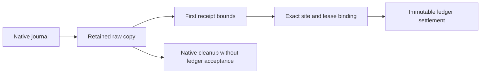

# Managed cooperative boundary

`NativeCooperativeClient` uses source-generated imports and a controller-owned native session handle.
Both ABI layouts are checked at 88 bytes. The finalizer retains unresolved native ownership.
Successful submission records generation ownership before receipt-tracker allocation.

`CooperativeSite` and `CooperativeLeaseIdentity` parse identities before dependent operations.
The child representation carries explicit site fields. It does not reuse interrupted instruction addresses.
`CooperativeReceipts` copies raw input, preserves each child's first receipt bounds, and retains the first rejection permanently.
The receipt clock is read after native copy return in the same native nanosecond domain.
The 100 ms upper bound remains inclusive. Later reads can add children but cannot replace earlier bounds.

```csharp
var generation = client.Submit(0, command, budget);
var observation = client.Read(0);
var result = adapter.Accept(observation, state);
```

`CooperativeAccountingAdapter` returns immutable adapter/ledger updates.
It preserves native error, child, receipt, continuation, prefix, and aggregate checks.
All three site fields participate in eligibility. Ineligible children must contain no wait.
Replayed prefixes cannot pay twice. Concurrent selected credit survives settlement.
Cancellation requires managed intent. A valid terminal journal requires at least one child.

Cleanup copies and releases native journals independently of receipt acceptance.
It retains an immutable final header, child list, and status before release.
The owner continues polling through termination, then retires only after release. The controller closes only after owner join.
The interop fixture keeps unresolved owner state alive for process termination instead of forcing native close.
Six cases verify tracker reset and independent settlement on a second generation, including after receipt rejection.
The diagnostic case preserves raw native snapshots across reuse without updating receipt tracking or settling the ledger.
The active-cleanup case enters cleanup with an unclaimed request and checks final cancelled-child retention.



Manual managed polls have a client and ledger boundary.
The optional `injected-paid` fixture connects the existing thread-local callback to native payment.
It skips entry and services at loop probe 2, with exact counts and checksum checks.
It repeats payment on a second independent generation at intervals 1, 64, 256, and 1024.
Run `./native/VerifyCooperativeInterop.ps1 -Injected` after building the workload and profiler.
Use `-Platform LinuxContainer` for the Linux profiler.
The fixture retains synthetic site identities and disables tiered compilation and ReadyToRun.
The legacy injected fixture retains synthetic identities. Sampled capacity and physical prediction remain incomplete.
The separate [bound probe path](probe-identity.md) implements literal identity and CLR invalidation observations.
The [bound cooperative client](bound-cooperative.md) connects that record to payment admission, receipt acceptance, and completion.
The [CLR lifetime research](../../docsSrc/Research/cooperative-clr-lifetime.md) requires immutable injected generation/site literals and permanent invalidation.
Do not use the controller-only transport revocation call from a CLR callback.
Retained injected runs: Windows `artifacts/cooperative-interop/20261015T094338818-84caeb46` and Linux `artifacts/cooperative-interop/20261015T094433278-cabb08b1`.
Both runs pass four intervals and preserve unchanged input hashes. This establishes controlled transport integration only.
See [the reference](../../docsSrc/Reference/cooperative-managed.md), [native interop](cooperative-interop.md), and [the lifecycle plan](../plans/experiment-lifecycle.md).
