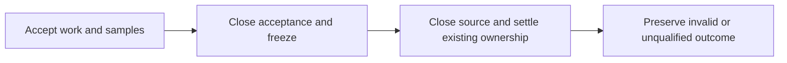

# Finite cooperative measurement

The bound workload has an opt-in frozen measurement path.
`FiniteCooperativeMeasurement` owns permanent acceptance closure and first-error retention.
`CooperativeMeasurementSnapshot` reconciles immutable ledger observations with managed native ownership.
`MeasurementWindowCapture` accepts cooperative evidence without a fabricated timer snapshot.

```csharp
measurement.Begin(ReadMeasurement);
measurement.Freeze(ReadMeasurement);
```

The caller prepares a separate `Window.Preparation` before source creation.
Preparation reads the same accounting state but does not start or freeze the real window.
The end precedes source closure and final peer settlement.
After freezing, source tails remain diagnostic and no new experiment lease is reserved.
Frozen global delay and progress survive subsequent cleanup.
The mode requires owner draining and fixed selected cadence. It remains disabled by default.



Effective duration subtracts the frozen global-delay delta, not summed worker waits.
Accepted unsettled prefixes differ from settled but unreleased native ownership.
Unknown native suffixes and known ledger residuals remain explicit.
Finite treatment completion requires positive peer and selected payment, not full residual repayment after closure.
The default capacity workload retains its full-repayment condition.
All current results remain invalid or unqualified because source membership and instrumentation attribution are unresolved.
The shared physical route and matched comparison remain required for the complete experiment slice.
The [first live capture](../../reliability/features/native-signal/cooperative-measurement.md) passes all three protocol cases and replays.
The treatment freezes a pending request before cleanup adds 499,989 ns to peer local credit.
Frozen global delay remains 73,245,889 ns. The endpoint remains unqualified after cleanup.
The invalidation case retains its endpoint and remains an invalid measurement.

See [the reference](../../docsSrc/Reference/cooperative-measurement.md), [the lifecycle plan](../plans/experiment-lifecycle.md),
and [the index](../lode-map.md).
