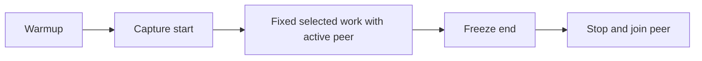

# Cooperative physical work

`CooperativeCpuWork` shares checksum arithmetic and atomic progress publication between physical and bound sampled routes.
The protocol is `cooperative-checksum-v1`. Each batch must produce `49995000` before progress publication.
The physical route runs selected work on the caller and peer work on a dedicated worker.
Only selected arithmetic changes in optimized mode.

```text
--cooperative-physical <output.json> <baseline|optimized> <batches>
```



Frozen progress deltas define measured work. Final peer totals include boundary-external work.
The route requires disabled tiering, ReadyToRun, and startup profiling.
Its managed implementation still requires execution checks for other platform and runtime combinations.
Baseline and optimized physical execution pass once each on Windows x64 and Linux x64 with 50,000 selected batches.
The physical parser accepts all four records, and workload input hashes remain unchanged.
The runtime versions differ. See [the retained evidence](../../reliability/features/native-signal/cooperative-physical.md).
The [first reviewed matched block](../../reliability/features/native-signal/cooperative-comparison.md) completes all four arms with unchanged inputs.
Both sampled records remain unqualified. The prediction interval is about -2.4% to +0.3%, against physical change of +14.1% to +69.8%.
Treatment freezes peer command 275 before cleanup. Frozen global delay remains 66,143,001 ns after later settlement.
`VerifyCooperativeComparison.ps1` retains a four-arm plan before preparation and initializes unexecuted outcomes.
It snapshots sources and binaries, compiles the cooperative native library from snapshots, and resolves image identities.
Each Linux container has read-only inputs and a separate writable arm directory.
Controlled runner checks cover successful collection, launch failure, nonzero exit, preflight failure, and changed inputs.
Original inputs are checked after capture. Changed retained hashes prevent analyzer execution.
The runner always returns failure while prediction qualification remains unmet.
The MiniScaffold targets are `CooperativeComparisonChecks` and `LinuxCooperativeComparison`.
`AnalyzeCooperativeComparison.py` parses process outcomes before aggregation and retains missing or failed arms.
It rejects duplicate JSON fields, Boolean counters, incomplete image digests, and missing required snapshots.
Portable checks cover real sampled-half replay and physical parsing. Collection orchestration checks use controlled arm results.
The analyzer suppresses comparisons after integrity errors. It never qualifies prediction accuracy.
It rejects zero sampled clock frequency before replay and retains per-arm arithmetic failures.
Outcomes retain the common container arguments as well as per-arm activation and workload arguments.
The first diagnostic block accepts cold boundary uncertainty. Its physical start brackets are about 108.6 ms and 56.1 ms.
The earlier physical-only capture has Linux start brackets of about 107 ms and 90 ms.
Source hashes do not bind source to prebuilt binaries. Direct physical failure paths still lack fault-injection checks.
These limits are accepted for an unqualified diagnostic capture, not for prediction or general failure-safety claims.
General comparison reliability and accuracy qualification remain incomplete.
Treatment has 143 selected pauses and 79,729 receipt-readiness calls. Inspect these costs before changing sampled accounting.
The optimized arithmetic does not establish an exact 50% region-time reduction.
The shared checksum checks and counters change sampled per-batch costs relative to earlier captures.

See [the human reference](../../docsSrc/Reference/cooperative-physical-work.md),
[the comparison explanation](../../docsSrc/Explanations/cooperative-physical-comparison.md),
[finite measurement](cooperative-measurement.md), and [the index](../lode-map.md).
