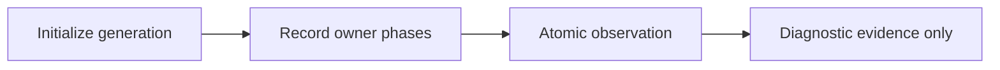

# Native cooperative progress marker

`CooperativeTarget` optionally records the last reached phase in `CooperativeProgress`.
The packed atomic contains a 32-bit generation, 17-bit ordinal, and 4-bit phase.
Disabled targets skip writes. Activation is fixed at registration.
The C ABI query holds the shared API lifetime guard and never reads controller-owned slot generation.
It rejects wide generations and reports disabled targets explicitly.
The peer registration enables capture through `COZNET_PEER_PROGRESS=1` or `-PeerProgress`.

```cpp
auto observation = target.progress(generation);
```

The query brackets the atomic load with outstanding-generation loads.
Stale, released, zero, and disabled requests return no observation.
The caller owns target lifetime protection.
Only the controller initializes generations. Owner writes use generation-checked CAS.
Old epilogues cannot overwrite a newer generation or a terminal phase.
After mailbox quiescence, updates use only cached generation and the atomic marker.
No mutable lease or journal state is read after that boundary.

`quiesced` describes mailbox ownership, not successful payment.
Snapshots never authorize release or journal access.
The marker cannot identify scheduling cause or continuous execution.
Wait markers remain within the existing measured interval and can affect timing.



The target checks cover disabled observation, a held wait, ordinal retention,
generation replacement, terminal preservation, and unchanged release authorization.
Managed capture retains only the latest submission and first failed-debt observation.
The peer reads its OS identity during registration through the existing platform factory.
Query brackets remain separate from the debt timestamp. Diagnostic errors preserve the workload failure.
The selected-payment runner binds activation in its manifest and outcome checks.
Replay checks bind observations to retained payments or the pending request and failure boundary.
The [first retained run](../../reliability/features/native-signal/peer-progress-marker.md) fails the treatment's 100 ms receipt limit.
Its submission snapshot is pending. No failed debt gate occurs.
Zero-speedup and intended invalidation pass. All three records verify through replay.
The one-CPU capture retains pending markers at two live failed-debt gates and verifies all three records.
Its treatment query starts 172,022 ns after debt observation and precedes failure handling.
Pending proves no recorded native poll entry for that generation at query time, not absence of peer CPU execution.
Scheduler cause remains unverified. The live missing-pending branch remains an accepted diagnostic coverage gap;
it has no accounting authority, and replay fixtures cover the unavailable representation.

See [the reference](../../docsSrc/Reference/cooperative-progress-marker.md),
[peer progress](peer-progress.md), and [the index](../lode-map.md).

The [coverage limits](../../reliability/features/native-signal/peer-progress-marker.md#remaining-coverage-limits)
record accepted gaps: exact CAS interleavings, transient phase placement, and diagnostic failure at the live debt branch.
A concurrent writer stress check supplements the sequential generation checks.
These limits must remain explicit until direct checks replace them.
